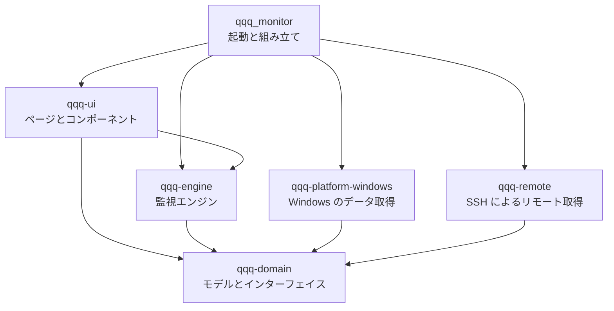
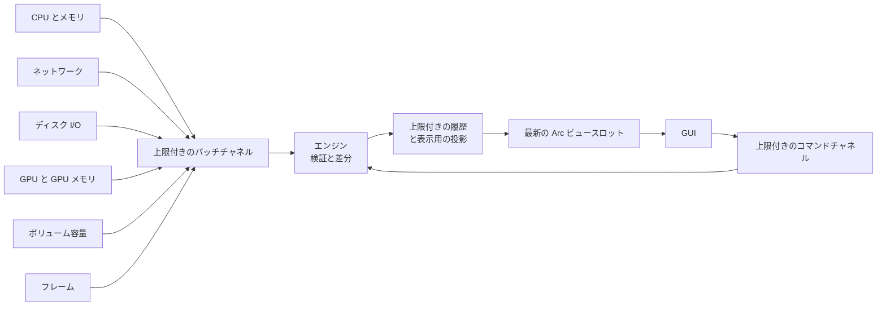

<p align="center">
  
</p>

<h1 align="center">QQQ Monitor</h1>

<p align="center">
  看板娘「MINT ちゃん」が PC の様子を見守る、アニメ風ピクセルアートの Windows パフォーマンスモニター。<br>
  Rust 2024 · egui / wgpu (DX12) · Windows x64 · MIT
</p>

<p align="center">
  <a href="README.md">English</a> · <a href="README.zh-CN.md">简体中文</a> · <b>日本語</b>
</p>

QQQ Monitor は Rust で書かれた Windows 向けの多機能タスクマネージャーです。現在のバージョン 0.4.3 はリアルタイムのパフォーマンス監視に特化しています。Windows のネイティブ API から CPU、メモリ、GPU、ディスク、ネットワークのデータを取得し、ネイティブ GUI で履歴グラフとデバイス情報を表示します。画面の端にドッキングすると、常に最前面に表示されるミニバーになります。ドッキング中や最小化中はタスクトレイに収まります。Windows と実行中の WSL ディストリビューションのプロセスも一覧・管理でき、SSH で 1 台以上の Linux ホストを監視し、ゲームなど前面のアプリのフレームレートとフレームタイムを計測し、指標がしきい値を超えたときに Windows 通知を送ることもできます。さらに、ショートカットで範囲を選んで撮るスクリーンショット、最近コピーした内容を記録するクリップボード履歴、ショートカットで呼び出す常に最前面の Markdown 付箋、ショートカットで PowerShell コマンドを実行するクイックコマンドを備えています。

## メイン画面


左側にナビゲーションと看板娘、右側に現在のページがあります。下部のステータスバーには、監視の状態、サンプリング間隔、セッション時間、ミニバー用の 3 つのボタンが並びます。

## 機能

### パフォーマンス監視

| ページ | 内容 |
| --- | --- |
| 概要 | CPU、メモリ、ディスク読み取り、ネットワーク受信のリアルタイムカードとピクセルミニグラフ。CPU とメモリ、ディスクの読み書き、ネットワークの送受信の履歴グラフ。プロセッサのモデル、論理コア数、メモリ総量、選択中のディスクとアダプター、稼働時間をまとめたデバイス情報 |
| CPU | 全体の使用率と履歴、最も忙しいコア、論理コアのヒートグリッド。コアをクリックするとその履歴を表示 |
| メモリ | 物理メモリの使用率、使用中と利用可能な容量、使用量の推移 |
| GPU | 最も忙しいエンジンによる GPU 使用率（タスク マネージャーと同じ算出方法）、エンジンの種類ごとの負荷（3D、コピー、ビデオのエンコードとデコード、コンピュートなど）、専用 GPU メモリと共有 GPU メモリ。グラフィックスカードを切り替えられ、エンジンをクリックするとその履歴を表示 |
| フレーム | フレーム監視のスイッチ。計測対象（前面のアプリの実行ファイル名、PID、表示 API）、フレームレート、平均フレームタイムと最長フレーム、フレームレートとフレームタイムの推移 |
| ディスク | 物理ディスクの読み書き速度と履歴。すべてのローカルボリュームのラベル、ファイルシステム、空き容量と総容量 |
| ネットワーク | 選択したアダプターの受信・送信速度、履歴グラフ、このセッションの通信量 |
| プロセス | Windows と実行中の各 WSL ディストリビューションのプロセス：名前、PID、ユーザー、CPU、メモリ、スレッド、優先度、コマンドライン。検索、列ごとの並べ替え、プロセスの終了と優先度の変更 |
| リモート | SSH で接続した Linux ホスト：デバイス情報（ホスト名、ディストリビューション、カーネルとアーキテクチャ、プロセッサ、メモリとスワップ、稼働時間、ロードアベレージ）、CPU とメモリの使用率の推移、選んだディスクの読み書きとアダプターの送受信、ファイルシステムの容量、論理コアのヒートマップ |
| アラート | アラート ルールの一覧（デバイスと指標、条件、現在値、状態）。ルールの追加、編集、有効化、無効化、削除。テスト通知の送信。今回の起動で発生したアラート |
| ツール | 上部のボタンで 4 つのツールを切り替えます。キャプチャ：スクリーンショットの撮影と保存フォルダーを開く操作。ショートカットのオン・オフと変更、保存数。最近のスクリーンショットのサムネイル、撮影日時、サイズ、ファイルサイズと、コピー・開く・削除。クリップボード：クリップボード履歴のオン・オフ、保存数、消去。新しい順のクリップボード履歴（テキスト・画像・ファイルのプレビュー）と、ワンクリックでのコピー、削除。付箋：付箋を開く、新しい付箋、付箋フォルダーを開く操作。付箋のショートカットのオン・オフと変更。すべての付箋のタイトル、更新日時、冒頭の数行と、開く・削除。クイックコマンド：新しいコマンドの作成。すべてのクイックコマンドの名前、実行方法、冒頭のコマンド行、ショートカットと、実行・編集・削除。ショートカットの設定、オン・オフと変更 |
| 設定 | 左側に表示言語、サンプリング間隔、既定の履歴範囲、アニメーション、端へのドッキング、トレイへの最小化、フレーム監視、スクリーンショットのショートカット、付箋のショートカット、クリップボード履歴、クイックコマンドの効果音、自動起動、自動起動時のトレイへの格納。右側にプロジェクトのロゴ、バージョン、紹介文、GitHub ページを開くボタン。下部に動作状況、データソースの診断、履歴のメモリ使用量、デバイスの手動再検出 |

指標の定義：

- ディスク I/O は物理ディスクごとに、容量はローカルボリュームごとに表示します。
- ネットワークは選択した 1 つのインターフェイスのみを集計するため、物理アダプターと VPN などの仮想インターフェイスは別々に計測されます。セッションの通信量は、今回の実行中に観測したカウンターの有効な増加分です。
- 速度の単位は B/s、KiB/s、MiB/s、容量の単位は MiB、GiB です。
- 各読み取り値は状態（ウォームアップ、リアルタイム、データが古い、非対応、取得失敗、切断）を持ちます。古いデータにはデータの経過時間を表示し、取得の中断はグラフの途切れとして表示します。

### 履歴グラフ

エンジンは指標ごとに最大 15 分の履歴を保持し、ページ右上のボタンで 60 秒、5 分、15 分の表示を切り替えます。履歴の総量は 16 MiB 以内に収まり、グラフの各線は最大 400 点に投影され、間引くときもピークと谷を残します。

### 端へのドッキングとミニバー

ウィンドウを画面の上端または左右の端までドラッグして離すと、常に最前面に表示されるミニバーに切り替わり、CPU、メモリ、GPU、GPU メモリの使用率を表示し続けます。

<p align="center">
  <br>
  <sub>上端のバー：数値の下にセグメントバー</sub>
</p>

<p align="center">
  <br>
  <sub>左右のバー：ピクセルのリングゲージ</sub>
</p>

- GPU と GPU メモリは GPU ページで選択したカードを表示します。既定では GPU メモリが最も多いカードを選びます。
- フレーム監視がオンのときは、前面のアプリのフレームレートを示す FPS が加わります。50 未満でオレンジ、30 未満で赤になります。上端のバーは幅 640、左右のバーは高さ 316 論理ピクセルに広がります。
- ミニバーは端に沿って動かしたり、別の端へ移したりできます。どの端からも離れた位置で放すとその場所に通常のウィンドウが戻り、ダブルクリックまたは展開ボタンではドッキング前の位置とサイズに戻ります。
- ミニバーのあるモニターでゲームや動画などのアプリが全画面で前面にある間は、マウス操作がミニバーを通り抜けてそのアプリに届くため、マウスで視点を動かすゲームでもフォーカスが移りません。通常のウィンドウが前面に戻ると、ミニバーは再びドラッグや展開ができます。
- メインウィンドウのステータスバーにある 3 つのボタンで、上端・左端・右端へ直接ドッキングできます。
- Windows のスナップと最大化の操作はシステムの動作のままです。
- ドッキングしたまま終了すると、次回はミニバーの状態で起動します。

### タスクトレイ

- ミニバーにドッキングしている間、ウィンドウはタスクバーから外れ、タスクトレイにアイコンが表示されます。
- 設定ページの「トレイに最小化」は既定でオンです。通常のウィンドウを最小化するとウィンドウが隠れ、トレイアイコンだけが残ります。
- 設定ページの「自動起動時はタスクトレイに格納する」は既定でオンです。Windows へのサインイン時に自動起動すると、ウィンドウを表示せずにトレイアイコンだけを表示し、バックグラウンドで通常どおりサンプリングします。
- トレイアイコンをクリックするか、右クリックメニューの「メインウィンドウを表示」を選ぶと、通常のウィンドウに戻ってアクティブになります。「スクリーンショット」を選ぶとキャプチャを始めます。「付箋」を選ぶと付箋ウィンドウを表示します。「終了」を選ぶと設定を保存して終了します。

### プロセス管理

- ページ上部のボタンで Windows と実行中の各 WSL ディストリビューションを切り替えます。WSL が動いていないときは Windows だけが表示されます。
- 検索ボックスで名前、PID、ユーザー、コマンドラインを絞り込みます。列の見出しをクリックするとその列で並べ替え、既定は CPU の高い順です。CPU はすべての論理プロセッサに対する割合、メモリは Windows ではプライベートワーキングセット、WSL では常駐メモリです。
- プロセスを選ぶと、ツールバーまたは右クリックメニューで終了や優先度の変更（高、通常以上、通常、通常以下、低）ができます。WSL のプロセスには「強制終了」もあります。終了の前には確認が表示され、Delete キーでも選択中のプロセスを終了できます。
- Windows のプロセスは現在のアカウントの権限で操作するため、システムや他のアカウントのプロセスには管理者としての実行が必要です。WSL のプロセスは root として操作します。どの操作も先にプロセスの開始時刻を確かめるので、PID が新しいプロセスに再利用されていても新しいプロセスには作用しません。
- プロセスを読み込むのはプロセスページの表示中だけで、Windows は毎秒、WSL は 2 秒ごとです。読み込みの前にディストリビューションが動いていることを確かめるため、停止中のディストリビューションを起動することはありません。プロセスを表示している間、そのディストリビューションは動作し続けます。

### リモートホスト


- 「リモート」ページの「ホストを追加」で、アドレス、ポート、ユーザー名とログイン方法を指定します。ログイン方法はパスワード、秘密鍵ファイル（OpenSSH または PuTTY 形式の Ed25519、ECDSA、RSA の鍵。暗号化された鍵はパスフレーズも入力）、SSH エージェント（Windows の OpenSSH Authentication Agent サービスまたは Pageant に読み込まれた鍵）から選びます。「SSH 設定から読み込む」は `~/.ssh/config` のホストを一覧し、選ぶとアドレス、ポート、ユーザー名、秘密鍵ファイルが入力されます。
- 初めての接続ではホスト鍵の SHA-256 フィンガープリントが表示されます。確認できたら「信頼して接続」をクリックします。`~/.ssh/known_hosts` に記録済みのホストはそのまま接続します。信頼した鍵と異なる鍵が提示されたときは接続せずに警告を表示し、確認のうえで新しい鍵を信頼できます。
- ホストごとに SSH 接続を 1 本保ち、その上で動かす POSIX シェルがサンプリング間隔（最短 1 秒）で `/proc` を読み取ります。ファイルシステムは 2 本目のチャネルで 30 秒ごとに実行する `df` から読み取るため、応答しないファイルシステム（到達できないネットワーク共有など）が影響するのはファイルシステムの値だけです。ホストに必要なのは `sh`、`cat`、`df` などの基本的なコマンドだけで、busybox のシステムでも動作し、エージェントのインストールは不要です。
- 速度はホスト自身の時計で計算します。アダプターは既定でデフォルトルートのインターフェイスを選び、ディスクは物理ディスク単位、ファイルシステムはローカルのものを表示し、使用率は `df` と同じ基準です。
- 接続が切れた、拒否された、タイムアウトしたときは、2 秒から最長 60 秒まで間隔を延ばしながら自動で再接続します。ユーザー名、パスワード、鍵が拒否されたときやホスト鍵が未信頼のときは、設定の変更か「再接続」を待ちます。ログイン失敗の繰り返しでサーバーの遮断ルールに触れることはありません。
- リモートホストの履歴もこのコンピューターの指標と同じく 15 分間保持し、ほかのページを表示している間も記録を続けます。ホストを削除すると、そのデータと保存したパスワードも削除されます。

### フレーム監視

- 「フレーム」ページまたは設定ページで「フレーム監視」をオンにします（既定はオフ）。前面のアプリの画面をバックグラウンドで計測し、フレームレートは 1 秒間に表示したフレーム数、フレームタイムは隣り合う表示の間隔です。ページにはサンプリング周期ごとの平均フレームタイムと最長フレーム、フレームレートとフレームタイムの推移を表示し、ミニバーにも FPS を表示するので、ゲーム中は画面の端にドッキングして確認できます。
- 計測対象は前面のウィンドウのプロセスです。QQQ Monitor 自身が前面にある間は直前のアプリを計測し続けるので、いつでも切り替えて確認できます。1 つのプロセスが複数のスワップチェーンで表示している場合は、最も多く表示しているものを計測します。
- データは Windows のイベント トレース（ETW）にある DXGI と Direct3D 9 の Present イベントから取得します。PresentMon や Xbox Game Bar と同じ取得元で、システムのイベントを読み取るだけなので、ゲームのプロセスには関与しません。Direct3D 9〜12 のアプリを計測でき、Vulkan と OpenGL のアプリはグラフィックス ドライバーが DXGI 経由で表示する場合に計測できます。
- イベント トレースの読み取りには管理者権限、または Performance Log Users グループへの追加と Windows への再サインインが必要です。権限がないときは「フレーム」ページに説明と「管理者として再起動」ボタンが表示され、システムの確認に同意すると管理者としてフレーム ページを開き直します。フレーム監視をオフにするとイベント トレースも止まります。
- 前面のアプリが約 2 秒間表示を止めると、フレームレートは 0 になります。

### 監視アラート

- 「アラート」ページの「アラートを追加」で、デバイスと指標、条件（上回る・下回る）、しきい値、継続時間（即時、5 秒、10 秒、30 秒、1 分、5 分）を指定します。デバイスはプロセッサ、物理メモリ、グラフィックスカード、前面のアプリ、物理ディスク、ローカルボリューム、ネットワーク アダプター、リモートホストのデバイスから選べます。指標は使用率、空き容量と使用量、GPU メモリ、読み書きと送受信の速度、フレームレートとフレームタイム、リモートホストの I/O 待ち、スワップ、平均負荷、プロセス数です。しきい値は指標の単位（パーセント、GiB、MiB/s、FPS、ミリ秒）で入力します。
- 値がしきい値を超えた状態が継続時間だけ続くと、デバイスと指標をタイトルに、現在値としきい値を本文にした Windows 通知が届きます。反対側に戻った状態が同じ時間続くと、ルールは正常に戻ります。同じルールの通知は 1 分に 1 回までです。ルールはリアルタイムの有効な値だけを使い、値が古くなった、取得に失敗した、切断されたときは継続時間を数え直します。
- アラートはバックグラウンドのエンジンが判定するため、ウィンドウをトレイに格納したりミニバーにドッキングしたりしていても通知が届き、通知をクリックするとメイン ウィンドウが開きます。発生中のルールがあるとステータスバーに件数が表示され、クリックするとアラート ページに移動します。
- ルールの一覧には各ルールの現在値と状態（正常、しきい値を超えてからのカウントダウン、アラート発生中と継続時間、データ待ち、無効）を表示します。チェックボックスで有効・無効を切り替え、「編集」「削除」で変更や削除ができます。「最近のアラート」には今回の起動で発生したアラートを一覧し、「テスト通知を送信」で Windows の通知設定を確認できます。
- Windows はスタート メニューにショートカットがあるデスクトップ アプリの通知バナーを表示するため、アラート ページを開いたときや通知を送るときに、現在のユーザーのスタート メニューにこの実行ファイルを指す「QQQ Monitor」ショートカットを作成または更新します。アプリごとの通知は Windows の設定の「通知」で管理できます。
- ルールは再起動後も変わらない識別子でデバイスを記録します。ネットワーク アダプターはインターフェイス GUID、グラフィックスカードは PCI ID、ボリュームはボリューム GUID、リモートのデバイスはホスト ID 付きです。

### スクリーンショット

- スクリーンショットのショートカット（既定は `Ctrl+Alt+A`）を押すか、「ツール」ページの「キャプチャ」で「キャプチャ開始」をクリックするか、トレイアイコンの右クリックメニューで「スクリーンショット」を選ぶと、画面が静止して暗くなり、上部に操作のヒントが表示されます。キャプチャはすべてのモニターを物理ピクセルで対象にします。
- ドラッグで範囲を選択します。選択範囲は元の明るさのまま青緑の枠で囲まれ、横にサイズがリアルタイムで表示されます。ドラッグせずにクリックするとポインターのあるモニター全体をキャプチャします。ドラッグ中の右クリックで選択をやり直し、Esc か右クリックでキャプチャを終了します。
- マウスを離すと、選択した範囲がクリップボードにコピーされ、`%LOCALAPPDATA%\qqq_monitor\data\screenshots` に `QQQ Screenshot 2026-10-15 143012.png` のような名前の PNG として保存されます。
- 「ツール」ページの「キャプチャ」には最近のスクリーンショットがサムネイル、撮影日時、サイズ、ファイルサイズとともに並び、クリップボードへのコピー、既定のプログラムで開く、削除ができます。サムネイルをクリックしても画像が開き、「フォルダーを開く」で保存フォルダーを開きます。保存数は 10、20、50、100 枚から選べ（既定は 20）、超えた分は古いものから削除します。管理するのは `QQQ Screenshot` で始まるファイルだけで、フォルダー内のほかのファイルはそのまま残ります。
- 「キャプチャ開始」はメイン ウィンドウを画面から隠してから静止させ、終了後に元に戻します。ショートカットとトレイメニューは画面をそのままの状態で静止させます。
- ショートカットはグローバルで、ウィンドウをトレイに格納したりミニバーにドッキングしたりしていても使えます。変更するには「キャプチャ」で「変更」をクリックし、新しい組み合わせを押します。Ctrl か Alt と英字・数字、または F1〜F24 を使え、いずれにも Shift を加えられます。「キャプチャ」と設定ページでショートカットのオン・オフを切り替えられ、ほかのアプリが同じ組み合わせを使っているときはステータスバーに表示されます。

### クリップボード履歴

- 「ツール」ページの「クリップボード」または設定ページでクリップボード履歴をオンにすると（既定はオフ）、それ以降にクリップボードへコピーしたテキスト、画像、ファイルを記録します。オンにした時点でクリップボードにある内容が最初の項目になります。
- 項目は新しい順に並び、種類とサイズ（文字数、画像サイズ、ファイル数）、コピーした時刻、プレビュー（テキストの先頭 3 行、画像のサムネイル、先頭 3 件のファイルパス）を表示します。「コピー」または内容そのものをクリックすると、その内容がクリップボードに戻って先頭に移動し、ほかのアプリやエクスプローラーにそのまま貼り付けられます。記録済みの内容をもう一度コピーした場合も、その項目が先頭に移動します。
- 保存数は 20、50、100、200 件から選べ（既定は 50）、画像は合計 256 MiB までメモリを使います。いずれかを超えると古い項目から削除します。「履歴を消去」と各項目の「削除」で整理できます。
- 履歴はメモリにだけ保持し、プログラムの終了時に消去します。パスワード マネージャーなどが `ExcludeClipboardContentFromMonitorProcessing` または `CanIncludeInClipboardHistory` で非公開とした内容は、Windows のクリップボード履歴と同じくスキップします。

### 付箋

- 付箋のショートカット（既定は `Ctrl+Alt+N`）を押すか、「ツール」ページの「付箋」で「付箋を開く」をクリックするか、トレイアイコンの右クリックメニューで「付箋」を選ぶと、付箋ウィンドウがすべてのウィンドウより手前に表示されてキーボード フォーカスを受け取り、そのまま入力できます。付箋の中でもう一度ショートカットを押すと隠れます。メイン ウィンドウを最小化したり、トレイに格納したり、ミニバーにドッキングしたりしていても使えます。
- 付箋ウィンドウはピクセル風の小さな独立ウィンドウです。タイトル バーをドラッグして移動し、右下の角をドラッグしてサイズを変更します。タイトル バーの右側のボタンは、順に「すべての付箋」「新しい付箋」「編集／プレビュー」「付箋を削除」「隠す」です。最初はメイン ウィンドウのあるモニターの作業領域の右上に表示され、以後は前回の位置とサイズで表示されます。
- 内容は Markdown です。編集中は Markdown の記号が青緑色で表示され、見出しは大きく太字に、強調・インライン コード・リンクもそれぞれの書式で表示されます。`Ctrl+E` か編集／プレビューのボタンでプレビューに切り替えると、見出し、太字、斜体、取り消し線、インライン コードとコード ブロック、引用、番号付き・番号なしリスト、タスク リスト、表、区切り線、リンクを表示します。プレビューでタスクのボックスをクリックするとチェックが切り替わり、Markdown の本文に書き戻されます。Web とメールのリンクは既定のプログラムで開きます。文字は選択してコピーでき、空いている場所をダブルクリックすると編集に戻ります。
- 付箋はいくつでも作れます。`Ctrl+N` か「+」ボタンで新しい付箋を作り、「すべての付箋」で更新日時の新しい順に一覧し、クリックで切り替えます。付箋を削除する前には確認があります。
- 付箋は 1 件ずつ `%LOCALAPPDATA%\qqq_monitor\data\notes` の Markdown ファイルとして保存され、`QQQ Note 2026-10-23 143012.md` のような名前になります。ほかのエディターでも開けます。入力が止まると自動で保存され、入力を続けている間も 5 秒ごとに保存されます。`Ctrl+S` ですぐに保存でき、付箋を隠したときとプログラムの終了時にも保存されます。内容を空にした付箋はファイルが削除されます。「ツール」ページの「付箋」ではすべての付箋のタイトル、更新日時、冒頭の数行を一覧し、開く・削除ができます。「フォルダーを開く」で付箋のフォルダーを開きます。
- 「付箋」と設定ページで付箋のショートカットのオン・オフを切り替えられます。変更するには「付箋」で「変更」をクリックし、新しい組み合わせを押します。使える組み合わせはスクリーンショットのショートカットと同じで、2 つのショートカットはそれぞれ別の組み合わせを使います。

### クイックコマンド

- クイックコマンドは 1 つ以上の Windows PowerShell コマンドをまとめたもので、ショートカットか「ツール」ページから実行します。「ツール」ページの「クイックコマンド」で「新しいコマンド」をクリックし、名前、コマンド（1 行に 1 つの PowerShell コマンド）、セッション、ウィンドウ、作業フォルダーを入力して「保存」をクリックします。
- セッションでコマンドの実行方法を選びます。「1 つのセッションで順に実行」では、すべての行を 1 つのセッションで順番に実行するので、前の行で設定した変数や現在の場所を後の行でもそのまま使えます。「コマンドごとに別のセッション」では、各行をそれぞれのセッションで同時に開始します。
- 「PowerShell ウィンドウを表示し、終了後も開いたままにする」がオン（既定）のとき、セッションごとにコンソール ウィンドウが開き、コマンドの終了後も開いたままになるので、出力を確認したり続けて入力したりできます。ウィンドウのタイトルはクイックコマンドの名前で、コマンドごとに別のセッションではその行が続きます。オフにするとセッションはバックグラウンドで実行し、コマンドが終わるとセッションも終了します。作業フォルダーには既存のフォルダーの完全なパスを入力します。空欄のときはユーザー フォルダーで開始します。
- 「クイックコマンド」にはすべてのクイックコマンドの名前、概要（セッション、コマンドの数、ウィンドウ表示かバックグラウンドか、作業フォルダー）、冒頭の 3 行、ショートカットが並びます。「実行」ですぐに実行し、「編集」で編集ダイアログを開き、「削除」は確認してから削除します。1 つのクイックコマンドは最大 32 行、半角で合計約 8000 文字まで、クイックコマンドは最大 32 件まで保存できます。
- プログラムはクイックコマンドが開始した各セッションを追跡します。実行中のセッションがあるあいだ、カードには「実行中 · セッション N 個」と、「実行」の横に「終了」ボタンが表示されます。「終了」をクリックすると、そのクイックコマンドのすべてのセッションと、セッションから起動したプログラムを終了し、ウィンドウ表示のセッションはウィンドウも閉じます。自然に終わったセッションは 1 秒ほどでカードから消えます。プログラムを終了してもセッションは動き続けます。
- クイックコマンドを実行するたびに短い効果音が鳴ります。セッションが開始すると短いチャイム、開始に失敗したセッションがあると下がる 2 音です。「クイックコマンド」タブと設定ページのスイッチでオフにできます。ウィンドウをトレイに格納したりミニバーにドッキングしたりしているときは、トレイアイコンからバルーンも表示し、クイックコマンドの名前と開始したセッション数、または失敗の理由を知らせます。バルーンをクリックするとメイン ウィンドウが開きます。
- ショートカットを割り当てるには、クイックコマンドの「設定」をクリックして組み合わせを押します。使える組み合わせはスクリーンショットのショートカットと同じで、ショートカットはそれぞれ別の組み合わせを使います。割り当て後はチェックボックスでオン・オフを切り替え、「変更」で新しいキーを記録します。ショートカットはグローバルで、ウィンドウをトレイに格納したりミニバーにドッキングしたりしていても使えます。セッションを開始できないとき（作業フォルダーを移動した場合など）は、ステータスバーに理由が表示されます。

### 看板娘 MINT ちゃん

MINT ちゃんは、青緑色のロングヘアにピンクのメッシュ、白くふわふわした猫耳の女の子です。カチューシャには黒猫のぬいぐるみが乗り、白いケープと黒いワンピースを着て、襟元には金色の鈴を付けています。インターフェイスの配色も彼女の姿から取っています。サイドバーの下部にいて、CPU とメモリのリアルタイムの負荷に応じて表情とセリフが変わるため、サイドバーはシステムの健康状態を示すインジケーターも兼ねています。

<p align="center">
  
</p>

| 位置 | 表情 | 素材 | 条件 |
| --- | --- | --- | --- |
| 上段左 | のんびり | `mint-1` | CPU が 15% 未満 |
| 上段中央 | おだやか | `mint-4` | 通常の負荷 |
| 上段右 | いそがしい | `mint-3` | CPU が 50% 以上、またはメモリが 75% 以上 |
| 下段左 | オーバーロード | `mint-5` | CPU が 85% 以上、またはメモリが 90% 以上 |
| 下段中央 | 取得エラー | `mint-2` | データソースがエラーを報告している |
| 下段右 | 待機中 | `mint-6` | 起動後、最初の CPU とメモリの値を待っている |

サイドバーの上半身は、ビルドスクリプト `crates/qqq-ui/build.rs` が [`docs/images/assets`](docs/images/assets) のイラスト `mint-1` から `mint-6` をもとに生成します。画像の縁につながる白い背景は透明になり、元画像の 10 × 10 ピクセルがスプライトの 1 ピクセルになります。スプライトの各ピクセルは物理ピクセルの整数倍で描画されるため、輪郭がくっきり保たれます。イラストを差し替えて再ビルドすると看板娘が更新されます。`mint-0` はプロジェクトのロゴです。設定ページには、この文書の冒頭と同じロゴ `docs/images/logo.png` を表示します。

アニメーションがオンのとき、MINT ちゃんは 1 秒ごとに軽く揺れます。アニメーションは予約した再描画で動くため、アイドル時の再描画は少なく抑えられます。

### アプリケーションアイコン

<p align="center">
  
</p>

アプリケーションアイコンは、MINT ちゃんの猫耳が生えたピクセルのモニターです。画面にはピンクのパルスが走り、ほっぺは赤く、下には彼女の金色の鈴が下がっています。マルチサイズの ICO が EXE に埋め込まれ、エクスプローラー、タイトルバー、タスクバーで共有されます。16、24、32 ピクセルの 3 種類は手描きで、一般的な拡大率でもくっきり表示されます。

### 表示言語

インターフェイスは English、简体中文（簡体字中国語）、日本語に対応しています。既定ではシステムに合わせます。起動時に Windows の表示言語の優先順位から最初に対応している言語を選び、中国語の各地域の変種は簡体字中国語を使い、どれにも対応していない場合は英語を使います。設定ページの「表示言語」では「システムに従う」または特定の言語を選べます。クリックするとインターフェイス全体とウィンドウタイトルがすぐに切り替わり、選択が保存されます。

ページ、カード、グラフ、状態とエラーの表示、デバイス名と詳細、看板娘のセリフ、起動失敗時のダイアログはすべて表示言語に従います。各ページ上部のピクセル英字の小見出し、数値と単位はどの言語でも同じです。3 つの言語はすべて埋め込みの Noto Sans CJK SC フォントで表示され、日本語の漢字は簡体字中国語の字形になります。

### 設定

設定ページは「適用して保存」で反映します。サンプリング間隔（0.5、1、2 秒）、既定の履歴範囲、アニメーション、端へのドッキング、トレイへの最小化はすぐに有効になり、バックグラウンドのスレッドが TOML ファイルに書き込みます。表示言語はクリックした時点で有効になり、保存されます。自動起動はチェックを切り替えた時点で有効になります。プログラムは現在のユーザーの Windows スタートアップに `--autostart` 付きで自身を追加、または削除し、この項目はタスクマネージャーの「スタートアップ アプリ」にも表示されます。チェックボックスは、タスクマネージャーで無効にした場合も含めて、この項目の実際の状態を表示します。その下の「自動起動時はタスクトレイに格納する」は既定でオンで、クリックした時点で有効になり、保存されます。自動起動がオンのときに変更できます。アダプターの選択、ウィンドウの位置とサイズ、ドッキングした端、ミニバーの位置は終了時にまとめて保存されます。リモートホストは追加、編集、削除、ホスト鍵の信頼の時点で保存されます。パスワードとパスフレーズは Windows 資格情報マネージャーに保存し、設定ファイルには書き込みません。フレーム監視はクリックした時点で有効になり、保存されます。アラート ルールは追加、編集、有効・無効の切り替え、削除の時点で保存されます。クイックコマンドは追加、編集、削除と、ショートカットの設定、オン・オフ、変更の時点で、効果音のスイッチはクリックした時点で保存されます。スクリーンショットと付箋のショートカットとそのオン・オフ、スクリーンショットの保存数、クリップボード履歴のオン・オフと保存数は、変更した時点で有効になり、保存されます。付箋ウィンドウの位置とサイズは終了時に保存されます。

| ファイル | 場所 |
| --- | --- |
| 設定 | `%APPDATA%\qqq_monitor\config\config.toml` |
| ログ | `%LOCALAPPDATA%\qqq_monitor\data\logs`（日ごとにローテーションし、7 ファイルを保持） |
| スクリーンショット | `%LOCALAPPDATA%\qqq_monitor\data\screenshots`（最近のスクリーンショット） |
| 付箋 | `%LOCALAPPDATA%\qqq_monitor\data\notes`（付箋ごとに 1 つの Markdown ファイル） |
| リモートホストのパスワード | Windows 資格情報マネージャーの汎用資格情報 `qqq_monitor/ssh/<ホスト ID>` |
| 通知用ショートカット | `%APPDATA%\Microsoft\Windows\Start Menu\Programs\QQQ Monitor.lnk` |

## はじめに

### 必要な環境

- Windows x64 と DX12 対応のグラフィックスアダプター
- Rust 1.99 以降、ターゲット `x86_64-pc-windows-msvc`
- Visual Studio Build Tools の C++ ツールチェーンと Windows SDK

### ビルドと実行

```powershell
cargo run --release
```

実行ファイルは `target\release\qqq_monitor.exe` で、そのまま実行できます。フレーム監視には管理者権限か Performance Log Users グループへの追加が必要で、それ以外の指標は標準ユーザーのアカウントで取得できます。

### コマンドラインオプション

同じ実行ファイルは一度に 1 つのインスタンスだけが動作します。もう一度起動すると実行中のインスタンスのウィンドウを表示し、自動起動では実行中のインスタンスをそのままにします。`--smoke-test` と `--capture` は実行中のインスタンスと並行して動作します。

| オプション | 動作 |
| --- | --- |
| `--smoke-test` | 約 8 秒間実行し、CPU、メモリ、物理ディスク I/O、ネットワーク、ボリューム容量、Windows のプロセス一覧のすべてに有効な値があることを確認して、GPU を含む全指標と実行中の各 WSL ディストリビューションのプロセス数を出力します。すべて合格すると終了コード 0 で終了します |
| `--capture PATH` | 実際の GUI を起動し、約 8 秒後にウィンドウを PNG として保存して終了します。ユーザー設定はそのまま残ります。`PATH` の親フォルダーはあらかじめ存在している必要があります |
| `--page PAGE` | 指定したページを開きます。`--capture` と組み合わせると撮るページを選びます：`overview`、`cpu`、`memory`、`gpu`、`frames`、`disk`、`network`、`processes`、`remote`、`alerts`、`tools`、`settings` |
| `--dock EDGE` | ミニバーの状態で起動します：`top`、`left`、`right`。`--capture` と組み合わせるとミニバーを撮影します |
| `--lang LANG` | 指定した表示言語で起動します。設定ページでその言語を選ぶのと同じです：`zh-CN`、`en`、`ja`。`--capture` と組み合わせるとその言語のページを撮影します |
| `--autostart` | 自動起動の項目が使う引数です。「自動起動時はタスクトレイに格納する」がオンのときはトレイアイコンだけを表示します |
| `--replace` | 同じ実行ファイルの実行中のインスタンスが終了するのを待ってから起動します。管理者として再起動するときに使います |
| `--help` | オプションの一覧を表示します（簡体字中国語） |

```powershell
cargo run --release -- --capture "$PWD\target\gpu.png" --page gpu
cargo run --release -- --capture "$PWD\target\dock-left.png" --dock left
cargo run --release -- --capture "$PWD\target\settings-ja.png" --page settings --lang ja
```

## アーキテクチャ

このプロジェクトは、5 つのライブラリクレートと 1 つの起動パッケージからなる Cargo ワークスペースです。ドメインモデルと監視エンジンは Windows と GUI から独立しています。起動パッケージが具体的なコレクターを注入し、GUI はエンジンが公開する不変のビューだけを読み取ります。



| パス | 役割 |
| --- | --- |
| `src/` | ログの初期化、依存関係の組み立て、システム言語の判定、DX12 ウィンドウとウィンドウアイコン、コマンドラインのスモークテストと撮影、終了処理 |
| `build.rs`、`assets/` | マルチサイズのアプリケーションアイコンとリソーススクリプト。ビルド時に EXE へ埋め込みます |
| `crates/qqq-domain/` | デバイス（前面のアプリのフレームを含む）、指標、単位（フレームレートとミリ秒を含む）、読み取り状態と取得できない理由、プロセスのインスタンスと操作、リモートホストの接続先とセッション、スクリーンショットの画像、クリップボードの内容、スクリーンショット・付箋・クイックコマンドのショートカット、および `Collector`、`CollectorFactory`、`ProcessPlatform`、`RemotePlatform`、`SecretStore` のインターフェイス |
| `crates/qqq-platform-windows/` | sysinfo による CPU とメモリ、IP Helper によるネットワーク、PDH によるディスク I/O と GPU エンジン・GPU メモリ、DXGI によるグラフィックスカードの列挙、ローカルボリュームの容量、モニターの作業領域とマウスの状態、ユーザーの表示言語、EXE リソースからのウィンドウアイコンの読み込み、タスクトレイのアイコンとメニュー、タスクバーボタン、1 回のシステムコールによる Windows プロセスの一覧と終了・優先度の変更、`wsl.exe` を通じた実行中の WSL ディストリビューションのプロセスの読み込みと操作、Windows 資格情報マネージャーでのリモートホストのパスワードとパスフレーズの保存、現在のユーザーの `Run` レジストリキーによる自動起動の切り替え、ETW の DXGI と Direct3D 9 の Present イベントによる前面のアプリのフレームレートとフレームタイムの計測、スタート メニューのショートカットで登録したアプリ ID による Windows 通知、管理者としての再起動、スクリーンショット・付箋・クイックコマンドのグローバル ショートカット、画面を静止させて範囲を選ぶキャプチャ ウィンドウ、クイックコマンド用のコンソール ウィンドウ付きまたはバックグラウンドの Windows PowerShell セッション、クリップボードのテキスト・ビットマップ・ファイル一覧の監視と読み書き、ローカル時刻の換算、既定のプログラムでファイルを開く操作、既定のブラウザーで URL を開く操作。ネイティブ呼び出しは `native.rs`、`tray.rs`、`process.rs`、`secret.rs`、`autostart.rs`、`frames.rs`、`notify.rs`、`capture.rs`、`clipboard.rs`、`powershell.rs`、`sound.rs` にまとめ、ハンドルは RAII で管理します |
| `crates/qqq-engine/` | サンプリングのスケジュール、カウンターの差分とウォームアップ、上限付きの履歴と表示用の投影、必要なときだけのプロセスのポーリングとプロセスの CPU 使用率、専用スレッドでのプロセス操作、リモートホストごとの接続スレッドと再接続の方針、設定のスイッチに従うフレームの取得、アラート ルールの判定と専用スレッドでの通知、不変のビュー、設定（表示言語、リモートホスト、フレーム監視、アラート ルール、スクリーンショット・クリップボード・付箋の設定、クイックコマンドを含む）の読み書きとバックグラウンド保存、言語に依存しないコマンドと設定の通知 |
| `crates/qqq-remote/` | SSH クライアント（russh）：パスワード、秘密鍵、SSH エージェントによるログイン、信頼した鍵または `known_hosts` によるホスト鍵の確認、ホスト上の POSIX シェルによる `/proc` と `df` の読み取りとホストの時計による速度の計算、追加時に読み込む `~/.ssh/config` のホスト |
| `crates/qqq-ui/` | フレーム、プロセス管理、リモートホスト、アラート、スクリーンショット・クリップボード履歴・付箋・クイックコマンドをまとめたツールを含む 12 のページ、端へのドッキングとミニバー、タスクトレイへの格納、スクリーンショット ライブラリ（バックグラウンド スレッドでの PNG の保存と読み込み）、クリップボード履歴、常に最前面の付箋ウィンドウと付箋ファイル（バックグラウンド スレッドでの Markdown ファイルの読み書き）、Markdown の色分けと描画（pulldown-cmark）、グラフと共通コンポーネント、テーマ、ピクセル描画（ビットマップフォント、アイコン、スプライト）、看板娘（ビルド時にイラストから生成するピクセルスプライト）、3 言語のインターフェイステキストと埋め込みの CJK フォント |

### データの流れ



- **独立した取得スレッド**：各コレクターは自分のスレッドでリソースを作成・使用・解放し、サンプリング間隔または固定周期（ボリューム容量は 30 秒）で動作します。エラーが起きたコレクターは 1〜30 秒のバックオフで再作成され、ほかのコレクターはそのまま動き続けます。フレームのコレクターはフレーム監視がオンの間だけ動作し、オフにするとイベント トレースを止めて前面のアプリを切断済みにします。
- **バックプレッシャー**：各コレクターがバッファーするバッチは最大 8 個です。満杯のときは現在のバッチを破棄し、履歴に途切れを残します。処理中のコマンドは最大 32 個です。
- **ブロックしない描画**：エンジンはロックの外でビューを組み立て、`Arc` スロットを 1 つ差し替えて再描画を要求します。GUI はフレームごとにブロックせずに最新のビューを取り出し、必要に応じて履歴の照会を送ります。
- **リモートホスト**：ホストごとのスレッドが自分の SSH 接続とシングルスレッドの tokio ランタイムを持ちます。読み取った値はデバイスの接頭辞 `ssh:<ホスト ID>/` を付けて、このコンピューターの値と同じ検証、履歴、投影の流れを通ります。
- **アラート**：エンジンはビューを公開する前にルールに従って最新の値を確認し、発生したアラートを専用の通知スレッドに渡します。起動パッケージが現在の表示言語で文面を作り、プラットフォームクレートが通知を表示します。
- **安全性の境界**：ドメイン、エンジン、GUI、リモート取得、起動パッケージは `unsafe` を禁止しています。Windows の FFI はプラットフォームクレートの `native.rs`、`tray.rs`、`process.rs`、`secret.rs`、`autostart.rs`、`frames.rs`、`notify.rs`、`capture.rs`、`clipboard.rs`、`powershell.rs`、`sound.rs` にまとめています。

### 拡張方法

- **指標の追加**：プラットフォームクレートで `CollectorFactory` を実装して `collectors()` に登録します。エンジンは共通のパイプラインで処理し、ページは `MetricKey` で読み取ります。
- **ページの追加**：`crates/qqq-ui/src/pages/` にページのファイルと `Page` のルートを追加し、既存のコンポーネントを組み合わせて、ページが照会する指標を宣言します。
- **言語の追加**：`Language` に言語と BCP 47 タグを追加し、`crates/qqq-ui/src/i18n/` にその言語のテキスト表を追加します。`Strings` の各項目はすべての言語で埋める必要があり、翻訳が欠けているとコンパイルに失敗します。
- **アラートの指標の追加**：`crates/qqq-ui/src/components.rs` の `ALERT_METRICS` と `alert_unit` に指標名と単位を追加し、各言語のテキスト表の `metric` に名前を入れます。

インターフェイスの契約、スレッドモデル、履歴の予算、障害の分離については [アーキテクチャ設計](docs/ARCHITECTURE.md) で詳しく説明しています。

## 開発時のチェック

```powershell
cargo fmt --all -- --check
cargo clippy --workspace --all-targets -- -D warnings
cargo test --workspace --release
cargo run --release -- --smoke-test
```

WSL ディストリビューションが動いているときは、`cargo test -p qqq-platform-windows -- --ignored` がその中でテスト用のプロセスを起動して終了させ、WSL プロセスの終了と優先度の変更を確認します。同じコマンドはテスト通知も表示し、通知が通知センターに届くことを確認します。管理者として `cargo test -p qqq-platform-windows frames` を実行すると、実際のイベント トレース セッションを開始してフレームを 1 回読み取ります。

`qqq-remote` の 2 つのサンプルで、このコンピューター上でリモート監視を試せます。`wsl_sshd` は 127.0.0.1 だけで待ち受ける開発用の SSH サーバーで、クライアントが実行するコマンドを WSL ディストリビューションで動かします。`probe` はモニターと同じ方法でホストに接続し、3 回分の読み取り値を出力します。まず `ssh-keygen -t ed25519 -f "$env:TEMP\qqq-host"` でホスト鍵を作成し（パスフレーズは空）、次を実行します。

```powershell
cargo run -p qqq-remote --example wsl_sshd -- --host-key "$env:TEMP\qqq-host" --password test
cargo run -p qqq-remote --example probe -- 127.0.0.1 test --port 2222 --password test --trust
```

サーバーの実行中は、「リモート」ページでアドレス `127.0.0.1`、ポート `2222`、パスワード `test` のホストを追加することもできます。

自動テストは、速度の計算、ウォームアップと障害からの復帰、データの鮮度の判定、履歴の予算と投影の途切れ、遅いコレクターの分離、コマンド数の上限、設定の保存と破損時の保護、GPU カウンターの解析、ドッキングする端の判定とミニバーの配置、プロセスの CPU 使用率とインスタンスの照合、プロセスのポーリングと操作結果、Windows プロセスの列挙とインスタンス単位の操作、WSL プロセスの出力の解析、リモートホストの接続状態と再接続の方針、ホスト鍵の確認、Linux の `/proc` と `df` の出力の解析とホストの時計による速度の計算、`~/.ssh/config` の読み込み、Windows 資格情報マネージャーの読み書き、アラート ルールの継続時間・復帰・通知間隔、フレーム監視のスイッチとアラート通知のランタイムの流れ、フレームの計測（前面のアプリ、スワップチェーンの選択、表示の停止の判定）、アラート ルールの設定の項目ごとの復旧、通知テキストのエスケープ、スクリーンショットと付箋のショートカットの解析と表記、クリップボードのビットマップとファイル一覧の形式、スクリーンショット ライブラリの保存と保存数、クリップボード履歴の重複の扱いとメモリ上限、付箋ファイルの保存・命名・空にしたときの削除・削除、Markdown の色分け・解析・タスクのチェック、スクリーンショット・クリップボード・付箋の設定の項目ごとの復旧、クイックコマンドのセッションの分け方・上限・項目ごとの復旧、PowerShell コマンドのエンコード、セッションの終了時にそこから起動したプロセスもあわせて終了すること、クイックコマンドの効果音の WAV 形式、システム言語の照合、各言語のテキスト表とアラートの指標名、看板娘のセリフの幅をカバーしています。ランタイムのテストは、制御可能な疑似コレクターでエンジン全体を動かします。

## リリース

`scripts\release.ps1` は `Cargo.toml` の現在のバージョンをタグ `v<バージョン>` としてリリースします。`Cargo.toml` のバージョンを上げてコミットし、リリースノートを Markdown ファイルに書いてから実行します。

```powershell
.\scripts\release.ps1 -NotesFile <ノートのファイル>
```

スクリプトはまず、作業ツリーがクリーンであること、`main` をチェックアウトしていて `origin/main` と同期していること、タグがまだ存在しないこと、GitHub CLI（`gh`）にログインしていることを確認します。次に上記の fmt、Clippy、Release テストを実行し、C ランタイムを静的リンクした `x86_64-pc-windows-msvc` の Release 版をビルドして、VC++ ランタイムに依存しないことを確かめてからスモークテストを実行します。プログラム、`LICENSE`、フォントのライセンス、3 つの README を `target\dist\v<バージョン>\qqq_monitor-v<バージョン>-x86_64-pc-windows-msvc.zip` にまとめ、同じフォルダーに `SHA256SUMS.txt` を作成します。最後に `main` と注釈付きタグをプッシュし、GitHub Release を作成して 2 つのファイルをアップロードします。

| オプション | 動作 |
| --- | --- |
| `-NotesFile PATH` | リリースノートの Markdown ファイル。公開するときは必須です |
| `-PackageOnly` | チェック、ビルド、パッケージ作成だけを行い、Git と GitHub はそのままにします |
| `-Draft` | Release を下書きとして作成します |
| `-SkipChecks` | fmt、Clippy、テスト、スモークテストを省略します |

## 設計ドキュメント

設計ドキュメントは簡体字中国語で書かれています。

| ドキュメント | 内容 |
| --- | --- |
| [技術方針](docs/TECHNICAL_PLAN.md) | 初版の範囲、技術選定、指標の定義、GUI のビジュアルと操作の指針、パフォーマンスの予算とリスク |
| [アーキテクチャ設計](docs/ARCHITECTURE.md) | ワークスペースの役割分担、依存の方向、インターフェイス、サンプリングと描画のデータフロー、エラー処理と拡張の手順 |
| [実装と受け入れの計画](docs/IMPLEMENTATION_PLAN.md) | 開発フェーズ、提供の順序、確認可能な受け入れ基準 |

## ライセンス

コードは MIT ライセンスです。[LICENSE](LICENSE) を参照してください。埋め込みの Noto Sans CJK SC フォントは SIL Open Font License です。[フォントのライセンス](crates/qqq-ui/assets/fonts/LICENSE.txt) を参照してください。
