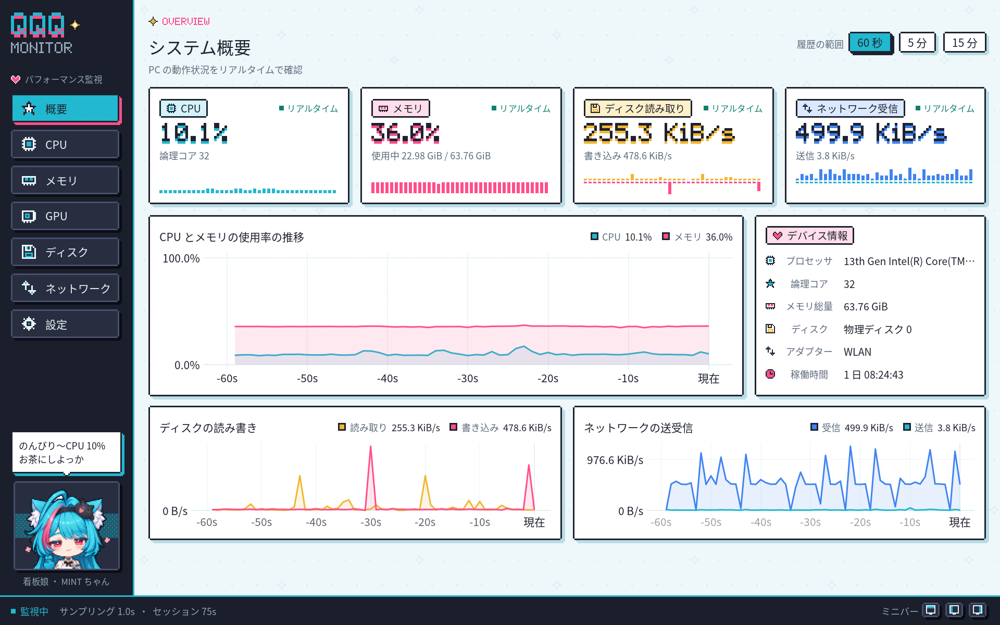
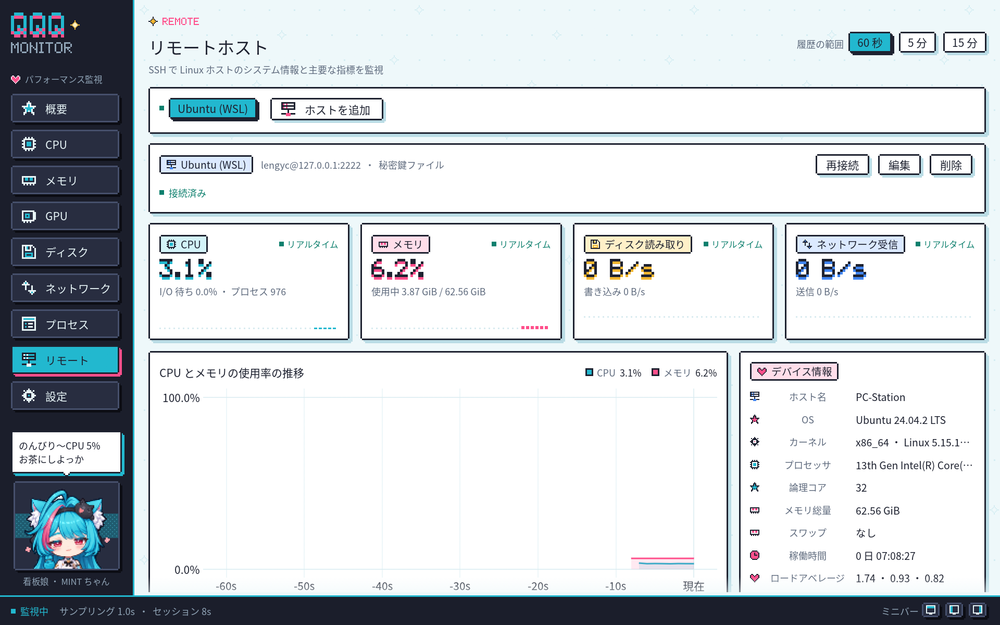
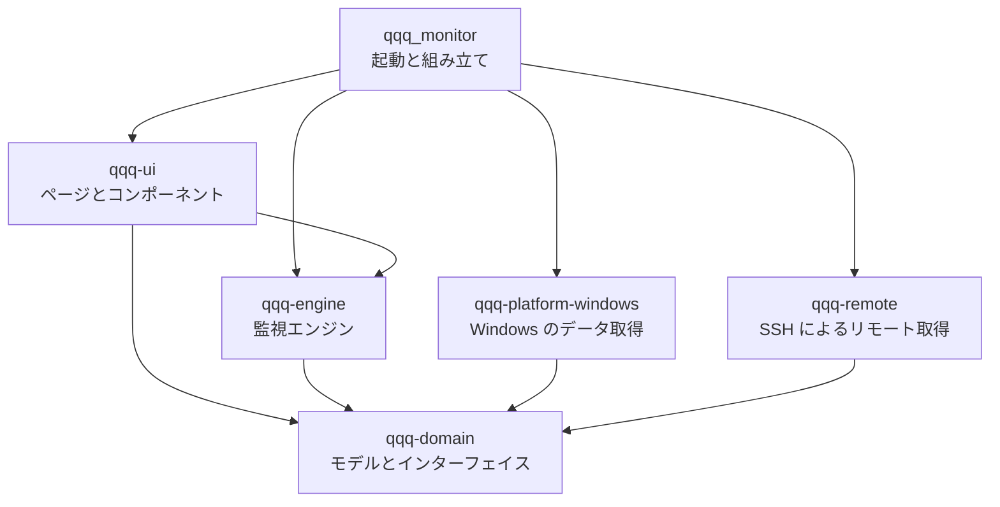
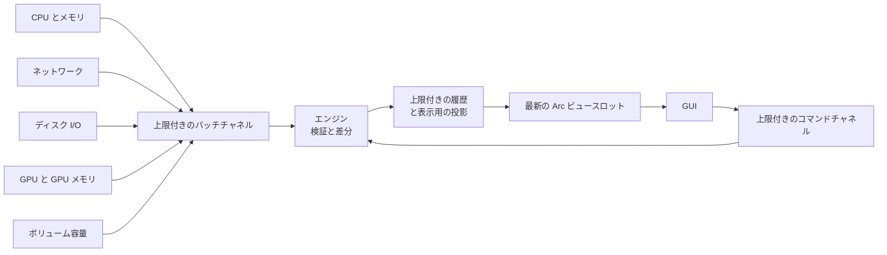

<p align="center">
  
</p>

<h1 align="center">QQQ Monitor</h1>

<p align="center">
  看板娘「MINT ちゃん」が PC の様子を見守る、アニメ風ピクセルアートの Windows パフォーマンスモニター。<br>
  Rust 2024 · egui / wgpu (DX12) · Windows x64 · MIT
</p>

<p align="center">
  <a href="README.md">English</a> · <a href="README.zh-CN.md">简体中文</a> · <b>日本語</b>
</p>

QQQ Monitor は Rust で書かれた Windows 向けの多機能タスクマネージャーです。現在のバージョン 0.1.0 はリアルタイムのパフォーマンス監視に特化しています。Windows のネイティブ API から CPU、メモリ、GPU、ディスク、ネットワークのデータを取得し、ネイティブ GUI で履歴グラフとデバイス情報を表示します。画面の端にドッキングすると、常に最前面に表示されるミニバーになります。ドッキング中や最小化中はタスクトレイに収まります。Windows と実行中の WSL ディストリビューションのプロセスも一覧・管理でき、SSH で 1 台以上の Linux ホストを監視することもできます。アラートは今後のバージョンで対応する予定です。

## メイン画面



左側にナビゲーションと看板娘、右側に現在のページがあります。下部のステータスバーには、監視の状態、サンプリング間隔、セッション時間、ミニバー用の 3 つのボタンが並びます。

## 機能

### パフォーマンス監視

| ページ | 内容 |
| --- | --- |
| 概要 | CPU、メモリ、ディスク読み取り、ネットワーク受信のリアルタイムカードとピクセルミニグラフ。CPU とメモリ、ディスクの読み書き、ネットワークの送受信の履歴グラフ。プロセッサのモデル、論理コア数、メモリ総量、選択中のディスクとアダプター、稼働時間をまとめたデバイス情報 |
| CPU | 全体の使用率と履歴、最も忙しいコア、論理コアのヒートグリッド。コアをクリックするとその履歴を表示 |
| メモリ | 物理メモリの使用率、使用中と利用可能な容量、使用量の推移 |
| GPU | 最も忙しいエンジンによる GPU 使用率（タスク マネージャーと同じ算出方法）、エンジンの種類ごとの負荷（3D、コピー、ビデオのエンコードとデコード、コンピュートなど）、専用 GPU メモリと共有 GPU メモリ。グラフィックスカードを切り替えられ、エンジンをクリックするとその履歴を表示 |
| ディスク | 物理ディスクの読み書き速度と履歴。すべてのローカルボリュームのラベル、ファイルシステム、空き容量と総容量 |
| ネットワーク | 選択したアダプターの受信・送信速度、履歴グラフ、このセッションの通信量 |
| プロセス | Windows と実行中の各 WSL ディストリビューションのプロセス：名前、PID、ユーザー、CPU、メモリ、スレッド、優先度、コマンドライン。検索、列ごとの並べ替え、プロセスの終了と優先度の変更 |
| リモート | SSH で接続した Linux ホスト：デバイス情報（ホスト名、ディストリビューション、カーネルとアーキテクチャ、プロセッサ、メモリとスワップ、稼働時間、ロードアベレージ）、CPU とメモリの使用率の推移、選んだディスクの読み書きとアダプターの送受信、ファイルシステムの容量、論理コアのヒートマップ |
| 設定 | 表示言語、サンプリング間隔、既定の履歴範囲、アニメーション、端へのドッキング、トレイへの最小化。動作状況、データソースの診断、履歴のメモリ使用量、デバイスの手動再検出 |

指標の定義：

- ディスク I/O は物理ディスクごとに、容量はローカルボリュームごとに表示します。
- ネットワークは選択した 1 つのインターフェイスのみを集計するため、物理アダプターと VPN などの仮想インターフェイスは別々に計測されます。セッションの通信量は、今回の実行中に観測したカウンターの有効な増加分です。
- 速度の単位は B/s、KiB/s、MiB/s、容量の単位は MiB、GiB です。
- 各読み取り値は状態（ウォームアップ、リアルタイム、データが古い、非対応、取得失敗、切断）を持ちます。古いデータにはデータの経過時間を表示し、取得の中断はグラフの途切れとして表示します。

### 履歴グラフ

エンジンは指標ごとに最大 15 分の履歴を保持し、ページ右上のボタンで 60 秒、5 分、15 分の表示を切り替えます。履歴の総量は 16 MiB 以内に収まり、グラフの各線は最大 400 点に投影され、間引くときもピークと谷を残します。

### 端へのドッキングとミニバー

ウィンドウを画面の上端または左右の端までドラッグして離すと、常に最前面に表示されるミニバーに切り替わり、CPU、メモリ、GPU、GPU メモリの使用率を表示し続けます。

<p align="center">
  <br>
  <sub>上端のバー：数値の下にセグメントバー</sub>
</p>

<p align="center">
  <br>
  <sub>左右のバー：ピクセルのリングゲージ</sub>
</p>

- GPU と GPU メモリは GPU ページで選択したカードを表示します。既定では GPU メモリが最も多いカードを選びます。
- ミニバーは端に沿って動かしたり、別の端へ移したりできます。どの端からも離れた位置で放すとその場所に通常のウィンドウが戻り、ダブルクリックまたは展開ボタンではドッキング前の位置とサイズに戻ります。
- メインウィンドウのステータスバーにある 3 つのボタンで、上端・左端・右端へ直接ドッキングできます。
- Windows のスナップと最大化の操作はシステムの動作のままです。
- ドッキングしたまま終了すると、次回はミニバーの状態で起動します。

### タスクトレイ

- ミニバーにドッキングしている間、ウィンドウはタスクバーから外れ、タスクトレイにアイコンが表示されます。
- 設定ページの「トレイに最小化」は既定でオンです。通常のウィンドウを最小化するとウィンドウが隠れ、トレイアイコンだけが残ります。
- トレイアイコンをクリックするか、右クリックメニューの「メインウィンドウを表示」を選ぶと、通常のウィンドウに戻ってアクティブになります。「終了」を選ぶと設定を保存して終了します。

### プロセス管理

- ページ上部のボタンで Windows と実行中の各 WSL ディストリビューションを切り替えます。WSL が動いていないときは Windows だけが表示されます。
- 検索ボックスで名前、PID、ユーザー、コマンドラインを絞り込みます。列の見出しをクリックするとその列で並べ替え、既定は CPU の高い順です。CPU はすべての論理プロセッサに対する割合、メモリは Windows ではプライベートワーキングセット、WSL では常駐メモリです。
- プロセスを選ぶと、ツールバーまたは右クリックメニューで終了や優先度の変更（高、通常以上、通常、通常以下、低）ができます。WSL のプロセスには「強制終了」もあります。終了の前には確認が表示され、Delete キーでも選択中のプロセスを終了できます。
- Windows のプロセスは現在のアカウントの権限で操作するため、システムや他のアカウントのプロセスには管理者としての実行が必要です。WSL のプロセスは root として操作します。どの操作も先にプロセスの開始時刻を確かめるので、PID が新しいプロセスに再利用されていても新しいプロセスには作用しません。
- プロセスを読み込むのはプロセスページの表示中だけで、Windows は毎秒、WSL は 2 秒ごとです。読み込みの前にディストリビューションが動いていることを確かめるため、停止中のディストリビューションを起動することはありません。プロセスを表示している間、そのディストリビューションは動作し続けます。

### リモートホスト



- 「リモート」ページの「ホストを追加」で、アドレス、ポート、ユーザー名とログイン方法を指定します。ログイン方法はパスワード、秘密鍵ファイル（OpenSSH または PuTTY 形式の Ed25519、ECDSA、RSA の鍵。暗号化された鍵はパスフレーズも入力）、SSH エージェント（Windows の OpenSSH Authentication Agent サービスまたは Pageant に読み込まれた鍵）から選びます。「SSH 設定から読み込む」は `~/.ssh/config` のホストを一覧し、選ぶとアドレス、ポート、ユーザー名、秘密鍵ファイルが入力されます。
- 初めての接続ではホスト鍵の SHA-256 フィンガープリントが表示されます。確認できたら「信頼して接続」をクリックします。`~/.ssh/known_hosts` に記録済みのホストはそのまま接続します。信頼した鍵と異なる鍵が提示されたときは接続せずに警告を表示し、確認のうえで新しい鍵を信頼できます。
- ホストごとに SSH 接続を 1 本保ち、その上で動かす POSIX シェルがサンプリング間隔（最短 1 秒）で `/proc` と `df` を読み取ります。ホストに必要なのは `sh`、`cat`、`df` などの基本的なコマンドだけで、busybox のシステムでも動作し、エージェントのインストールは不要です。
- 速度はホスト自身の時計で計算します。アダプターは既定でデフォルトルートのインターフェイスを選び、ディスクは物理ディスク単位、ファイルシステムはローカルのものを表示し、使用率は `df` と同じ基準です。
- 接続が切れた、拒否された、タイムアウトしたときは、2 秒から最長 60 秒まで間隔を延ばしながら自動で再接続します。ユーザー名、パスワード、鍵が拒否されたときやホスト鍵が未信頼のときは、設定の変更か「再接続」を待ちます。ログイン失敗の繰り返しでサーバーの遮断ルールに触れることはありません。
- リモートホストの履歴もこのコンピューターの指標と同じく 15 分間保持し、ほかのページを表示している間も記録を続けます。ホストを削除すると、そのデータと保存したパスワードも削除されます。

### 看板娘 MINT ちゃん

MINT ちゃんは、青緑色のロングヘアにピンクのメッシュ、白くふわふわした猫耳の女の子です。カチューシャには黒猫のぬいぐるみが乗り、白いケープと黒いワンピースを着て、襟元には金色の鈴を付けています。インターフェイスの配色も彼女の姿から取っています。サイドバーの下部にいて、CPU とメモリのリアルタイムの負荷に応じて表情とセリフが変わるため、サイドバーはシステムの健康状態を示すインジケーターも兼ねています。

<p align="center">
  
</p>

| 位置 | 表情 | 素材 | 条件 |
| --- | --- | --- | --- |
| 上段左 | のんびり | `mint-1` | CPU が 15% 未満 |
| 上段中央 | おだやか | `mint-4` | 通常の負荷 |
| 上段右 | いそがしい | `mint-3` | CPU が 50% 以上、またはメモリが 75% 以上 |
| 下段左 | オーバーロード | `mint-5` | CPU が 85% 以上、またはメモリが 90% 以上 |
| 下段中央 | 取得エラー | `mint-2` | データソースがエラーを報告している |
| 下段右 | 待機中 | `mint-6` | 起動後、最初の CPU とメモリの値を待っている |

サイドバーには上半身、設定ページには全身を表示します。どちらもビルドスクリプト `crates/qqq-ui/build.rs` が [`docs/images/assets`](docs/images/assets) のイラスト `mint-1` から `mint-6` をもとに生成します。画像の縁につながる白い背景は透明になり、元画像の 10 × 10 ピクセルがスプライトの 1 ピクセルになります。スプライトの各ピクセルは物理ピクセルの整数倍で描画されるため、輪郭がくっきり保たれます。イラストを差し替えて再ビルドすると看板娘が更新されます。`mint-0` はプロジェクトのロゴです。

アニメーションがオンのとき、MINT ちゃんは 1 秒ごとに軽く揺れます。アニメーションは予約した再描画で動くため、アイドル時の再描画は少なく抑えられます。

### アプリケーションアイコン

<p align="center">
  
</p>

アプリケーションアイコンは、MINT ちゃんの猫耳が生えたピクセルのモニターです。画面にはピンクのパルスが走り、ほっぺは赤く、下には彼女の金色の鈴が下がっています。マルチサイズの ICO が EXE に埋め込まれ、エクスプローラー、タイトルバー、タスクバーで共有されます。16、24、32 ピクセルの 3 種類は手描きで、一般的な拡大率でもくっきり表示されます。

### 表示言語

インターフェイスは English、简体中文（簡体字中国語）、日本語に対応しています。既定ではシステムに合わせます。起動時に Windows の表示言語の優先順位から最初に対応している言語を選び、中国語の各地域の変種は簡体字中国語を使い、どれにも対応していない場合は英語を使います。設定ページの「表示言語」では「システムに従う」または特定の言語を選べます。クリックするとインターフェイス全体とウィンドウタイトルがすぐに切り替わり、選択が保存されます。

ページ、カード、グラフ、状態とエラーの表示、デバイス名と詳細、看板娘のセリフ、起動失敗時のダイアログはすべて表示言語に従います。各ページ上部のピクセル英字の小見出し、数値と単位はどの言語でも同じです。3 つの言語はすべて埋め込みの Noto Sans CJK SC フォントで表示され、日本語の漢字は簡体字中国語の字形になります。

### 設定

設定ページは「適用して保存」で反映します。サンプリング間隔（0.5、1、2 秒）、既定の履歴範囲、アニメーション、端へのドッキング、トレイへの最小化はすぐに有効になり、バックグラウンドのスレッドが TOML ファイルに書き込みます。表示言語はクリックした時点で有効になり、保存されます。アダプターの選択、ウィンドウの位置とサイズ、ドッキングした端、ミニバーの位置は終了時にまとめて保存されます。リモートホストは追加、編集、削除、ホスト鍵の信頼の時点で保存されます。パスワードとパスフレーズは Windows 資格情報マネージャーに保存し、設定ファイルには書き込みません。

| ファイル | 場所 |
| --- | --- |
| 設定 | `%APPDATA%\qqq_monitor\config\config.toml` |
| ログ | `%LOCALAPPDATA%\qqq_monitor\data\logs`（日ごとにローテーションし、7 ファイルを保持） |
| リモートホストのパスワード | Windows 資格情報マネージャーの汎用資格情報 `qqq_monitor/ssh/<ホスト ID>` |

## はじめに

### 必要な環境

- Windows x64 と DX12 対応のグラフィックスアダプター
- Rust 1.99 以降、ターゲット `x86_64-pc-windows-msvc`
- Visual Studio Build Tools の C++ ツールチェーンと Windows SDK

### ビルドと実行

```powershell
cargo run --release
```

実行ファイルは `target\release\qqq_monitor.exe` で、そのまま実行できます。すべての指標は標準ユーザーのアカウントで取得できます。

### コマンドラインオプション

| オプション | 動作 |
| --- | --- |
| `--smoke-test` | 約 8 秒間実行し、CPU、メモリ、物理ディスク I/O、ネットワーク、ボリューム容量、Windows のプロセス一覧のすべてに有効な値があることを確認して、GPU を含む全指標と実行中の各 WSL ディストリビューションのプロセス数を出力します。すべて合格すると終了コード 0 で終了します |
| `--capture PATH` | 実際の GUI を起動し、約 8 秒後にウィンドウを PNG として保存して終了します。ユーザー設定はそのまま残ります。`PATH` の親フォルダーはあらかじめ存在している必要があります |
| `--page PAGE` | `--capture` で撮るページ：`overview`、`cpu`、`memory`、`gpu`、`disk`、`network`、`processes`、`remote`、`settings` |
| `--dock EDGE` | ミニバーの状態で起動します：`top`、`left`、`right`。`--capture` と組み合わせるとミニバーを撮影します |
| `--lang LANG` | 指定した表示言語で起動します。設定ページでその言語を選ぶのと同じです：`zh-CN`、`en`、`ja`。`--capture` と組み合わせるとその言語のページを撮影します |
| `--help` | オプションの一覧を表示します（簡体字中国語） |

```powershell
cargo run --release -- --capture "$PWD\target\gpu.png" --page gpu
cargo run --release -- --capture "$PWD\target\dock-left.png" --dock left
cargo run --release -- --capture "$PWD\target\settings-ja.png" --page settings --lang ja
```

## アーキテクチャ

このプロジェクトは、5 つのライブラリクレートと 1 つの起動パッケージからなる Cargo ワークスペースです。ドメインモデルと監視エンジンは Windows と GUI から独立しています。起動パッケージが具体的なコレクターを注入し、GUI はエンジンが公開する不変のビューだけを読み取ります。



| パス | 役割 |
| --- | --- |
| `src/` | ログの初期化、依存関係の組み立て、システム言語の判定、DX12 ウィンドウとウィンドウアイコン、コマンドラインのスモークテストと撮影、終了処理 |
| `build.rs`、`assets/` | マルチサイズのアプリケーションアイコンとリソーススクリプト。ビルド時に EXE へ埋め込みます |
| `crates/qqq-domain/` | デバイス、指標、単位、読み取り状態と取得できない理由、プロセスのインスタンスと操作、リモートホストの接続先とセッション、および `Collector`、`CollectorFactory`、`ProcessPlatform`、`RemotePlatform`、`SecretStore` のインターフェイス |
| `crates/qqq-platform-windows/` | sysinfo による CPU とメモリ、IP Helper によるネットワーク、PDH によるディスク I/O と GPU エンジン・GPU メモリ、DXGI によるグラフィックスカードの列挙、ローカルボリュームの容量、モニターの作業領域とマウスの状態、ユーザーの表示言語、EXE リソースからのウィンドウアイコンの読み込み、タスクトレイのアイコンとメニュー、タスクバーボタン、1 回のシステムコールによる Windows プロセスの一覧と終了・優先度の変更、`wsl.exe` を通じた実行中の WSL ディストリビューションのプロセスの読み込みと操作、Windows 資格情報マネージャーでのリモートホストのパスワードとパスフレーズの保存。ネイティブ呼び出しは `native.rs`、`tray.rs`、`process.rs`、`secret.rs` にまとめ、ハンドルは RAII で管理します |
| `crates/qqq-engine/` | サンプリングのスケジュール、カウンターの差分とウォームアップ、上限付きの履歴と表示用の投影、必要なときだけのプロセスのポーリングとプロセスの CPU 使用率、専用スレッドでのプロセス操作、リモートホストごとの接続スレッドと再接続の方針、不変のビュー、設定（表示言語とリモートホストを含む）の読み書きとバックグラウンド保存、言語に依存しないコマンドと設定の通知 |
| `crates/qqq-remote/` | SSH クライアント（russh）：パスワード、秘密鍵、SSH エージェントによるログイン、信頼した鍵または `known_hosts` によるホスト鍵の確認、ホスト上の POSIX シェルによる `/proc` と `df` の読み取りとホストの時計による速度の計算、追加時に読み込む `~/.ssh/config` のホスト |
| `crates/qqq-ui/` | プロセス管理とリモートホストを含む 9 つのページ、端へのドッキングとミニバー、タスクトレイへの格納、グラフと共通コンポーネント、テーマ、ピクセル描画（ビットマップフォント、アイコン、スプライト）、看板娘（ビルド時にイラストから生成するピクセルスプライト）、3 言語のインターフェイステキストと埋め込みの CJK フォント |

### データの流れ



- **独立した取得スレッド**：各コレクターは自分のスレッドでリソースを作成・使用・解放し、サンプリング間隔または固定周期（ボリューム容量は 30 秒）で動作します。エラーが起きたコレクターは 1〜30 秒のバックオフで再作成され、ほかのコレクターはそのまま動き続けます。
- **バックプレッシャー**：各コレクターがバッファーするバッチは最大 8 個です。満杯のときは現在のバッチを破棄し、履歴に途切れを残します。処理中のコマンドは最大 32 個です。
- **ブロックしない描画**：エンジンはロックの外でビューを組み立て、`Arc` スロットを 1 つ差し替えて再描画を要求します。GUI はフレームごとにブロックせずに最新のビューを取り出し、必要に応じて履歴の照会を送ります。
- **リモートホスト**：ホストごとのスレッドが自分の SSH 接続とシングルスレッドの tokio ランタイムを持ちます。読み取った値はデバイスの接頭辞 `ssh:<ホスト ID>/` を付けて、このコンピューターの値と同じ検証、履歴、投影の流れを通ります。
- **安全性の境界**：ドメイン、エンジン、GUI、リモート取得、起動パッケージは `unsafe` を禁止しています。Windows の FFI はプラットフォームクレートの `native.rs`、`tray.rs`、`process.rs`、`secret.rs` にまとめています。

### 拡張方法

- **指標の追加**：プラットフォームクレートで `CollectorFactory` を実装して `collectors()` に登録します。エンジンは共通のパイプラインで処理し、ページは `MetricKey` で読み取ります。
- **ページの追加**：`crates/qqq-ui/src/pages/` にページのファイルと `Page` のルートを追加し、既存のコンポーネントを組み合わせて、ページが照会する指標を宣言します。
- **言語の追加**：`Language` に言語と BCP 47 タグを追加し、`crates/qqq-ui/src/i18n/` にその言語のテキスト表を追加します。`Strings` の各項目はすべての言語で埋める必要があり、翻訳が欠けているとコンパイルに失敗します。

インターフェイスの契約、スレッドモデル、履歴の予算、障害の分離については [アーキテクチャ設計](docs/ARCHITECTURE.md) で詳しく説明しています。

## 開発時のチェック

```powershell
cargo fmt --all -- --check
cargo clippy --workspace --all-targets -- -D warnings
cargo test --workspace --release
cargo run --release -- --smoke-test
```

WSL ディストリビューションが動いているときは、`cargo test -p qqq-platform-windows -- --ignored` がその中でテスト用のプロセスを起動して終了させ、WSL プロセスの終了と優先度の変更を確認します。

`qqq-remote` の 2 つのサンプルで、このコンピューター上でリモート監視を試せます。`wsl_sshd` は 127.0.0.1 だけで待ち受ける開発用の SSH サーバーで、クライアントが実行するコマンドを WSL ディストリビューションで動かします。`probe` はモニターと同じ方法でホストに接続し、3 回分の読み取り値を出力します。まず `ssh-keygen -t ed25519 -f "$env:TEMP\qqq-host"` でホスト鍵を作成し（パスフレーズは空）、次を実行します。

```powershell
cargo run -p qqq-remote --example wsl_sshd -- --host-key "$env:TEMP\qqq-host" --password test
cargo run -p qqq-remote --example probe -- 127.0.0.1 test --port 2222 --password test --trust
```

サーバーの実行中は、「リモート」ページでアドレス `127.0.0.1`、ポート `2222`、パスワード `test` のホストを追加することもできます。

自動テストは、速度の計算、ウォームアップと障害からの復帰、データの鮮度の判定、履歴の予算と投影の途切れ、遅いコレクターの分離、コマンド数の上限、設定の保存と破損時の保護、GPU カウンターの解析、ドッキングする端の判定とミニバーの配置、プロセスの CPU 使用率とインスタンスの照合、プロセスのポーリングと操作結果、Windows プロセスの列挙とインスタンス単位の操作、WSL プロセスの出力の解析、リモートホストの接続状態と再接続の方針、ホスト鍵の確認、Linux の `/proc` と `df` の出力の解析とホストの時計による速度の計算、`~/.ssh/config` の読み込み、Windows 資格情報マネージャーの読み書き、システム言語の照合、各言語のテキスト表と看板娘のセリフの幅をカバーしています。ランタイムのテストは、制御可能な疑似コレクターでエンジン全体を動かします。

## 設計ドキュメント

設計ドキュメントは簡体字中国語で書かれています。

| ドキュメント | 内容 |
| --- | --- |
| [技術方針](docs/TECHNICAL_PLAN.md) | 初版の範囲、技術選定、指標の定義、GUI のビジュアルと操作の指針、パフォーマンスの予算とリスク |
| [アーキテクチャ設計](docs/ARCHITECTURE.md) | ワークスペースの役割分担、依存の方向、インターフェイス、サンプリングと描画のデータフロー、エラー処理と拡張の手順 |
| [実装と受け入れの計画](docs/IMPLEMENTATION_PLAN.md) | 開発フェーズ、提供の順序、確認可能な受け入れ基準 |

## ライセンス

コードは MIT ライセンスです。[LICENSE](LICENSE) を参照してください。埋め込みの Noto Sans CJK SC フォントは SIL Open Font License です。[フォントのライセンス](crates/qqq-ui/assets/fonts/LICENSE.txt) を参照してください。
