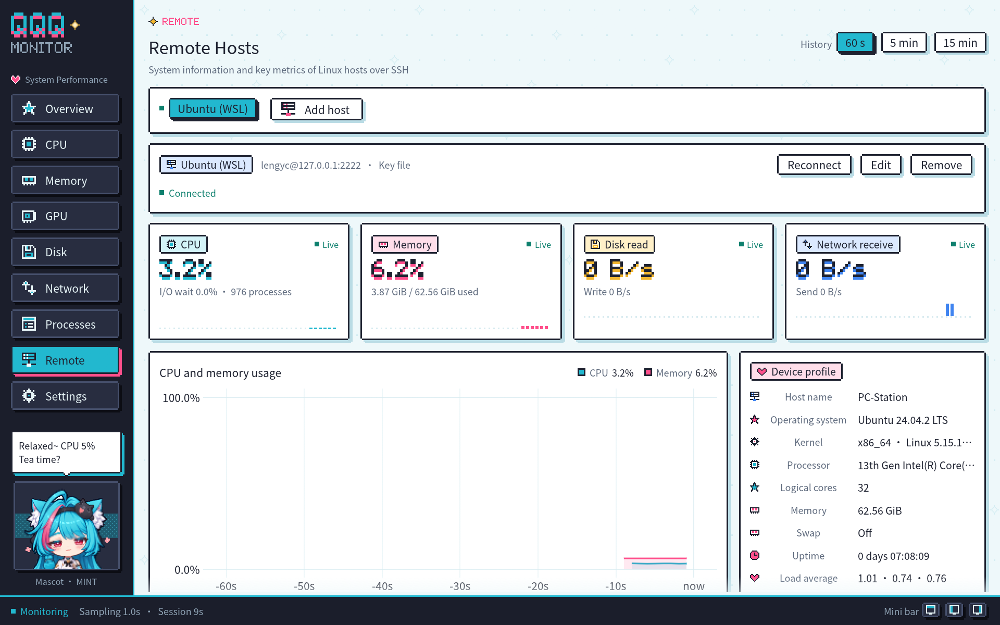
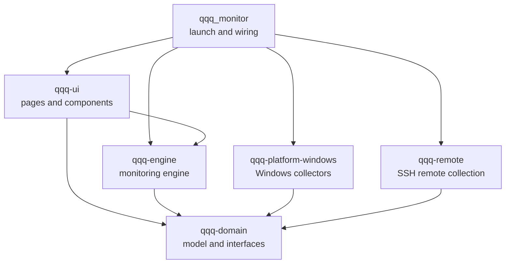
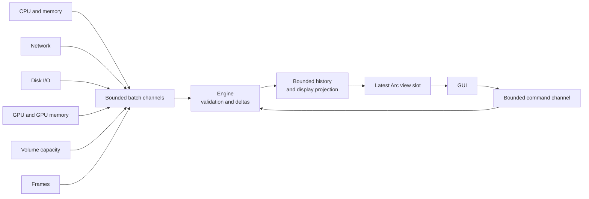

<p align="center">
  
</p>

<h1 align="center">QQQ Monitor</h1>

<p align="center">
  A pixel-art, anime-style performance monitor for Windows, with MINT the mascot keeping an eye on your PC.<br>
  Rust 2024 · egui / wgpu (DX12) · Windows x64 · MIT
</p>

<p align="center">
  <b>English</b> · <a href="README.zh-CN.md">简体中文</a> · <a href="README.ja.md">日本語</a>
</p>

QQQ Monitor is a multi-purpose task manager for Windows, written in Rust. Version 0.4.3 focuses on real-time performance monitoring: it collects CPU, memory, GPU, disk and network data from native Windows APIs, shows history charts and device details in a native GUI, and can dock to a screen edge as an always-on-top mini bar. Docked or minimized, it stays in the notification area. It also lists and manages the processes of Windows and of running WSL distributions, monitors one or more Linux hosts over SSH, counts the frame rate and frame time of games and other foreground apps, and sends Windows notifications when a metric crosses its threshold. A shortcut-driven screenshot tool, a clipboard history, always-on-top Markdown notes summoned with a shortcut and quick commands that run PowerShell commands from a shortcut round it off.

## Main window


Navigation and the mascot sit on the left and the current page on the right. The status bar at the bottom shows the monitor state, the sampling interval, the session length and three mini bar buttons.

## Features

### Performance monitoring

| Page | Contents |
| --- | --- |
| Overview | Live cards with pixel mini charts for CPU, memory, disk read and network receive; history charts for CPU and memory, disk read and write, and network traffic; a device profile with the processor model, logical cores, total memory, current disk and adapter, and system uptime |
| CPU | Total usage and its history, the busiest core and a heat grid of logical cores; click a core to see its history |
| Memory | Physical memory usage, used and available capacity, and usage over time |
| GPU | GPU usage from the busiest engine (matching Task Manager), the load of each engine type (3D, copy, video encode and decode, compute and more), dedicated and shared GPU memory; switch between graphics cards and click an engine to see its history |
| Frames | The frame monitoring switch; the app being counted (executable, PID and present API), its frame rate, mean and longest frame time, and frame rate and frame time charts |
| Disk | Physical disk read and write rates with history; label, file system, free and total space of every local volume |
| Network | Receive and send rates of the selected adapter, a history chart and the traffic of this session |
| Processes | Processes of Windows and of each running WSL distribution: name, PID, user, CPU, memory, threads, priority and command line; search, sorting by column, ending processes and changing their priority |
| Remote | Linux hosts over SSH: a device profile (host name, distribution, kernel and architecture, processor, memory and swap, uptime, load average), CPU and memory trends, read and write of a chosen disk, traffic of a chosen adapter, file system capacity and a heat grid of the logical cores |
| Alerts | The alert rules with device and metric, condition, current value and state; adding, editing, enabling, disabling and removing rules; a test notification; the alerts fired in this session |
| Tools | Buttons at the top switch between four tools. Screenshots: taking a screenshot and opening the screenshot folder; switching and changing the screenshot shortcut, the number to keep; the recent screenshots with thumbnail, time taken, size and file size, to copy, open or delete. Clipboard: switching clipboard history, the number to keep and clearing it; the entries from newest to oldest with previews of text, pictures and files, each copied back with one click or deleted. Notes: opening the notes, starting a new note and opening the notes folder; switching and changing the notes shortcut; every note with its title, when it changed and its first lines, to open or delete. Commands: adding a quick command; every quick command with its name, how it runs, its first command lines and its shortcut, to run, edit or delete, with its shortcut set, switched and changed |
| Settings | On the left, language, sampling interval, default history range, animations, edge docking, minimize to tray, frame monitoring, the screenshot shortcut, the notes shortcut, clipboard history, the quick command sound, autostart and starting hidden in the notification area; on the right, the project logo, the version, an introduction and a button that opens the GitHub page; at the bottom, runtime status, collector diagnostics, history memory and a manual device refresh |

Metric definitions:

- Disk I/O is counted per physical disk; capacity is shown per local volume.
- Network traffic is counted for the selected interface only, so physical adapters and virtual interfaces such as VPNs are measured separately; session traffic is the valid counter growth observed during this run.
- Rates use B/s, KiB/s and MiB/s; capacities use MiB and GiB.
- Every reading carries a state (warming up, live, stale, unsupported, failed, disconnected). Stale data shows its age, and collection outages appear as gaps in the charts.

### History charts

The engine keeps up to 15 minutes of history for every metric, and the buttons at the top right switch between 60-second, 5-minute and 15-minute views. All history stays within 16 MiB; each chart line projects at most 400 points and keeps peaks and valleys when downsampling.

### Edge docking and the mini bar

Drag the window to the top, left or right screen edge and release it: the window collapses into an always-on-top mini bar that keeps showing CPU, memory, GPU and GPU memory usage.

<p align="center">
  <br>
  <sub>Top bar: values above segmented level strips</sub>
</p>

<p align="center">
  <br>
  <sub>Side bar: pixel ring gauges</sub>
</p>

- GPU and GPU memory follow the card selected on the GPU page, which defaults to the card with the most memory.
- With frame monitoring on, the mini bar adds FPS, the frame rate of the foreground app, which turns orange below 50 and red below 30; the top bar widens to 640 points and the side bar grows to 316 points.
- Drag the mini bar along its edge or onto another edge. Dropping it away from every edge restores the full window at the drop point; double-clicking the bar or pressing its expand button restores the window's previous position and size.
- While a game, video or other app runs full screen in the foreground on the mini bar's monitor, the mouse passes through the bar and every click goes to that app, so a game steered with the mouse keeps the focus. Once an ordinary window is in front again, the bar can be dragged and expanded as usual.
- The three buttons in the status bar of the main window dock it to the top, left or right edge directly.
- Windows snap and maximize gestures keep their system behavior.
- When the app closes while docked, it starts as the mini bar next time.

### Notification area

- While docked as the mini bar, the window leaves the taskbar and an icon appears in the notification area.
- Minimize to tray on the Settings page is on by default: minimizing the full window hides it and leaves only the icon.
- Start hidden in the notification area on the Settings page is on by default: when Windows starts the app at sign-in, it shows only the icon, with no window, and samples in the background as usual.
- Clicking the icon or choosing Show main window from its menu restores and activates the full window; Take screenshot starts a screenshot; Notes shows the note window; Exit saves the configuration and closes the app.

### Process management

- The buttons at the top switch between Windows and each running WSL distribution; while WSL is not running, only Windows is listed.
- The search box filters by name, PID, user and command line; clicking a column title sorts by that column, CPU from highest first by default. CPU is a share of all logical processors; memory is the private working set on Windows and the resident set under WSL.
- With a process selected, the toolbar or the context menu ends it or changes its priority (High, Above normal, Normal, Below normal, Low); WSL processes also offer Force end. Ending asks for confirmation, and the Delete key ends the selected process too.
- Windows processes are handled with the rights of the current account, so system processes and those of other accounts need the app to run as administrator. WSL processes are handled as root. Every action first checks the start time of the process, so a PID that a new process reuses never reaches the new process.
- Processes are read only while the Processes page is shown: every second on Windows and every 2 seconds under WSL. Each read first confirms that the distribution still runs, so a stopped distribution never starts; while its processes are shown, the distribution keeps running.

### Remote hosts



- On the Remote page, Add host asks for the address, port and user, and a sign-in method: a password, a key file (Ed25519, ECDSA or RSA keys in OpenSSH or PuTTY format, with the passphrase of an encrypted key), or the SSH agent (keys loaded in the Windows OpenSSH Authentication Agent service or Pageant). Import from SSH config lists the hosts of `~/.ssh/config` and fills in the address, port, user and key file.
- The first connection shows the SHA-256 fingerprint of the host key; Trust and connect accepts it once you have checked it. Hosts already in `~/.ssh/known_hosts` connect at once. A host that offers a key other than the trusted one is not connected, and the page warns about it; you can trust the new key once you are sure.
- Each host keeps one SSH connection with one POSIX shell on it, which reads `/proc` at the sampling interval, at least once a second. File systems come from `df` every 30 seconds on a second channel, so a file system that stops answering, such as an unreachable network share, holds up only the file system readings. The host needs only basic commands such as `sh`, `cat` and `df`, busybox systems included; nothing is installed on it.
- Rates follow the host's own clock. The adapter of the default route is selected by default; disks are whole physical disks; file systems are the local ones, with usage as `df` reports it.
- A dropped, refused or timed-out connection reconnects by itself, waiting from 2 up to 60 seconds. A rejected user name, password or key and an untrusted host key wait for you to change the settings or click Reconnect, so repeated failed sign-ins never trip the server's ban rules.
- Remote history spans 15 minutes like that of this computer and keeps recording on every page; removing a host also removes its data and its saved password.

### Frame monitoring

- Switch on Frame monitoring on the Frames page or the Settings page; it is off by default. The app then counts the frames of the foreground app in the background: the frame rate is the number of frames presented per second, and the frame time is the gap between two presents. The page shows the mean and the longest frame time of each sampling period along with frame rate and frame time charts, and the mini bar shows FPS as well, so it can sit docked at a screen edge while you play.
- The app being counted is the process of the foreground window. While QQQ Monitor itself is in front, the previous app stays counted, so you can switch over and look at any time. When a process presents on several swap chains, the busiest one counts.
- The frames come from the Present events of DXGI and Direct3D 9 in Windows event tracing (ETW), the source PresentMon and the Xbox Game Bar read as well; the monitor only reads system events and leaves the game's process alone. Direct3D 9 to 12 apps report frames; Vulkan and OpenGL apps report them when the graphics driver presents through DXGI.
- Reading event tracing needs administrator rights, or membership in the Performance Log Users group followed by signing in to Windows again. Without them, the Frames page explains this and offers Restart as administrator, which reopens the Frames page with administrator rights once you confirm the system prompt. Switching frame monitoring off stops the event tracing.
- When the foreground app stops presenting for about 2 seconds, the frame rate reads 0.

### Alerts

- On the Alerts page, Add alert asks for a device and a metric, a condition (above or below), a threshold and a hold time (at once, 5 s, 10 s, 30 s, 1 min or 5 min). Devices include the processor, physical memory, graphics cards, the foreground app, physical disks, local volumes, network adapters and the devices of remote hosts; metrics include usage, available and used capacity, GPU memory, read, write, receive and send rates, frame rate and frame time, and the I/O wait, swap usage, load averages and process count of remote hosts. The threshold is in the metric's unit: percent, GiB, MiB/s, FPS or milliseconds.
- Once a reading stays past its threshold for the hold time, a Windows notification arrives with the device and metric as its title and the current value and threshold as its text; once the reading stays back on the other side for the same time, the rule is normal again. A rule notifies at most once a minute. Rules use live, valid readings only: a stale, failed or offline reading starts the hold time over.
- The engine judges alerts in the background, so notifications also arrive while the window sits in the tray or docks as the mini bar; clicking one opens the main window. While rules fire, the status bar shows how many, and clicking that opens the Alerts page.
- The rule list shows the current value and state of each rule (normal, the countdown past the threshold, firing and for how long, waiting for data, off); the checkbox switches a rule on or off, and Edit and Remove change or delete it. Recent alerts lists the alerts fired in this session, and Send test notification checks the Windows notification settings.
- Windows shows notification banners for desktop apps with a Start menu shortcut, so opening the Alerts page or sending a notification creates or updates a QQQ Monitor shortcut to this executable in the current user's Start menu. Notifications of each app can be managed under Notifications in Windows Settings.
- Rules identify devices across restarts: network adapters by interface GUID, graphics cards by PCI IDs, volumes by volume GUID and remote devices with their host ID.

### Screenshots

- Press the screenshot shortcut (`Ctrl+Alt+A` by default), click Take screenshot under Screenshots on the Tools page, or choose Take screenshot from the notification-area icon's menu: the screen freezes and dims, with a hint at the top. The capture covers every monitor in physical pixels.
- Drag to select a region: it keeps its brightness inside a teal border, with its size shown beside it. A click without dragging captures the whole monitor under the pointer; a right-click while dragging starts the selection over, and Esc or a right-click ends the screenshot.
- When you release the mouse, the region is copied to the clipboard and saved as a PNG in `%LOCALAPPDATA%\qqq_monitor\data\screenshots`, named like `QQQ Screenshot 2026-10-15 143012.png`.
- Screenshots on the Tools page lists the recent screenshots with thumbnail, time taken, size and file size; each can be copied back to the clipboard, opened with the default program or deleted. Clicking a thumbnail opens the picture too, and Open folder opens the screenshot folder. Keep 10, 20, 50 or 100 screenshots (20 by default); beyond that number the oldest go first. The app manages only files whose names start with `QQQ Screenshot`, and other files in the folder stay as they are.
- Take screenshot on the Tools page takes the main window off the screen before freezing it and brings the window back afterwards; the shortcut and the tray menu freeze the screen as it is.
- The shortcut is global and works while the window sits in the tray or docks as the mini bar. To change it, click Change under Screenshots and press the new combination: Ctrl or Alt with a letter or digit, or one of F1 to F24, each optionally with Shift. Both the Screenshots tool and the Settings page switch the shortcut on and off; when another app already uses the combination, the status bar says so.

### Clipboard history

- Turn on clipboard history under Clipboard on the Tools page or on the Settings page (off by default), and the app records the text, pictures and files copied to the clipboard from then on; the content already on the clipboard becomes the first entry.
- Entries run from newest to oldest, each with its kind and size (characters, picture size or file count), when it was copied and a preview: the first three lines of text, a picture thumbnail or the first three file paths. Copy, or a click on the content itself, puts the entry back on the clipboard and moves it to the top, ready to paste into other apps or File Explorer; copying content that is already recorded also moves its entry to the top.
- Keep 20, 50, 100 or 200 entries (50 by default); pictures take at most 256 MiB of memory together, and beyond either limit the oldest entries go first. Clear history and each entry's Delete tidy the list.
- History stays in memory and clears when the app exits. Content that password managers and similar apps mark as private with `ExcludeClipboardContentFromMonitorProcessing` or `CanIncludeInClipboardHistory` is skipped, as Windows clipboard history does.

### Notes

- Press the notes shortcut (`Ctrl+Alt+N` by default), click Open notes under Notes on the Tools page, or choose Notes from the notification-area icon's menu: the note window appears above every other window with the keyboard focus, ready for typing. Pressing the shortcut again in the note hides it. This works while the main window is minimized, sits in the tray or docks as the mini bar.
- The note window is a small pixel-style window of its own: drag its title bar to move it and its lower right corner to resize it. The buttons on the right of the title bar are, in order, All notes, New note, Edit or Preview, Delete note and Hide. It first appears at the top right of the work area of the main window's monitor and afterwards where you left it, at the size you gave it.
- Notes are Markdown. While you edit, Markdown marks show in teal, headings are larger and bold, and emphasis, inline code and links have their own styles. `Ctrl+E` or the Edit/Preview button switches to the preview, which shows headings, bold, italics, strikethrough, inline code and code blocks, quotes, numbered and bulleted lists, task lists, tables, rules and links. In the preview, a click on a task's box ticks or unticks it in the Markdown text; web and mail links open in their default program; text can be selected and copied, and a double click on the empty area returns to editing.
- Keep as many notes as you like: `Ctrl+N` or the + button starts a new note, All notes lists every note by when it changed, and a click switches to it. Deleting a note asks for confirmation.
- Each note is a Markdown file in `%LOCALAPPDATA%\qqq_monitor\data\notes`, named like `QQQ Note 2026-10-23 143012.md`, which other editors can open as well. A note is saved a moment after you stop typing, and at least every 5 seconds while you keep typing; `Ctrl+S` saves at once, and hiding the note or exiting the app saves too. Emptying a note removes its file. Notes on the Tools page lists every note with its title, when it changed and its first lines, to open or delete, and Open folder opens the notes folder.
- Both the Notes tool and the Settings page switch the notes shortcut on and off. To change it, click Change under Notes and press the new combination; the rules match the screenshot shortcut, and each shortcut has a combination of its own.

### Quick commands

- A quick command runs one or more Windows PowerShell commands together, from its shortcut or from the Tools page. Click New command under Commands on the Tools page and fill in a name, the commands (one PowerShell command per line), the sessions, the window and a working folder, then click Save.
- Sessions decide how the lines run. Run in order in one session runs every line in a single session, so later lines keep the variables and location that earlier ones set; One session per command starts each line in a session of its own, all at once.
- With Show the PowerShell window ticked (the default), each session opens a console window that stays open after the commands end, to read the output or keep typing; the window title is the command's name, followed by the line for one session per command. Untick it to run the sessions in the background, where each session ends with its commands. The working folder is the full path of an existing folder; left empty, the sessions start in the user folder.
- Commands lists every quick command with its name, a summary (sessions, number of lines, window or background, working folder), its first three lines and its shortcut. Run starts it at once, Edit opens the dialog again, and Delete asks for confirmation. Each quick command holds up to 32 lines and about 8000 characters, and the list holds up to 32 quick commands.
- The program follows every session a quick command starts. While any of them runs, the card shows Running with the number of sessions and a Stop button next to Run; Stop ends all of that command's sessions together with the programs they started, and a window session closes its window. Sessions that end on their own drop off the card within a second. Sessions keep running after the program exits.
- Every run plays a short sound: a short chime when the sessions start, two falling notes when a session fails to start. The switch on the Commands tab and in Settings turns it off. While the window sits in the tray or docks as the mini bar, a balloon from the tray icon also shows the command's name and how many sessions started, or why the run failed; clicking the balloon opens the window.
- To give a quick command a shortcut, click Set and press a combination; the rules match the screenshot shortcut, and every shortcut has a combination of its own. Afterwards the checkbox switches the shortcut on and off, and Change records new keys. Shortcuts are global and work while the window sits in the tray or docks as the mini bar. When a session fails to start, for example because the working folder has moved, the status bar says why.

### MINT, the mascot

MINT is a girl with long teal hair, a pink streak and fluffy white cat ears. A black cat plush rests on her headband, she wears a white capelet and a black dress, and a golden bell hangs at her collar; the interface colors come from her look. She lives at the bottom of the sidebar and changes her expression and lines with the live CPU and memory load, so the sidebar doubles as a health indicator:

<p align="center">
  
</p>

| Position | Mood | Asset | Trigger |
| --- | --- | --- | --- |
| Top left | Relaxed | `mint-1` | CPU below 15% |
| Top middle | Calm | `mint-4` | Normal load |
| Top right | Busy | `mint-3` | CPU at 50% or memory at 75% |
| Bottom left | Overloaded | `mint-5` | CPU at 85% or memory at 90% |
| Bottom middle | Trouble | `mint-2` | A collector reports an error |
| Bottom right | Waiting | `mint-6` | Waiting for the first CPU and memory readings after start |

The build script `crates/qqq-ui/build.rs` generates the bust in the sidebar from the illustrations `mint-1` to `mint-6` in [`docs/images/assets`](docs/images/assets): the white background connected to the image border becomes transparent, and every 10 × 10 block of source pixels becomes one sprite pixel. Each sprite pixel is drawn on a whole number of physical pixels, so the edges stay crisp. Replace the illustrations and rebuild to update the mascot. `mint-0` is the project logo. The Settings page shows the same logo as the top of this file, `docs/images/logo.png`.

With animations on, MINT bobs gently once a second. The animation runs on scheduled repaints, so the app redraws rarely while idle.

### Application icon

<p align="center">
  
</p>

The application icon is a pixel monitor with MINT's cat ears: a pink pulse runs across the screen, the cheeks blush and her golden bell hangs below. A multi-size ICO embedded in the EXE serves File Explorer, the title bar and the taskbar; the 16, 24 and 32 pixel versions are drawn by hand so they stay crisp at common scaling factors.

### Interface language

The interface is available in English, 简体中文 (Simplified Chinese) and 日本語 (Japanese). By default it follows the system: at startup it picks the first supported language from the Windows display language preferences, uses Simplified Chinese for every Chinese variant, and falls back to English. The Language row on the Settings page offers System default or a specific language; a click switches the whole interface and the window title at once and saves the choice.

Pages, cards, charts, status and error messages, device names and details, MINT's lines and the startup failure dialog all follow the interface language; the pixel-font captions at the top of each page, numbers and units look the same in every language. All three languages use the embedded Noto Sans CJK SC font.

### Configuration

The Settings page applies changes with Apply & save: the sampling interval (0.5, 1 or 2 seconds), the default history range, animations, edge docking and minimize to tray take effect at once, and a background thread writes them to a TOML file. The language takes effect and is saved as soon as you click it. Autostart takes effect as soon as you tick or clear it: the program adds itself, started with `--autostart`, to the current user's Windows startup programs or removes itself from them, and the Startup apps page of Task Manager lists the entry as well; the checkbox shows the actual state of that entry, including when it is disabled in Task Manager. The option beneath it, Start hidden in the notification area, is on by default; it takes effect and is saved as soon as you click it, and can be changed while autostart is on. The adapter selection, window position and size, docked edge and mini bar position are saved on close. Remote hosts are saved as soon as you add, edit or remove one or trust its host key; passwords and passphrases are kept in Windows Credential Manager, not in the configuration file. Frame monitoring takes effect and is saved as soon as you click it, alert rules are saved as soon as you add, edit, switch or remove one, and quick commands are saved as soon as you add, edit or remove one or set, switch or change its shortcut; the quick command sound switch is saved as soon as you click it. The screenshot and notes shortcuts and their switches, the number of screenshots to keep, clipboard history and the number of entries to keep take effect and are saved as soon as you change them; the note window's position and size are saved on close.

| File | Location |
| --- | --- |
| Configuration | `%APPDATA%\qqq_monitor\config\config.toml` |
| Remote host passwords | Windows Credential Manager, generic credentials `qqq_monitor/ssh/<host ID>` |
| Logs | `%LOCALAPPDATA%\qqq_monitor\data\logs`, rotated daily, 7 files kept |
| Screenshots | `%LOCALAPPDATA%\qqq_monitor\data\screenshots`, the recent screenshots |
| Notes | `%LOCALAPPDATA%\qqq_monitor\data\notes`, one Markdown file per note |
| Notification shortcut | `%APPDATA%\Microsoft\Windows\Start Menu\Programs\QQQ Monitor.lnk` |

## Getting started

### Requirements

- Windows x64 and a graphics adapter with DX12 support
- Rust 1.99 or newer, target `x86_64-pc-windows-msvc`
- The C++ toolchain and Windows SDK from Visual Studio Build Tools

### Build and run

```powershell
cargo run --release
```

The executable is `target\release\qqq_monitor.exe` and runs as is. Frame monitoring needs administrator rights or membership in the Performance Log Users group; a standard user account collects every other metric.

### Command-line options

Each executable runs one instance at a time: starting it again shows the running instance's window, and a start at sign-in leaves the running instance as it is. `--smoke-test` and `--capture` run alongside it.

| Option | Effect |
| --- | --- |
| `--smoke-test` | Runs for about 8 seconds, checks that CPU, memory, physical disk I/O, network, volume capacity and the Windows process list all have valid readings, and prints every metric including the GPU and the process count of each running WSL distribution; exits with code 0 when every check passes |
| `--capture PATH` | Starts the real GUI, saves the window as a PNG after about 8 seconds and exits, leaving the user configuration as it is; the parent folder of `PATH` must exist |
| `--page PAGE` | Opens a page, and with `--capture` picks the page to capture: `overview`, `cpu`, `memory`, `gpu`, `frames`, `disk`, `network`, `processes`, `remote`, `alerts`, `tools`, `settings` |
| `--dock EDGE` | Starts as the mini bar: `top`, `left`, `right`; with `--capture` it captures the mini bar |
| `--lang LANG` | Starts in an interface language, like choosing it on the Settings page: `zh-CN`, `en`, `ja`; with `--capture` it captures pages in that language |
| `--autostart` | The argument of the autostart entry; with Start hidden in the notification area on, only the icon appears |
| `--replace` | Waits for the running instance of the same executable to exit, then starts; the restart with administrator rights uses it |
| `--help` | Lists the options (in Simplified Chinese) |

```powershell
cargo run --release -- --capture "$PWD\target\gpu.png" --page gpu
cargo run --release -- --capture "$PWD\target\dock-left.png" --dock left
cargo run --release -- --capture "$PWD\target\settings-ja.png" --page settings --lang ja
```

## Architecture

The project is a Cargo workspace of five library crates and a launcher package. The domain model and the monitoring engine are independent of Windows and the GUI; the launcher injects the concrete collectors, and the GUI only reads immutable views that the engine publishes.



| Path | Responsibility |
| --- | --- |
| `src/` | Logging setup, wiring, system language detection, the DX12 window and window icon, the command-line smoke test and capture, orderly shutdown |
| `build.rs`, `assets/` | Multi-size application icon and resource script, embedded into the EXE at build time |
| `crates/qqq-domain/` | Devices (including the frames of the foreground app), metrics, units (including frames per second and milliseconds), reading states and unavailability reasons, process instances and actions, remote host endpoints and sessions, screenshot pictures, clipboard contents and the screenshot, notes and quick command shortcuts, plus the `Collector`, `CollectorFactory`, `ProcessPlatform`, `RemotePlatform` and `SecretStore` interfaces |
| `crates/qqq-platform-windows/` | CPU and memory through sysinfo; network through IP Helper; disk I/O, GPU engines and GPU memory through PDH; graphics cards through DXGI; local volume capacity; monitor work areas and mouse state; the user's display languages; window icons from the EXE resources; the notification-area icon, its menu and the taskbar button; Windows processes listed in one system call, ended and reprioritized; processes of running WSL distributions read and handled through `wsl.exe`; remote host passwords and passphrases in Windows Credential Manager; autostart through the current user's `Run` registry key; the frame rate and frame time of the foreground app from the DXGI and Direct3D 9 Present events of ETW; Windows notifications under an application identity registered with a Start menu shortcut; restarting with administrator rights; the global screenshot, notes and quick command shortcuts, the frozen screen and the region selection window; Windows PowerShell sessions for quick commands, with or without a console window; following, reading and setting text, bitmaps and file lists on the clipboard; local time, opening files with their default program and web addresses in the default browser. Native calls live in `native.rs`, `tray.rs`, `process.rs`, `secret.rs`, `autostart.rs`, `frames.rs`, `notify.rs`, `capture.rs`, `clipboard.rs`, `powershell.rs` and `sound.rs`, with RAII handle management |
| `crates/qqq-engine/` | Sampling schedule, counter deltas and warm-up, bounded history and display projection, on-demand process polling with process CPU usage, process actions on their own thread, a connection thread with a reconnect policy for each remote host, frame collection switched by the configuration, alert rule evaluation with notifications on their own thread, immutable views, configuration (including the interface language, remote hosts, frame monitoring, alert rules, the screenshot, clipboard and notes settings and the quick commands) with background saving, and language-neutral command and configuration notices |
| `crates/qqq-remote/` | SSH client (russh): sign-in with a password, a private key or the SSH agent, host key checks against the trusted key or `known_hosts`, a POSIX shell on the host that reads `/proc` and `df`, rates by the host's clock, and the hosts of `~/.ssh/config` for importing |
| `crates/qqq-ui/` | Twelve pages including frames, process management, remote hosts, alerts and the tools page with screenshots, clipboard history, notes and quick commands, edge docking and the mini bar, the tray presence, the screenshot library (PNG files written and read on a background thread), the clipboard history, the always-on-top note window and the note files (Markdown files read and written on a background thread), Markdown highlighting and rendering (pulldown-cmark), charts and shared components, the theme, pixel drawing (bitmap font, icons, sprites), the mascot (pixel sprites generated from illustrations at build time), interface text in three languages and the embedded CJK font |

### Data flow



- **Collector threads**: every collector creates, uses and releases its resources on its own thread and runs at the sampling interval or a fixed period (30 seconds for volume capacity). A failing collector is recreated with a backoff of 1 to 30 seconds while the others keep working. The frame collector runs only while frame monitoring is on; switching it off stops the event tracing and takes the foreground app offline.
- **Backpressure**: every collector buffers at most 8 batches; when the buffer is full, the current batch is dropped and the history records a gap. At most 32 commands are in flight.
- **Non-blocking rendering**: the engine builds views outside the lock, swaps a single `Arc` slot and requests a repaint; every frame, the GUI takes the latest view without blocking and submits history queries as needed.
- **Remote hosts**: each host has a thread with its own SSH connection and single-threaded tokio runtime; its readings carry the device prefix `ssh:<host ID>/` and pass through the same checks, history and projection as those of this computer.
- **Alerts**: before publishing each view, the engine checks the latest readings against the rules and hands fired alerts to a notification thread; the launcher phrases them in the current interface language and the platform crate shows them.
- **Safety boundary**: the domain, engine, GUI, remote collection and launcher forbid `unsafe`; Windows FFI lives in `native.rs`, `tray.rs`, `process.rs`, `secret.rs`, `autostart.rs`, `frames.rs`, `notify.rs`, `capture.rs`, `clipboard.rs`, `powershell.rs` and `sound.rs` of the platform crate.

### Extending

- **New metric**: implement `CollectorFactory` in the platform crate and register it in `collectors()`; the engine runs it through the common pipeline, and pages read it by `MetricKey`.
- **New page**: add a page file and a `Page` route under `crates/qqq-ui/src/pages/`, combine the existing components and declare the metrics the page queries.
- **New language**: add the language and its BCP 47 tag to `Language`, then add its text table under `crates/qqq-ui/src/i18n/`; every language fills every entry of `Strings`, so a missing translation fails to compile.
- **New alert metric**: add the metric name and its unit to `ALERT_METRICS` and `alert_unit` in `crates/qqq-ui/src/components.rs`, and its name to `metric` in the text table of every language.

The [architecture document](docs/ARCHITECTURE.md) covers the interface contracts, threading model, history budget and fault isolation in full.

## Development checks

```powershell
cargo fmt --all -- --check
cargo clippy --workspace --all-targets -- -D warnings
cargo test --workspace --release
cargo run --release -- --smoke-test
```

With a WSL distribution running, `cargo test -p qqq-platform-windows -- --ignored` starts and ends a test process inside it to check ending and reprioritizing WSL processes; the same command shows a test notification to check that it reaches the notification center. Run as administrator, `cargo test -p qqq-platform-windows frames` starts a real event tracing session and reads the frames once.

Two examples of `qqq-remote` let you try remote monitoring on this computer: `wsl_sshd` is a development SSH server that listens on 127.0.0.1 and runs every command of a client in a WSL distribution, and `probe` connects to a host the way the monitor does and prints three rounds of readings. Create a host key with `ssh-keygen -t ed25519 -f "$env:TEMP\qqq-host"` (empty passphrase), then run:

```powershell
cargo run -p qqq-remote --example wsl_sshd -- --host-key "$env:TEMP\qqq-host" --password test
cargo run -p qqq-remote --example probe -- 127.0.0.1 test --port 2222 --password test --trust
```

While the server runs, the Remote page can add host `127.0.0.1` with port `2222` and password `test` as well.

The automated tests cover rate calculation, warm-up and failure recovery, staleness, the history budget and projection gaps, slow collector isolation, the command limit, configuration saving and corruption protection, GPU counter parsing, docking edge detection and mini bar placement, process CPU usage and instance matching, process polling and action results, Windows process enumeration and per-instance actions, WSL process output parsing, remote host connection states and the reconnect policy, host key checks, parsing of Linux `/proc` and `df` output with rates by the host's clock, `~/.ssh/config` import, Windows Credential Manager access, the hold time, recovery and notification interval of alert rules, the runtime flow of the frame monitoring switch and alert notifications, frame counting (the foreground app, swap chain choice, pauses), per-entry recovery of alert rules, escaping of notification text, parsing and writing of the screenshot and notes shortcuts, the clipboard's bitmap and file list formats, saving and the number kept in the screenshot library, duplicate handling and the memory limit of the clipboard history, saving, naming, emptying and deleting note files, Markdown highlighting, parsing and task ticking, per-field recovery of the screenshot, clipboard and notes settings, the sessions, limits and per-entry recovery of quick commands, the encoding of PowerShell commands, ending a session together with the processes it started, the WAV images of the quick command sounds, system language matching, the text table and alert metric names of every language and the width of MINT's lines. Runtime tests drive the complete engine with controllable fake collectors.

## Releasing

`scripts\release.ps1` releases the current version in `Cargo.toml` under the tag `v<version>`. Raise the version in `Cargo.toml` and commit it, write the release notes as a Markdown file, then run:

```powershell
.\scripts\release.ps1 -NotesFile <notes file>
```

The script first makes sure the working tree is clean, `main` is checked out and in step with `origin/main`, the tag is new and the GitHub CLI (`gh`) is signed in. It then runs the fmt, Clippy and release test checks above, builds the `x86_64-pc-windows-msvc` release with the C runtime linked statically, confirms the program needs no VC++ runtime and runs the smoke test. The program, `LICENSE`, the font license and the three READMEs go into `target\dist\v<version>\qqq_monitor-v<version>-x86_64-pc-windows-msvc.zip`, with `SHA256SUMS.txt` beside it. Finally it pushes `main` and an annotated tag, creates the GitHub release and uploads both files.

| Option | Effect |
| --- | --- |
| `-NotesFile PATH` | Markdown file with the release notes; required to publish |
| `-PackageOnly` | Checks, builds and packages only, leaving Git and GitHub as they are |
| `-Draft` | Creates the release as a draft |
| `-SkipChecks` | Skips fmt, Clippy, the tests and the smoke test |

## Design documents

The design documents are written in Simplified Chinese.

| Document | Contents |
| --- | --- |
| [Technical plan](docs/TECHNICAL_PLAN.md) | First-release scope, technology choices, metric definitions, GUI visual and interaction guidelines, performance budget and risks |
| [Architecture](docs/ARCHITECTURE.md) | Workspace roles, dependency direction, interfaces, sampling and rendering data flow, error handling and extension steps |
| [Implementation and acceptance plan](docs/IMPLEMENTATION_PLAN.md) | Development phases, delivery order and checkable acceptance criteria |

## License

The code is licensed under the MIT License, see [LICENSE](LICENSE). The embedded Noto Sans CJK SC font is licensed under the SIL Open Font License, see the [font license](crates/qqq-ui/assets/fonts/LICENSE.txt).
