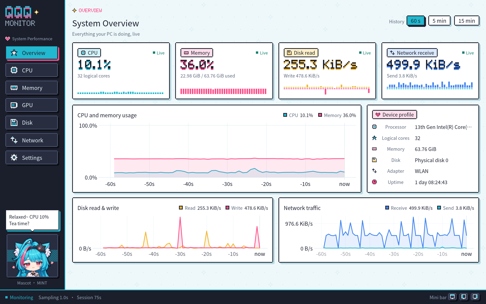
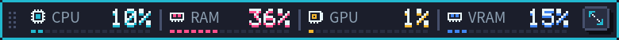
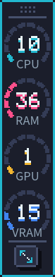
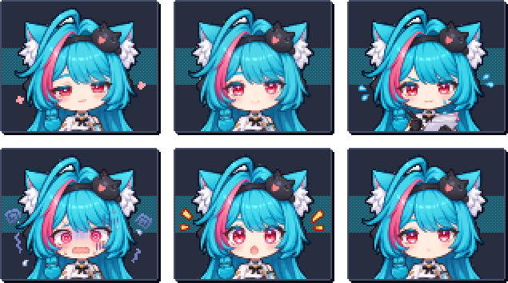
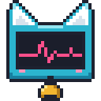
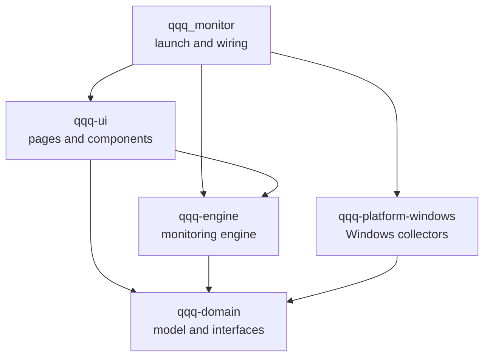
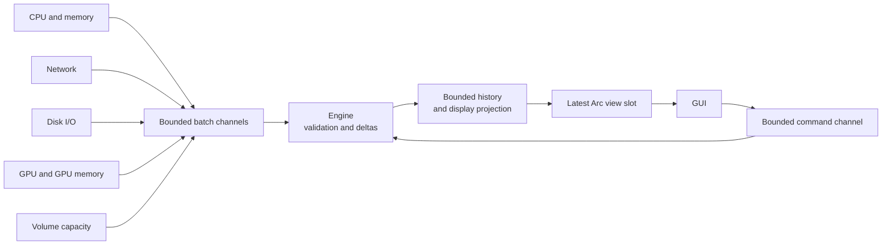

<p align="center">
  
</p>

<h1 align="center">QQQ Monitor</h1>

<p align="center">
  A pixel-art, anime-style performance monitor for Windows, with MINT the mascot keeping an eye on your PC.<br>
  Rust 2024 · egui / wgpu (DX12) · Windows x64 · MIT
</p>

<p align="center">
  <b>English</b> · <a href="README.zh-CN.md">简体中文</a> · <a href="README.ja.md">日本語</a>
</p>

QQQ Monitor is a multi-purpose task manager for Windows, written in Rust. Version 0.1.0 focuses on real-time performance monitoring: it collects CPU, memory, GPU, disk and network data from native Windows APIs, shows history charts and device details in a native GUI, and can dock to a screen edge as an always-on-top mini bar. Process management, alerts and a tray icon are planned for later versions.

## Main window



Navigation and the mascot sit on the left and the current page on the right. The status bar at the bottom shows the monitor state, the sampling interval, the session length and three mini bar buttons.

## Features

### Performance monitoring

| Page | Contents |
| --- | --- |
| Overview | Live cards with pixel mini charts for CPU, memory, disk read and network receive; history charts for CPU and memory, disk read and write, and network traffic; a device profile with the processor model, logical cores, total memory, current disk and adapter, and system uptime |
| CPU | Total usage and its history, the busiest core and a heat grid of logical cores; click a core to see its history |
| Memory | Physical memory usage, used and available capacity, and usage over time |
| GPU | GPU usage from the busiest engine (matching Task Manager), the load of each engine type (3D, copy, video encode and decode, compute and more), dedicated and shared GPU memory; switch between graphics cards and click an engine to see its history |
| Disk | Physical disk read and write rates with history; label, file system, free and total space of every local volume |
| Network | Receive and send rates of the selected adapter, a history chart and the traffic of this session |
| Settings | Language, sampling interval, default history range, animations and edge docking; runtime status, collector diagnostics, history memory and a manual device refresh |

Metric definitions:

- Disk I/O is counted per physical disk; capacity is shown per local volume.
- Network traffic is counted for the selected interface only, so physical adapters and virtual interfaces such as VPNs are measured separately; session traffic is the valid counter growth observed during this run.
- Rates use B/s, KiB/s and MiB/s; capacities use MiB and GiB.
- Every reading carries a state (warming up, live, stale, unsupported, failed, disconnected). Stale data shows its age, and collection outages appear as gaps in the charts.

### History charts

The engine keeps up to 15 minutes of history for every metric, and the buttons at the top right switch between 60-second, 5-minute and 15-minute views. All history stays within 16 MiB; each chart line projects at most 400 points and keeps peaks and valleys when downsampling.

### Edge docking and the mini bar

Drag the window to the top, left or right screen edge and release it: the window collapses into an always-on-top mini bar that keeps showing CPU, memory, GPU and GPU memory usage.

<p align="center">
  <br>
  <sub>Top bar: values above segmented level strips</sub>
</p>

<p align="center">
  <br>
  <sub>Side bar: pixel ring gauges</sub>
</p>

- GPU and GPU memory follow the card selected on the GPU page, which defaults to the card with the most memory.
- Drag the mini bar along its edge or onto another edge. Dropping it away from every edge restores the full window at the drop point; double-clicking the bar or pressing its expand button restores the window's previous position and size.
- The three buttons in the status bar of the main window dock it to the top, left or right edge directly.
- Windows snap and maximize gestures keep their system behavior.
- When the app closes while docked, it starts as the mini bar next time.

### MINT, the mascot

MINT is a girl with long teal hair, a pink streak and fluffy white cat ears. A black cat plush rests on her headband, she wears a white capelet and a black dress, and a golden bell hangs at her collar; the interface colors come from her look. She lives at the bottom of the sidebar and changes her expression and lines with the live CPU and memory load, so the sidebar doubles as a health indicator:

<p align="center">
  
</p>

| Position | Mood | Asset | Trigger |
| --- | --- | --- | --- |
| Top left | Relaxed | `mint-1` | CPU below 15% |
| Top middle | Calm | `mint-4` | Normal load |
| Top right | Busy | `mint-3` | CPU at 50% or memory at 75% |
| Bottom left | Overloaded | `mint-5` | CPU at 85% or memory at 90% |
| Bottom middle | Trouble | `mint-2` | A collector reports an error |
| Bottom right | Waiting | `mint-6` | Waiting for the first CPU and memory readings after start |

The sidebar shows her bust and the Settings page her full figure. The build script `crates/qqq-ui/build.rs` generates both from the illustrations `mint-1` to `mint-6` in [`docs/images/assets`](docs/images/assets): the white background connected to the image border becomes transparent, and every 10 × 10 block of source pixels becomes one sprite pixel. Each sprite pixel is drawn on a whole number of physical pixels, so the edges stay crisp. Replace the illustrations and rebuild to update the mascot. `mint-0` is the project logo.

With animations on, MINT bobs gently once a second. The animation runs on scheduled repaints, so the app redraws rarely while idle.

### Application icon

<p align="center">
  
</p>

The application icon is a pixel monitor with MINT's cat ears: a pink pulse runs across the screen, the cheeks blush and her golden bell hangs below. A multi-size ICO embedded in the EXE serves File Explorer, the title bar and the taskbar; the 16, 24 and 32 pixel versions are drawn by hand so they stay crisp at common scaling factors.

### Interface language

The interface is available in English, 简体中文 (Simplified Chinese) and 日本語 (Japanese). By default it follows the system: at startup it picks the first supported language from the Windows display language preferences, uses Simplified Chinese for every Chinese variant, and falls back to English. The Language row on the Settings page offers System default or a specific language; a click switches the whole interface and the window title at once and saves the choice.

Pages, cards, charts, status and error messages, device names and details, MINT's lines and the startup failure dialog all follow the interface language; the pixel-font captions at the top of each page, numbers and units look the same in every language. All three languages use the embedded Noto Sans CJK SC font.

### Configuration

The Settings page applies changes with Apply & save: the sampling interval (0.5, 1 or 2 seconds), the default history range, animations and edge docking take effect at once, and a background thread writes them to a TOML file. The language takes effect and is saved as soon as you click it. The adapter selection, window position and size, docked edge and mini bar position are saved on close.

| File | Location |
| --- | --- |
| Configuration | `%APPDATA%\qqq_monitor\config\config.toml` |
| Logs | `%LOCALAPPDATA%\qqq_monitor\data\logs`, rotated daily, 7 files kept |

## Getting started

### Requirements

- Windows x64 and a graphics adapter with DX12 support
- Rust 1.99 or newer, target `x86_64-pc-windows-msvc`
- The C++ toolchain and Windows SDK from Visual Studio Build Tools

### Build and run

```powershell
cargo run --release
```

The executable is `target\release\qqq_monitor.exe` and runs as is. A standard user account collects every metric.

### Command-line options

| Option | Effect |
| --- | --- |
| `--smoke-test` | Runs for about 8 seconds, checks that CPU, memory, physical disk I/O, network and volume capacity all have valid readings, and prints every metric including the GPU; exits with code 0 when every check passes |
| `--capture PATH` | Starts the real GUI, saves the window as a PNG after about 8 seconds and exits, leaving the user configuration as it is; the parent folder of `PATH` must exist |
| `--page PAGE` | Page for `--capture`: `overview`, `cpu`, `memory`, `gpu`, `disk`, `network`, `settings` |
| `--dock EDGE` | Starts as the mini bar: `top`, `left`, `right`; with `--capture` it captures the mini bar |
| `--lang LANG` | Starts in an interface language, like choosing it on the Settings page: `zh-CN`, `en`, `ja`; with `--capture` it captures pages in that language |
| `--help` | Lists the options (in Simplified Chinese) |

```powershell
cargo run --release -- --capture "$PWD\target\gpu.png" --page gpu
cargo run --release -- --capture "$PWD\target\dock-left.png" --dock left
cargo run --release -- --capture "$PWD\target\settings-ja.png" --page settings --lang ja
```

## Architecture

The project is a Cargo workspace of four library crates and a launcher package. The domain model and the monitoring engine are independent of Windows and the GUI; the launcher injects the concrete collectors, and the GUI only reads immutable views that the engine publishes.



| Path | Responsibility |
| --- | --- |
| `src/` | Logging setup, wiring, system language detection, the DX12 window and window icon, the command-line smoke test and capture, orderly shutdown |
| `build.rs`, `assets/` | Multi-size application icon and resource script, embedded into the EXE at build time |
| `crates/qqq-domain/` | Devices, metrics, units, reading states and unavailability reasons, plus the `Collector` and `CollectorFactory` interfaces |
| `crates/qqq-platform-windows/` | CPU and memory through sysinfo; network through IP Helper; disk I/O, GPU engines and GPU memory through PDH; graphics cards through DXGI; local volume capacity; monitor work areas and mouse state; the user's display languages; window icons from the EXE resources. Native calls live in `native.rs`, with RAII handle management |
| `crates/qqq-engine/` | Sampling schedule, counter deltas and warm-up, bounded history and display projection, immutable views, configuration (including the interface language) with background saving, and language-neutral command and configuration notices |
| `crates/qqq-ui/` | Seven pages, edge docking and the mini bar, charts and shared components, the theme, pixel drawing (bitmap font, icons, sprites), the mascot (pixel sprites generated from illustrations at build time), interface text in three languages and the embedded CJK font |

### Data flow



- **Collector threads**: every collector creates, uses and releases its resources on its own thread and runs at the sampling interval or a fixed period (30 seconds for volume capacity). A failing collector is recreated with a backoff of 1 to 30 seconds while the others keep working.
- **Backpressure**: every collector buffers at most 8 batches; when the buffer is full, the current batch is dropped and the history records a gap. At most 32 commands are in flight.
- **Non-blocking rendering**: the engine builds views outside the lock, swaps a single `Arc` slot and requests a repaint; every frame, the GUI takes the latest view without blocking and submits history queries as needed.
- **Safety boundary**: the domain, engine, GUI and launcher forbid `unsafe`; Windows FFI lives in `native.rs` of the platform crate.

### Extending

- **New metric**: implement `CollectorFactory` in the platform crate and register it in `collectors()`; the engine runs it through the common pipeline, and pages read it by `MetricKey`.
- **New page**: add a page file and a `Page` route under `crates/qqq-ui/src/pages/`, combine the existing components and declare the metrics the page queries.
- **New language**: add the language and its BCP 47 tag to `Language`, then add its text table under `crates/qqq-ui/src/i18n/`; every language fills every entry of `Strings`, so a missing translation fails to compile.

The [architecture document](docs/ARCHITECTURE.md) covers the interface contracts, threading model, history budget and fault isolation in full.

## Development checks

```powershell
cargo fmt --all -- --check
cargo clippy --workspace --all-targets -- -D warnings
cargo test --workspace --release
cargo run --release -- --smoke-test
```

The automated tests cover rate calculation, warm-up and failure recovery, staleness, the history budget and projection gaps, slow collector isolation, the command limit, configuration saving and corruption protection, GPU counter parsing, docking edge detection and mini bar placement, system language matching, the text table of every language and the width of MINT's lines. Runtime tests drive the complete engine with controllable fake collectors.

## Design documents

The design documents are written in Simplified Chinese.

| Document | Contents |
| --- | --- |
| [Technical plan](docs/TECHNICAL_PLAN.md) | First-release scope, technology choices, metric definitions, GUI visual and interaction guidelines, performance budget and risks |
| [Architecture](docs/ARCHITECTURE.md) | Workspace roles, dependency direction, interfaces, sampling and rendering data flow, error handling and extension steps |
| [Implementation and acceptance plan](docs/IMPLEMENTATION_PLAN.md) | Development phases, delivery order and checkable acceptance criteria |

## License

The code is licensed under the MIT License, see [LICENSE](LICENSE). The embedded Noto Sans CJK SC font is licensed under the SIL Open Font License, see the [font license](crates/qqq-ui/assets/fonts/LICENSE.txt).
