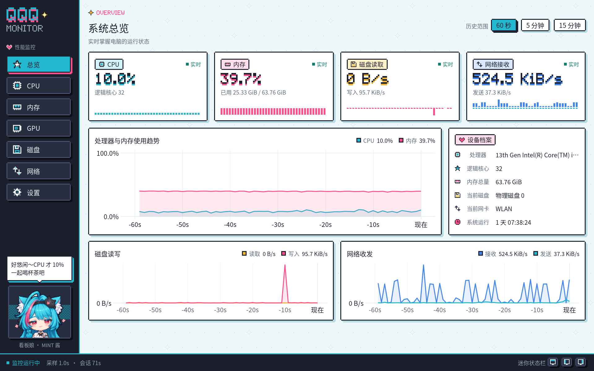
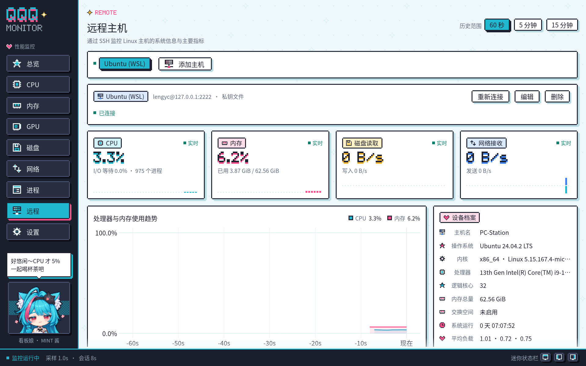
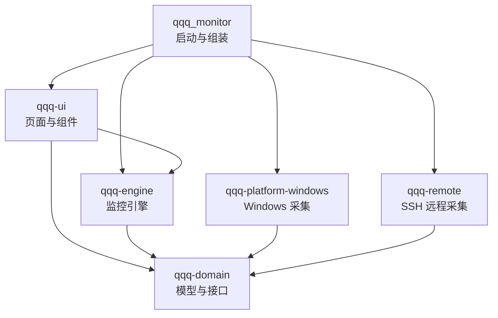
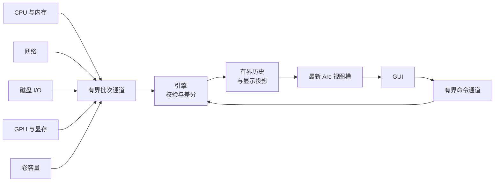

<p align="center">
  
</p>

<h1 align="center">QQQ Monitor</h1>

<p align="center">
  二次元像素风格的 Windows 性能监控器，由看板娘「MINT 酱」陪你看着电脑的状态。<br>
  Rust 2024 · egui / wgpu (DX12) · Windows x64 · MIT
</p>

<p align="center">
  <a href="README.md">English</a> · <b>简体中文</b> · <a href="README.ja.md">日本語</a>
</p>

QQQ Monitor 是一个用 Rust 编写的 Windows 多功能任务管理器。当前版本 0.2.0 聚焦实时性能监控：从 Windows 原生接口采集 CPU、内存、GPU、磁盘与网络数据，以原生 GUI 呈现历史曲线与设备详情，并可吸附到屏幕边缘变成常驻置顶的迷你状态栏，吸附或最小化时收进任务栏托盘；还可以查看并管理 Windows 与运行中的 WSL 发行版里的进程，并通过 SSH 监控一台或多台 Linux 主机。告警列入后续计划。

## 主界面



左侧为导航与看板娘，右侧为当前页面，底部状态栏显示监控状态、采样间隔、会话时长以及三个迷你状态栏按钮。

## 功能

### 性能监控

| 页面 | 内容 |
| --- | --- |
| 总览 | CPU、内存、磁盘读取、网络接收四张实时卡片与像素迷你图；处理器与内存趋势、磁盘读写、网络收发三组历史曲线；设备档案（处理器型号、逻辑核心数、内存总量、当前磁盘与网卡、系统运行时长） |
| CPU | 总使用率与历史曲线、最忙核心、逻辑核心热力网格；点击核心查看其历史 |
| 内存 | 物理内存使用率、已用与可用容量、使用趋势 |
| GPU | 按最忙引擎计算的 GPU 使用率（与任务管理器口径一致）、各类引擎占用（3D、复制、视频编解码、计算等）、专用显存与共享 GPU 内存；可切换显卡，点击引擎查看其历史 |
| 磁盘 | 物理磁盘读写速率与历史；全部本地卷的卷标、文件系统、可用与总容量 |
| 网络 | 选中网卡的接收与发送速率、历史曲线、本次会话累计流量 |
| 进程 | Windows 与每个运行中 WSL 发行版的进程：名称、PID、用户、CPU、内存、线程、优先级与命令行；搜索、按列排序、结束进程与调整优先级 |
| 远程 | 通过 SSH 连接的 Linux 主机：设备档案（主机名、发行版、内核与架构、处理器、内存与交换空间、运行时长、平均负载）、CPU 与内存使用率趋势、所选磁盘读写与网卡收发、文件系统容量、逻辑核心热力格 |
| 设置 | 界面语言、采样间隔、默认历史范围、界面动效、边缘吸附、最小化到托盘、开机自动启动与开机启动时收进托盘开关；运行状态、采集源诊断、历史内存占用与手动刷新设备 |

指标口径：

- 磁盘 I/O 按物理磁盘统计，卷容量按本地卷单独展示。
- 网络统计选中的单个接口，物理网卡与 VPN 等虚拟接口的流量分别计算；会话流量为本次运行观测到的有效计数差。
- 速率单位为 B/s、KiB/s、MiB/s，容量单位为 MiB、GiB。
- 每项读数带有状态（预热、实时、过期、不支持、失败、离线），过期数据会标注数据年龄，采集中断在图表上显示为缺口。

### 历史曲线

引擎为每个指标保留最多 15 分钟历史，页面右上角可切换 60 秒、5 分钟、15 分钟视图。历史总量限制在 16 MiB 以内；图表每条曲线最多投影 400 点，降采样时保留峰谷。

### 边缘吸附与迷你状态栏

把窗口拖到屏幕顶部或左右边缘后松开，窗口会收起为置顶的迷你状态栏，持续显示 CPU、内存、GPU 和显存使用率：

<p align="center">
  <br>
  <sub>顶部横条：数值下方带分段条</sub>
</p>

<p align="center">
  <br>
  <sub>左右竖条：像素环形仪表盘</sub>
</p>

- GPU 与显存跟随 GPU 页面所选显卡，默认选显存最大的显卡。
- 拖动迷你状态栏可沿边缘移动或换到另一条边缘；拖离边缘时在落点恢复完整窗口，双击或点击展开按钮则按吸附前的位置与尺寸恢复。
- 主窗口底部状态栏的三个按钮可直接吸附到顶部、左侧或右侧。
- Windows 自带的贴靠与最大化手势保持系统行为。
- 关闭时处于吸附状态，下次启动直接显示迷你状态栏。

### 任务栏托盘

- 吸附为迷你状态栏时，窗口移出任务栏，任务栏托盘显示程序图标。
- 设置页的“最小化到托盘”默认开启：最小化完整窗口时隐藏窗口，只保留托盘图标。
- 设置页的“开机启动时直接收进托盘”默认开启：登录 Windows 自动启动时不显示窗口，只显示托盘图标，后台照常采样。
- 单击托盘图标或选择右键菜单的“显示主窗口”，恢复并激活完整窗口；选择“退出”则保存配置并关闭程序。

### 进程管理

- 页面顶部在 Windows 与每个运行中的 WSL 发行版之间切换；WSL 未运行时只显示 Windows。
- 搜索框按名称、PID、用户和命令行筛选；点击表头按该列排序，默认按 CPU 从高到低。CPU 为占全部逻辑处理器的比例，内存在 Windows 上为专用工作集，在 WSL 中为常驻内存。
- 选中进程后，用工具栏或右键菜单结束进程、调整优先级（高、高于正常、正常、低于正常、低）；WSL 进程另有“强制结束”。结束前会弹出确认，Delete 键同样可以结束选中的进程。
- Windows 进程以当前账户的权限操作，系统与其他账户的进程需以管理员身份运行；WSL 进程以 root 身份操作，结束与调整优先级前都会核对进程的启动时刻，PID 被新进程复用时操作不会作用到新进程上。
- 只在进程页面显示时读取进程：Windows 每秒一次，WSL 每 2 秒一次。读取前先确认发行版仍在运行，因此不会启动已停止的发行版；查看某个发行版的进程期间，该发行版保持运行。

### 远程主机



- 在「远程」页面点击「添加主机」，填写地址、端口与用户名，再选择登录方式：密码、私钥文件（OpenSSH 或 PuTTY 格式的 Ed25519、ECDSA、RSA 私钥，加密私钥同时填写口令），或 SSH 代理（Windows OpenSSH 认证代理服务或 Pageant 中已加载的密钥）。「从 SSH 配置导入」列出 `~/.ssh/config` 中的主机，选择后自动填入地址、端口、用户名与私钥文件。
- 首次连接时页面显示主机密钥的 SHA-256 指纹，核对无误后点击「信任并连接」；`~/.ssh/known_hosts` 已记录的主机直接连接。主机提供的密钥与信任的密钥不同时停止连接并给出警告，确认后可信任新密钥。
- 每台主机保持一条 SSH 连接，在其上运行一个 POSIX shell，按采样间隔（至少 1 秒）读取 `/proc` 与 `df`。远程主机只需提供 `sh`、`cat`、`df` 等基础命令，busybox 系统同样适用，无需安装任何代理程序。
- 速率按远程主机自身的时钟计算。网卡默认选中默认路由所在的接口；磁盘统计整块物理磁盘；文件系统列出本地文件系统，使用率与 `df` 一致。
- 连接断开、超时或被拒绝时自动重连，等待时间从 2 秒逐步延长到 60 秒。用户名、密码或密钥被拒绝，或主机密钥尚未受信任时，等待用户修改设置或点击「重新连接」，以免反复登录失败触发服务器的封禁策略。
- 远程主机的历史与本机指标一样保留 15 分钟，切换页面不中断采集；删除主机时一并删除它的数据与保存的密码。

### 看板娘 MINT 酱

MINT 酱是一位青色长发、粉色挑染、白绒猫耳的少女，发箍上趴着黑猫玩偶，穿白色短披肩与黑色裙装，领口系着金色铃铛，界面配色也取自她的形象。她常驻侧栏底部，根据实时 CPU 与内存负载切换表情和台词，侧栏因此兼作系统健康指示器：

<p align="center">
  
</p>

| 位置 | 表情 | 素材 | 触发条件 |
| --- | --- | --- | --- |
| 上排左 | 悠闲 | `mint-1` | CPU 低于 15% |
| 上排中 | 平静 | `mint-4` | 负载正常 |
| 上排右 | 忙碌 | `mint-3` | CPU 达到 50% 或内存达到 75% |
| 下排左 | 超载 | `mint-5` | CPU 达到 85% 或内存达到 90% |
| 下排中 | 采集异常 | `mint-2` | 有采集源报告错误 |
| 下排右 | 等待 | `mint-6` | 启动后等待首批 CPU 与内存读数 |

侧栏显示半身像，设置页面显示全身像。两者都由构建脚本 `crates/qqq-ui/build.rs` 从 [`docs/images/assets`](docs/images/assets) 中的 `mint-1` 至 `mint-6` 插画生成：与图片边缘相连的白色背景变为透明，每 10 × 10 个源像素合成一个精灵像素；绘制时每个精灵像素对齐整数个物理像素，边缘保持清晰。替换插画后重新构建即可更新看板娘。`mint-0` 是项目标志。

开启界面动效时，MINT 酱每秒轻轻晃动；动效由定时重绘驱动，空闲时保持低刷新。

### 程序图标

<p align="center">
  
</p>

程序图标是一台长着 MINT 酱猫耳的像素显示器：屏幕上跳动着粉色脉冲，两颊带腮红，下方挂着她的金色铃铛。图标以多尺寸 ICO 嵌入 EXE，资源管理器、标题栏和任务栏共用；16、24、32 像素三版分别手绘，在常见缩放比例下保持像素清晰。

### 界面语言

界面提供简体中文、English 和日本語。默认跟随系统：启动时按 Windows 显示语言的偏好顺序取第一个受支持的语言，中文各地区变体使用简体中文，都不受支持时使用英语。设置页面的「界面语言」可选择「跟随系统」或指定语言，点击后整个界面与窗口标题立即切换，并写入配置。

页面、卡片、图表、状态与异常提示、设备名称与详情、看板娘台词和启动失败提示都跟随界面语言；页面顶部的像素英文小标题、数值与单位在各语言中保持一致。三种语言共用内嵌的 Noto Sans CJK SC 字体。

### 配置

设置页面采用“应用并保存”：采样间隔（0.5、1、2 秒）、默认历史范围、界面动效、边缘吸附与最小化到托盘立即生效，并由后台线程写入 TOML 配置。界面语言在点击时立即生效并保存。开机自动启动在勾选或取消时立即生效：程序在当前用户的 Windows 启动项中添加或移除自身（以 `--autostart` 参数启动），任务管理器的“启动应用”页同样列出这一项；设置页显示这一项的实际状态，包括在任务管理器中禁用后的状态。其下的“开机启动时直接收进托盘”默认开启，在点击时立即生效并保存，开启开机自动启动时可以更改。网卡选择、窗口位置与尺寸、吸附边缘和迷你状态栏位置在关闭时一并保存。远程主机在添加、编辑、删除或信任主机密钥时立即保存；密码与私钥口令保存在 Windows 凭据管理器中，不写入配置文件。

| 文件 | 位置 |
| --- | --- |
| 配置 | `%APPDATA%\qqq_monitor\config\config.toml` |
| 日志 | `%LOCALAPPDATA%\qqq_monitor\data\logs`，按日滚动，保留 7 个文件 |
| 远程主机密码 | Windows 凭据管理器的普通凭据 `qqq_monitor/ssh/<主机 ID>` |

## 快速开始

### 环境要求

- Windows x64 与支持 DX12 的图形适配器
- Rust 1.99 或更新版本，目标 `x86_64-pc-windows-msvc`
- Visual Studio Build Tools 的 C++ 工具链与 Windows SDK

### 构建与运行

```powershell
cargo run --release
```

构建产物位于 `target\release\qqq_monitor.exe`，可直接运行。普通账户即可完成全部采集。

### 命令行参数

| 参数 | 作用 |
| --- | --- |
| `--smoke-test` | 运行约 8 秒，检查 CPU、内存、物理磁盘 I/O、网络、卷容量与 Windows 进程列表均有有效读数，并输出全部指标（含 GPU）与各运行中 WSL 发行版的进程数；全部通过时退出码为 0 |
| `--capture PATH` | 启动真实 GUI，约 8 秒后把窗口保存为 PNG 并退出，用户配置保持原样；`PATH` 的父目录需已存在 |
| `--page PAGE` | 与 `--capture` 配合选择页面：`overview`、`cpu`、`memory`、`gpu`、`disk`、`network`、`processes`、`remote`、`settings` |
| `--dock EDGE` | 以迷你状态栏启动：`top`、`left`、`right`；与 `--capture` 配合可截取迷你状态栏 |
| `--lang LANG` | 以指定界面语言启动，等同在设置页面选择该语言：`zh-CN`、`en`、`ja`；与 `--capture` 配合可截取各语言页面 |
| `--autostart` | 开机自动启动项使用的参数；“开机启动时直接收进托盘”开启时只显示托盘图标 |
| `--help` | 显示参数说明 |

```powershell
cargo run --release -- --capture "$PWD\target\gpu.png" --page gpu
cargo run --release -- --capture "$PWD\target\dock-left.png" --dock left
cargo run --release -- --capture "$PWD\target\settings-ja.png" --page settings --lang ja
```

## 架构

项目是一个 Cargo Workspace，由五个库 crate 和一个启动包组成。领域模型与监控引擎独立于 Windows 和 GUI；具体采集器由启动入口注入，GUI 只读取引擎发布的不可变视图。



| 路径 | 职责 |
| --- | --- |
| `src/` | 日志初始化、依赖组装、系统语言解析、DX12 窗口与窗口图标、命令行冒烟检查与截图、统一关闭 |
| `build.rs`、`assets/` | 多尺寸程序图标与资源脚本，构建时嵌入 EXE |
| `crates/qqq-domain/` | 设备、指标、单位、读数状态与不可用原因、进程实例与进程操作、远程主机的连接端点与会话，以及 `Collector`、`CollectorFactory`、`ProcessPlatform`、`RemotePlatform`、`SecretStore` 接口 |
| `crates/qqq-platform-windows/` | sysinfo 采集 CPU 与内存；IP Helper 采集网络；PDH 采集磁盘 I/O 与 GPU 引擎、显存；DXGI 枚举显卡；本地卷容量；显示器工作区与鼠标状态查询；读取用户显示语言；从 EXE 资源加载窗口图标；任务栏托盘图标、托盘菜单与任务栏按钮；用一次系统调用列出 Windows 进程并结束进程、调整优先级；经 `wsl.exe` 读取与操作运行中 WSL 发行版的进程；在 Windows 凭据管理器中保存远程主机的密码与口令；经当前用户的 `Run` 注册表项开关开机自动启动。原生调用集中在 `native.rs`、`tray.rs`、`process.rs`、`secret.rs` 与 `autostart.rs` 并以 RAII 管理句柄 |
| `crates/qqq-engine/` | 采样调度、计数差分与预热、有界历史与显示投影、按需进程轮询与进程 CPU 使用率、独立线程执行的进程操作、每台远程主机的连接线程与重连策略、不可变视图、配置读写（含界面语言与远程主机）与后台保存、语言中立的命令与配置提示 |
| `crates/qqq-remote/` | SSH 客户端（russh）：密码、私钥与 SSH 代理登录，按信任的密钥或 `known_hosts` 核对主机密钥，在远程主机上运行 POSIX shell 读取 `/proc` 与 `df` 并按远程时钟换算速率；读取 `~/.ssh/config` 供添加主机时导入 |
| `crates/qqq-ui/` | 九个页面（含进程管理与远程主机）、边缘吸附与迷你状态栏、托盘驻留、图表与通用组件、主题、像素绘制（位图字体、图标、精灵）、看板娘（构建时由插画生成像素精灵）、三种语言的界面文本与内嵌 CJK 字体 |

### 数据流



- **独立采集线程**：每个采集源在自己的线程里创建、使用并释放资源，按采样间隔或固定周期（卷容量 30 秒）运行；单个采集源出错时按 1 至 30 秒退避重建，其余采集源照常工作。
- **背压**：每个采集源最多缓存 8 批数据，满载时丢弃当前批次并在历史中留出缺口；在途命令上限 32 个。
- **远程主机**：每台主机一个线程，持有自己的 SSH 连接与单线程 tokio 运行时；读数以 `ssh:<主机 ID>/` 为设备前缀，与本机读数进入同一条校验、历史与投影管线。
- **无阻塞渲染**：引擎在锁外构造视图，只替换一个 `Arc` 槽并唤醒重绘；GUI 每帧非阻塞地取最新视图，按需提交历史查询。
- **安全边界**：领域、引擎、GUI、远程采集与启动包均禁用 `unsafe`，Windows FFI 集中在平台层的 `native.rs`、`tray.rs`、`process.rs`、`secret.rs` 与 `autostart.rs`。

### 扩展方式

- **新增指标**：在平台层实现 `CollectorFactory` 并加入 `collectors()` 注册列表，引擎按统一管线处理，页面通过 `MetricKey` 读取。
- **新增页面**：在 `crates/qqq-ui/src/pages/` 添加页面文件与 `Page` 路由，组合现有组件，并在查询中声明所需指标。
- **新增语言**：在 `Language` 中加入语言与 BCP 47 标签，并在 `crates/qqq-ui/src/i18n/` 添加该语言的文本表；`Strings` 的每一项都由各语言填写，缺少译文时编译失败。

接口契约、线程模型、历史预算与故障隔离的完整说明见 [架构设计](docs/ARCHITECTURE.md)。

## 开发检查

```powershell
cargo fmt --all -- --check
cargo clippy --workspace --all-targets -- -D warnings
cargo test --workspace --release
cargo run --release -- --smoke-test
```

有运行中的 WSL 发行版时，`cargo test -p qqq-platform-windows -- --ignored` 会在其中启动并结束一个测试进程，检查 WSL 进程的结束与优先级调整。

`qqq-remote` 的两个示例可以在本机试用远程监控：`wsl_sshd` 是只监听 127.0.0.1 的开发用 SSH 服务器，把客户端执行的每条命令交给 WSL 发行版运行；`probe` 按程序的方式连接主机并输出三轮读数。先用 `ssh-keygen -t ed25519 -f "$env:TEMP\qqq-host"` 生成主机密钥（口令留空），再运行：

```powershell
cargo run -p qqq-remote --example wsl_sshd -- --host-key "$env:TEMP\qqq-host" --password test
cargo run -p qqq-remote --example probe -- 127.0.0.1 test --port 2222 --password test --trust
```

服务器运行期间，也可以在「远程」页面添加 `127.0.0.1`、端口 `2222`、密码 `test` 的主机。

自动测试覆盖速率计算、预热与失败恢复、过期判定、历史预算与投影缺口、慢采集隔离、命令上限、配置保存与损坏保护、GPU 计数器解析、吸附边缘判定与迷你状态栏定位、进程 CPU 使用率与实例匹配、进程轮询与操作结果、Windows 进程枚举与按实例操作、WSL 进程输出解析、远程主机的连接状态与重连策略、主机密钥核对、Linux `/proc` 与 `df` 输出解析和按远程时钟计算速率、`~/.ssh/config` 导入、Windows 凭据管理器读写，以及系统语言匹配、各语言文本表与看板娘台词宽度；运行时测试使用可控的假采集器驱动完整引擎。

## 发布

`scripts\release.ps1` 发布 `Cargo.toml` 中的当前版本，标签为 `v<版本>`。先提升 `Cargo.toml` 中的版本号并提交，再把 Release 说明写成 Markdown 文件，然后运行：

```powershell
.\scripts\release.ps1 -NotesFile <说明文件>
```

脚本先确认工作区干净、位于 `main` 且与 `origin/main` 同步、标签尚不存在且 GitHub CLI（`gh`）已登录，然后运行上述 fmt、Clippy 与 Release 测试，以静态链接的 C 运行库构建 `x86_64-pc-windows-msvc` Release 版，确认程序不依赖 VC++ 运行库并运行冒烟测试。程序、`LICENSE`、字体许可与三份 README 打包为 `target\dist\v<版本>\qqq_monitor-v<版本>-x86_64-pc-windows-msvc.zip`，同目录生成 `SHA256SUMS.txt`。最后推送 `main` 与附注标签，创建 GitHub Release 并上传这两个文件。

| 参数 | 作用 |
| --- | --- |
| `-NotesFile PATH` | Release 说明的 Markdown 文件，发布时必填 |
| `-PackageOnly` | 只检查、构建和打包，Git 与 GitHub 保持原样 |
| `-Draft` | 以草稿创建 Release |
| `-SkipChecks` | 跳过 fmt、Clippy、测试与冒烟测试 |

## 设计文档

| 文档 | 内容 |
| --- | --- |
| [技术方案](docs/TECHNICAL_PLAN.md) | 首版范围、技术选型、指标口径、GUI 视觉与交互规范、性能预算和风险 |
| [架构设计](docs/ARCHITECTURE.md) | Workspace 分工、依赖方向、接口、采样与渲染数据流、异常处理和扩展步骤 |
| [实施与验收计划](docs/IMPLEMENTATION_PLAN.md) | 开发阶段、交付顺序和可检查的验收标准 |

## 许可

项目代码使用 MIT 许可证，见 [LICENSE](LICENSE)。内嵌的 Noto Sans CJK SC 字体使用 SIL Open Font License，见 [字体许可](crates/qqq-ui/assets/fonts/LICENSE.txt)。
