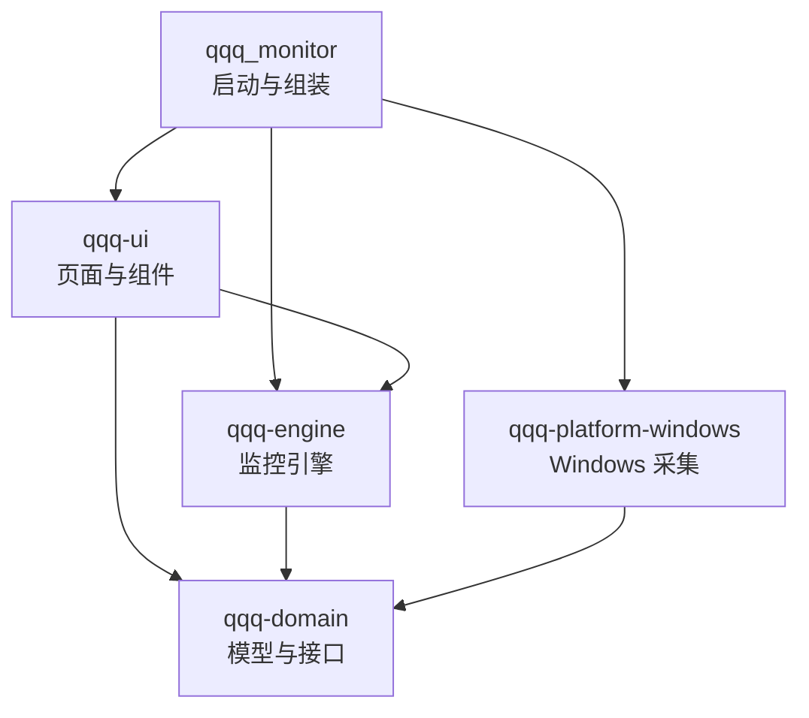
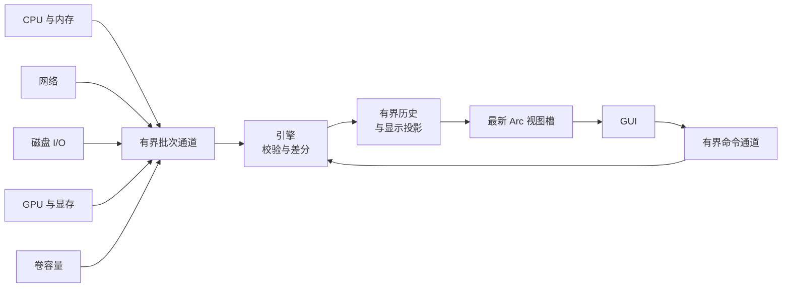

<p align="center">
  
</p>

<h1 align="center">QQQ Monitor</h1>

<p align="center">
  二次元像素风格的 Windows 性能监控器，由看板娘「MINT 酱」陪你看着电脑的状态。<br>
  Rust 2024 · egui / wgpu (DX12) · Windows x64 · MIT
</p>

<p align="center">
  <a href="README.md">English</a> · <b>简体中文</b> · <a href="README.ja.md">日本語</a>
</p>

QQQ Monitor 是一个用 Rust 编写的 Windows 多功能任务管理器。当前版本 0.1.0 聚焦实时性能监控：从 Windows 原生接口采集 CPU、内存、GPU、磁盘与网络数据，以原生 GUI 呈现历史曲线与设备详情，并可吸附到屏幕边缘变成常驻置顶的迷你状态栏。进程管理、告警与托盘功能列入后续计划。

## 主界面


左侧为导航与看板娘，右侧为当前页面，底部状态栏显示监控状态、采样间隔、会话时长以及三个迷你状态栏按钮。

## 功能

### 性能监控

| 页面 | 内容 |
| --- | --- |
| 总览 | CPU、内存、磁盘读取、网络接收四张实时卡片与像素迷你图；处理器与内存趋势、磁盘读写、网络收发三组历史曲线；设备档案（处理器型号、逻辑核心数、内存总量、当前磁盘与网卡、系统运行时长） |
| CPU | 总使用率与历史曲线、最忙核心、逻辑核心热力网格；点击核心查看其历史 |
| 内存 | 物理内存使用率、已用与可用容量、使用趋势 |
| GPU | 按最忙引擎计算的 GPU 使用率（与任务管理器口径一致）、各类引擎占用（3D、复制、视频编解码、计算等）、专用显存与共享 GPU 内存；可切换显卡，点击引擎查看其历史 |
| 磁盘 | 物理磁盘读写速率与历史；全部本地卷的卷标、文件系统、可用与总容量 |
| 网络 | 选中网卡的接收与发送速率、历史曲线、本次会话累计流量 |
| 设置 | 界面语言、采样间隔、默认历史范围、界面动效、边缘吸附开关；运行状态、采集源诊断、历史内存占用与手动刷新设备 |

指标口径：

- 磁盘 I/O 按物理磁盘统计，卷容量按本地卷单独展示。
- 网络统计选中的单个接口，物理网卡与 VPN 等虚拟接口的流量分别计算；会话流量为本次运行观测到的有效计数差。
- 速率单位为 B/s、KiB/s、MiB/s，容量单位为 MiB、GiB。
- 每项读数带有状态（预热、实时、过期、不支持、失败、离线），过期数据会标注数据年龄，采集中断在图表上显示为缺口。

### 历史曲线

引擎为每个指标保留最多 15 分钟历史，页面右上角可切换 60 秒、5 分钟、15 分钟视图。历史总量限制在 16 MiB 以内；图表每条曲线最多投影 400 点，降采样时保留峰谷。

### 边缘吸附与迷你状态栏

把窗口拖到屏幕顶部或左右边缘后松开，窗口会收起为置顶的迷你状态栏，持续显示 CPU、内存、GPU 和显存使用率：

<p align="center">
  <br>
  <sub>顶部横条：数值下方带分段条</sub>
</p>

<p align="center">
  <br>
  <sub>左右竖条：像素环形仪表盘</sub>
</p>

- GPU 与显存跟随 GPU 页面所选显卡，默认选显存最大的显卡。
- 拖动迷你状态栏可沿边缘移动或换到另一条边缘；拖离边缘时在落点恢复完整窗口，双击或点击展开按钮则按吸附前的位置与尺寸恢复。
- 主窗口底部状态栏的三个按钮可直接吸附到顶部、左侧或右侧。
- Windows 自带的贴靠与最大化手势保持系统行为。
- 关闭时处于吸附状态，下次启动直接显示迷你状态栏。

### 看板娘 MINT 酱

MINT 酱是一位青色长发、粉色挑染、白绒猫耳的少女，发箍上趴着黑猫玩偶，穿白色短披肩与黑色裙装，领口系着金色铃铛，界面配色也取自她的形象。她常驻侧栏底部，根据实时 CPU 与内存负载切换表情和台词，侧栏因此兼作系统健康指示器：

<p align="center">
  
</p>

| 位置 | 表情 | 素材 | 触发条件 |
| --- | --- | --- | --- |
| 上排左 | 悠闲 | `mint-1` | CPU 低于 15% |
| 上排中 | 平静 | `mint-4` | 负载正常 |
| 上排右 | 忙碌 | `mint-3` | CPU 达到 50% 或内存达到 75% |
| 下排左 | 超载 | `mint-5` | CPU 达到 85% 或内存达到 90% |
| 下排中 | 采集异常 | `mint-2` | 有采集源报告错误 |
| 下排右 | 等待 | `mint-6` | 启动后等待首批 CPU 与内存读数 |

侧栏显示半身像，设置页面显示全身像。两者都由构建脚本 `crates/qqq-ui/build.rs` 从 [`docs/images/assets`](docs/images/assets) 中的 `mint-1` 至 `mint-6` 插画生成：与图片边缘相连的白色背景变为透明，每 10 × 10 个源像素合成一个精灵像素；绘制时每个精灵像素对齐整数个物理像素，边缘保持清晰。替换插画后重新构建即可更新看板娘。`mint-0` 是项目标志。

开启界面动效时，MINT 酱每秒轻轻晃动；动效由定时重绘驱动，空闲时保持低刷新。

### 程序图标

<p align="center">
  
</p>

程序图标是一台长着 MINT 酱猫耳的像素显示器：屏幕上跳动着粉色脉冲，两颊带腮红，下方挂着她的金色铃铛。图标以多尺寸 ICO 嵌入 EXE，资源管理器、标题栏和任务栏共用；16、24、32 像素三版分别手绘，在常见缩放比例下保持像素清晰。

### 界面语言

界面提供简体中文、English 和日本語。默认跟随系统：启动时按 Windows 显示语言的偏好顺序取第一个受支持的语言，中文各地区变体使用简体中文，都不受支持时使用英语。设置页面的「界面语言」可选择「跟随系统」或指定语言，点击后整个界面与窗口标题立即切换，并写入配置。

页面、卡片、图表、状态与异常提示、设备名称与详情、看板娘台词和启动失败提示都跟随界面语言；页面顶部的像素英文小标题、数值与单位在各语言中保持一致。三种语言共用内嵌的 Noto Sans CJK SC 字体。

### 配置

设置页面采用“应用并保存”：采样间隔（0.5、1、2 秒）、默认历史范围、界面动效与边缘吸附立即生效，并由后台线程写入 TOML 配置。界面语言在点击时立即生效并保存。网卡选择、窗口位置与尺寸、吸附边缘和迷你状态栏位置在关闭时一并保存。

| 文件 | 位置 |
| --- | --- |
| 配置 | `%APPDATA%\qqq_monitor\config\config.toml` |
| 日志 | `%LOCALAPPDATA%\qqq_monitor\data\logs`，按日滚动，保留 7 个文件 |

## 快速开始

### 环境要求

- Windows x64 与支持 DX12 的图形适配器
- Rust 1.99 或更新版本，目标 `x86_64-pc-windows-msvc`
- Visual Studio Build Tools 的 C++ 工具链与 Windows SDK

### 构建与运行

```powershell
cargo run --release
```

构建产物位于 `target\release\qqq_monitor.exe`，可直接运行。普通账户即可完成全部采集。

### 命令行参数

| 参数 | 作用 |
| --- | --- |
| `--smoke-test` | 运行约 8 秒，检查 CPU、内存、物理磁盘 I/O、网络与卷容量均有有效读数，并输出全部指标（含 GPU）；全部通过时退出码为 0 |
| `--capture PATH` | 启动真实 GUI，约 8 秒后把窗口保存为 PNG 并退出，用户配置保持原样；`PATH` 的父目录需已存在 |
| `--page PAGE` | 与 `--capture` 配合选择页面：`overview`、`cpu`、`memory`、`gpu`、`disk`、`network`、`settings` |
| `--dock EDGE` | 以迷你状态栏启动：`top`、`left`、`right`；与 `--capture` 配合可截取迷你状态栏 |
| `--lang LANG` | 以指定界面语言启动，等同在设置页面选择该语言：`zh-CN`、`en`、`ja`；与 `--capture` 配合可截取各语言页面 |
| `--help` | 显示参数说明 |

```powershell
cargo run --release -- --capture "$PWD\target\gpu.png" --page gpu
cargo run --release -- --capture "$PWD\target\dock-left.png" --dock left
cargo run --release -- --capture "$PWD\target\settings-ja.png" --page settings --lang ja
```

## 架构

项目是一个 Cargo Workspace，由四个库 crate 和一个启动包组成。领域模型与监控引擎独立于 Windows 和 GUI；具体采集器由启动入口注入，GUI 只读取引擎发布的不可变视图。



| 路径 | 职责 |
| --- | --- |
| `src/` | 日志初始化、依赖组装、系统语言解析、DX12 窗口与窗口图标、命令行冒烟检查与截图、统一关闭 |
| `build.rs`、`assets/` | 多尺寸程序图标与资源脚本，构建时嵌入 EXE |
| `crates/qqq-domain/` | 设备、指标、单位、读数状态与不可用原因，以及 `Collector`、`CollectorFactory` 接口 |
| `crates/qqq-platform-windows/` | sysinfo 采集 CPU 与内存；IP Helper 采集网络；PDH 采集磁盘 I/O 与 GPU 引擎、显存；DXGI 枚举显卡；本地卷容量；显示器工作区与鼠标状态查询；读取用户显示语言；从 EXE 资源加载窗口图标。原生调用集中在 `native.rs` 并以 RAII 管理句柄 |
| `crates/qqq-engine/` | 采样调度、计数差分与预热、有界历史与显示投影、不可变视图、配置读写（含界面语言）与后台保存、语言中立的命令与配置提示 |
| `crates/qqq-ui/` | 七个页面、边缘吸附与迷你状态栏、图表与通用组件、主题、像素绘制（位图字体、图标、精灵）、看板娘（构建时由插画生成像素精灵）、三种语言的界面文本与内嵌 CJK 字体 |

### 数据流



- **独立采集线程**：每个采集源在自己的线程里创建、使用并释放资源，按采样间隔或固定周期（卷容量 30 秒）运行；单个采集源出错时按 1 至 30 秒退避重建，其余采集源照常工作。
- **背压**：每个采集源最多缓存 8 批数据，满载时丢弃当前批次并在历史中留出缺口；在途命令上限 32 个。
- **无阻塞渲染**：引擎在锁外构造视图，只替换一个 `Arc` 槽并唤醒重绘；GUI 每帧非阻塞地取最新视图，按需提交历史查询。
- **安全边界**：领域、引擎、GUI 与启动包均禁用 `unsafe`，Windows FFI 集中在平台层的 `native.rs`。

### 扩展方式

- **新增指标**：在平台层实现 `CollectorFactory` 并加入 `collectors()` 注册列表，引擎按统一管线处理，页面通过 `MetricKey` 读取。
- **新增页面**：在 `crates/qqq-ui/src/pages/` 添加页面文件与 `Page` 路由，组合现有组件，并在查询中声明所需指标。
- **新增语言**：在 `Language` 中加入语言与 BCP 47 标签，并在 `crates/qqq-ui/src/i18n/` 添加该语言的文本表；`Strings` 的每一项都由各语言填写，缺少译文时编译失败。

接口契约、线程模型、历史预算与故障隔离的完整说明见 [架构设计](docs/ARCHITECTURE.md)。

## 开发检查

```powershell
cargo fmt --all -- --check
cargo clippy --workspace --all-targets -- -D warnings
cargo test --workspace --release
cargo run --release -- --smoke-test
```

自动测试覆盖速率计算、预热与失败恢复、过期判定、历史预算与投影缺口、慢采集隔离、命令上限、配置保存与损坏保护、GPU 计数器解析、吸附边缘判定与迷你状态栏定位，以及系统语言匹配、各语言文本表与看板娘台词宽度；运行时测试使用可控的假采集器驱动完整引擎。

## 设计文档

| 文档 | 内容 |
| --- | --- |
| [技术方案](docs/TECHNICAL_PLAN.md) | 首版范围、技术选型、指标口径、GUI 视觉与交互规范、性能预算和风险 |
| [架构设计](docs/ARCHITECTURE.md) | Workspace 分工、依赖方向、接口、采样与渲染数据流、异常处理和扩展步骤 |
| [实施与验收计划](docs/IMPLEMENTATION_PLAN.md) | 开发阶段、交付顺序和可检查的验收标准 |

## 许可

项目代码使用 MIT 许可证，见 [LICENSE](LICENSE)。内嵌的 Noto Sans CJK SC 字体使用 SIL Open Font License，见 [字体许可](crates/qqq-ui/assets/fonts/LICENSE.txt)。
