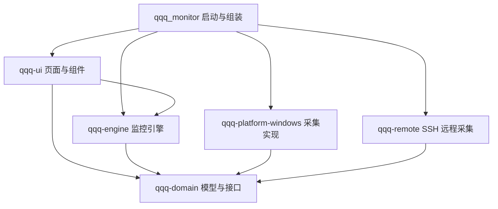
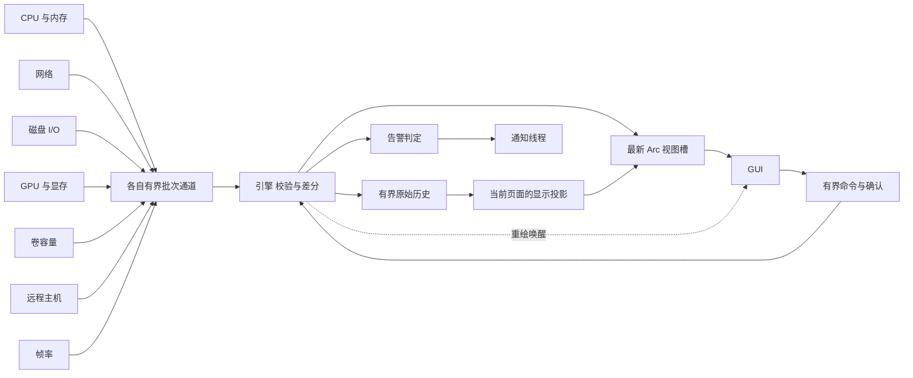

# qqq_monitor 架构设计

本项目已建立一个 Cargo Workspace、五个库 crate 和一个启动包。领域模型与引擎不依赖 Windows 或 GUI；具体采集器由启动入口注入，页面只使用不可变监控视图。本文说明当前实现、扩展契约与已知边界，范围和验收目标分别见 [技术方案](TECHNICAL_PLAN.md) 与 [实施与验收计划](IMPLEMENTATION_PLAN.md)。

## 模块和依赖方向



箭头表示编译依赖。五个库对应不同变化原因：系统接口变化只影响平台层，SSH 协议与远程 Linux 的读取方式归远程采集，指标语义变化进入领域层，调度与历史策略归引擎，布局和交互归 GUI。异步运行时只在远程采集内部承载 SSH 连接，引擎与其他采集使用标准线程；无需新增动态插件、数据库或系统服务即可扩展内置功能。

| 模块 | 当前职责 | 对外接口 |
| --- | --- | --- |
| `qqq-domain` | 设备（含所属远程主机与前台应用的帧率）、指标、单位（含帧每秒与毫秒）、读数状态与不可用原因、采集工厂、进程实例与进程操作、远程主机端点与会话、密码存储、截图图片、剪贴板内容，以及截图与便签快捷键 | `Collector`、`CollectorFactory`、`ProcessPlatform`、`ProcessSource`、`RemotePlatform`、`RemoteSession`、`SecretStore`、`Reason`、`Picture`、`Clip`、`CaptureEnd`、`Hotkey`、`Shortcut` 和模型 |
| `qqq-platform-windows` | sysinfo、IP Helper、PDH、DXGI、卷 GUID、显示器工作区、前台全屏窗口判定、用户显示语言、通知区域图标与任务栏按钮、Windows 进程枚举与操作、经 `wsl.exe` 读取和操作 WSL 进程、Windows 凭据管理器中的密码与口令、当前用户 `Run` 注册表项中的开机自动启动、经 ETW 统计前台应用的帧率与帧时间、以开始菜单快捷方式登记应用标识的 Toast 通知、以管理员身份重新启动、全局截图与便签快捷键、定格屏幕与框选区域的截图窗口、剪贴板的监听与读写、本地时间换算、以默认程序打开文件与用默认浏览器打开网址、原生句柄 RAII | `collectors()`、`frames()`、`processes()`、`secrets()`、`notify()`、`prepare_notifications()`、`restart_elevated()`、`set_hotkey()`、`screenshot_requested()`、`note_requested()`、`start_capture()`、`take_capture()`、`watch_clipboard()`、`take_clipboard()`、`set_clipboard()`、`open_path()`、`open_url()`、`local_time()`、显示器、前台全屏窗口与鼠标状态查询、显示语言列表、窗口图标、托盘图标与任务栏按钮、开机自动启动的读取与开关、安全的启动错误提示 |
| `qqq-remote` | SSH 连接与登录、主机密钥核对、远程 Linux 的 shell 程序与输出解析、按远程时钟换算速率、读取 `~/.ssh/config` | `ssh()`、`secret_name()`；示例 `wsl_sshd` 与 `probe` |
| `qqq-engine` | 采样调度、差分、历史、查询投影、进程轮询与进程 CPU 使用率、进程操作、远程主机线程与重连、按配置开关运行的帧率采集、告警规则判定与通知线程、配置（含界面语言、远程主机、帧率开关、告警规则、截图、剪贴板与便签设置）、命令确认与提示 | `MonitorRuntime`、`Services`、`MonitorClient`、`MonitorView`、`ProcessView`、`RemoteView`、`AlertView`、`AlertRule`、`AlertEvent`、`ConfigStore`、`RemoteHost`、`Language`、`Notice`、`SaveStatus` |
| `qqq-ui` | 十二个独立页面（含帧率、进程管理、远程主机、告警，以及收纳截图、剪贴板管理与便签的小工具）、边缘吸附与迷你状态栏、托盘驻留、截图请求与截图库、剪贴板记录、始终置顶的便签窗口与便签文件、Markdown 的编辑着色与渲染、图表、设备选择、主题、三种语言的界面文本、CJK 字体、看板娘精灵 | `DesktopApp`、`Page`、截图选项、`Desktop` 显示器查询、托盘、开机自动启动、通知、重新启动、截图与便签快捷键、选区截图、剪贴板、打开文件与网址接口、`viewport()` 初始窗口、`i18n` 文本表与告警通知措辞 `i18n::alert` |
| 根包 | 日志、组装、系统语言解析、告警通知的措辞与推送、DX12 窗口、程序图标资源、CLI 冒烟和关闭 | Windows EXE |

领域、引擎、远程采集、GUI 和启动包禁止 `unsafe`。Windows 必要的 FFI 集中在 `native.rs`、`tray.rs`、`process.rs`、`secret.rs`、`autostart.rs`、`frames.rs`、`fullscreen.rs`、`notify.rs`、`capture.rs` 与 `clipboard.rs`，说明每个调用的句柄、缓冲区和生命周期条件；调用方只看到安全接口。

## 当前目录

```text
qqq_monitor/
├── Cargo.toml                       # Workspace、依赖和 Rust 版本
├── Cargo.lock
├── build.rs                         # 编译并嵌入图标资源
├── assets/
│   ├── qqq_monitor.ico              # 多尺寸程序图标
│   └── qqq_monitor.rc               # Windows 资源脚本
├── src/
│   ├── main.rs                      # GUI、冒烟、截图、关闭
│   └── bootstrap.rs                 # 日志初始化
├── scripts/
│   └── release.ps1                  # 检查、构建、打包并发布 GitHub Release
├── crates/
│   ├── qqq-domain/src/
│   │   ├── lib.rs
│   │   ├── metric.rs                # 指标键、单位、采样、状态和原因
│   │   ├── device.rs                # 身份、类型、在线状态、详情
│   │   ├── collector.rs             # 工厂、周期、批次和错误
│   │   ├── process.rs               # 进程宿主、实例标识、优先级、快照与进程操作接口
│   │   ├── remote.rs                # 远程主机端点、登录方式、会话、平台与密码存储接口
│   │   └── clip.rs                  # 截图图片、剪贴板内容、截图结果与快捷键
│   ├── qqq-platform-windows/src/
│   │   ├── lib.rs                   # 内置工厂注册
│   │   ├── cpu_memory.rs            # 持久 System 实例
│   │   ├── network.rs               # 网卡计数与身份
│   │   ├── disk_io.rs               # 物理磁盘 PDH 读写
│   │   ├── gpu.rs                   # 显卡利用率与显存聚合
│   │   ├── inventory.rs             # 本地卷发现与容量
│   │   ├── native.rs                # IP Helper、PDH、DXGI、卷、显示器、显示语言、以管理员身份重新启动、本地时间与打开文件
│   │   ├── process.rs               # Windows 进程枚举、命令行与所有者、结束与优先级
│   │   ├── wsl.rs                   # 运行中的 WSL 发行版及其进程的读取与操作
│   │   ├── secret.rs                # Windows 凭据管理器中的密码与口令
│   │   ├── autostart.rs             # 当前用户启动项中的开机自动启动
│   │   ├── frames.rs                # ETW 会话、前台应用与帧率统计
│   │   ├── fullscreen.rs            # 前台全屏窗口判定与前台切换钩子
│   │   ├── notify.rs                # 开始菜单快捷方式与 Toast 通知
│   │   ├── capture.rs               # 定格屏幕与框选区域的截图窗口
│   │   ├── clipboard.rs             # 剪贴板监听、读取与写入
│   │   └── tray.rs                  # 通知区域图标、托盘菜单、任务栏按钮与截图、便签快捷键
│   ├── qqq-remote/
│   │   ├── src/
│   │   │   ├── lib.rs               # SSH 远程平台与密码名称
│   │   │   ├── session.rs           # 连接、登录、主机密钥核对与常驻 shell
│   │   │   ├── linux.rs             # 远程 shell 程序、输出解析与速率换算
│   │   │   └── presets.rs           # ~/.ssh/config 中的主机
│   │   └── examples/
│   │       ├── wsl_sshd.rs          # 把命令交给 WSL 执行的开发用 SSH 服务器
│   │       └── probe.rs             # 按程序方式连接主机并输出读数
│   ├── qqq-engine/
│   │   ├── src/
│   │   │   ├── lib.rs
│   │   │   ├── runtime.rs           # 线程、命令、退出与故障隔离
│   │   │   ├── normalize.rs         # 实际时间差、预热与数据验证
│   │   │   ├── history.rs           # 有界历史和显示投影
│   │   │   ├── process.rs           # 进程轮询、CPU 使用率与进程操作线程
│   │   │   ├── remote.rs            # 远程主机线程、连接状态与重连
│   │   │   ├── alert.rs             # 告警规则、判定与通知线程
│   │   │   ├── view.rs              # 不可变 GUI 无关视图
│   │   │   ├── config.rs            # 界面语言、校验、恢复和后台保存
│   │   │   └── notice.rs            # 命令与配置提示、设置状态
│   │   └── tests/runtime_flow.rs    # 可控假采集器与假远程平台的运行时测试
│   └── qqq-ui/
│       ├── build.rs                 # 由看板娘插画生成像素精灵
│       ├── assets/fonts/            # Noto Sans CJK SC 和 OFL 许可
│       └── src/
│           ├── lib.rs
│           ├── app.rs               # 导航、查询、UI 状态和生命周期
│           ├── dock.rs              # 边缘吸附、窗口几何与初始窗口
│           ├── minibar.rs           # 吸附时的迷你状态栏
│           ├── tray.rs              # 托盘驻留：图标、任务栏按钮与最小化隐藏
│           ├── shots.rs             # 截图库：后台线程保存、列出、读取与清理 PNG
│           ├── clips.rs             # 剪贴板记录、去重与内存上限
│           ├── note.rs              # 便签窗口：置顶的独立窗口、编辑、预览与便签列表
│           ├── notes.rs             # 便签文件：后台线程列出、读取、写入与删除 Markdown 文件
│           ├── markdown.rs          # Markdown 的编辑着色、解析与渲染
│           ├── theme.rs             # 配色、字体、控件和卡片
│           ├── pixel.rs             # 像素图标、位图字体与精灵
│           ├── mascot.rs            # 看板娘表情、精灵纹理与角色卡
│           ├── components.rs        # 格式、图表、状态、设备名称与选择
│           ├── i18n.rs              # 当前语言、文本表结构与措辞入口
│           ├── i18n/
│           │   ├── zh.rs            # 简体中文文本表
│           │   ├── en.rs            # 英语文本表
│           │   └── ja.rs            # 日语文本表
│           └── pages/
│               ├── mod.rs
│               ├── overview.rs
│               ├── cpu.rs
│               ├── memory.rs
│               ├── gpu.rs
│               ├── frames.rs
│               ├── disk.rs
│               ├── network.rs
│               ├── processes.rs
│               ├── remote.rs
│               ├── alerts.rs
│               ├── tools.rs             # 小工具：截图、剪贴板与便签的切换，快捷键的录制与注册
│               ├── screenshots.rs
│               ├── clipboard.rs
│               ├── notes.rs
│               └── settings.rs
└── docs/
    ├── TECHNICAL_PLAN.md
    ├── ARCHITECTURE.md
    ├── IMPLEMENTATION_PLAN.md
    └── images/                      # 各语言 README 的截图、标志与看板娘图
        └── assets/                  # 看板娘插画 mint-0 至 mint-6
```

调度、命令与客户端暂集中在 `runtime.rs`，历史与投影集中在 `history.rs`；继续增长时可在原 crate 内拆分普通模块。页面已独立分文件，页面模块是 `app` 的内部子模块，可以访问必要的 UI 状态，无需将状态字段暴露为公共 API。

## 设备和指标契约

`DeviceDescriptor` 包含会话 ID、可选的跨启动身份 persistent_id、类型、名称、在线状态和详情。名称取系统提供的名称，如 CPU 型号、网卡别名、显卡描述和卷挂载点；内存、本机、物理磁盘与逻辑核心由系统留空，GUI 按类型和 ID 中的序号以当前语言命名。详情是稳定键与值的列表，键包括 `logical_cores`、`os`、`description`、`interface_guid`、`interface_type`、`link_speed`、`vendor`、`memory_type`、`adapter_luid`、`counter_instance`、`volume_label`、`file_system`、`volume_guid`、`kernel`、`architecture`、`default_route`、`device`、`process_id`、`present_api`；枚举值同样使用稳定标记，`interface_type` 为 `physical` 或 `virtual`，`memory_type` 为 `dedicated` 或 `shared`，`default_route` 为 `yes`，`present_api` 为 `dxgi` 或 `d3d9`。GUI 负责措辞键名与标记。主键以身份而非名称构建：`cpu`、`core:索引`、`memory`、`system`、`disk:设备号`、`volume:卷GUID`、`net:LUID`、`gpu:adapter LUID`、`frames`，远程主机的设备另加 `ssh:主机ID/` 前缀。物理磁盘设备号与 LUID 用于本次会话；跨启动保存时使用 `DeviceDescriptor::identity()`，即有 persistent_id 时取它、否则取设备 ID：网卡的 persistent_id 为接口 GUID，显卡为 PCI 标识 `pci:厂商:设备:子系统:修订`，同型号的第二块起追加 `#序号`。网卡选择保存接口 GUID，启动后重新解析为本次 LUID。

`MetricKey` 由设备 ID 和指标名组成，例如 `(cpu, usage)`、`(memory, available)`、`(disk:0, read)`、`(net:LUID, receive)`、`(gpu:LUID, memory_usage)`。GPU 设备提供 `usage`、每类引擎的 `engine:类型`（如 `engine:3d`、`engine:videodecode`）、按显卡类型选取的 `memory_used`、`memory_total`、`memory_usage`，以及 `dedicated_used`、`dedicated_total`、`shared_used`、`shared_total`。引擎类型出现后持续上报，空闲时为 0。`MetricDescriptor` 声明单位；`MetricSample` 额外包含真实单调时间和 `SampleValue`：

- `Gauge(f64)` 是已经归一化的值，包括 CPU 百分比、容量和 PDH 格式化 B/s。
- `Counter(u64)` 是累计计数；当前用于网络字节，由引擎计算速率。
- `WarmingUp`、`Unsupported(Reason)`、`Failed(Reason)` 保留状态与原因，不能用零代替。`Reason` 是语言中立的枚举，例如显卡缺少性能计数器、卷容量暂不可用、设备断开、采集线程异常，以及带 API 名与状态码的系统调用失败；采集源整体失败的 `CollectorError` 与诊断中的采集源错误同样携带 `Reason`。

引擎检查单位一致、采样时刻不倒退，以及同一个指标键不被两个采集源覆盖。百分比要求 0 至 100；所有 Gauge 要求非负且有限。合法零流量仍为有效数据。

`MetricReading` 保存当前值、会话字节、状态、失败原因、最后成功时刻、最后尝试时刻和周期。无效采样保留上次成功值，但卡片和图表标注其状态和数据年龄。状态包括 `WarmingUp`、`Ready`、`Stale`、`Unsupported`、`Failed`、`Offline`；过期阈值为 `max(3 × 周期, 3 秒)`，30 秒容量指标不会在 3 秒后过期。

`Unit` 包括百分比、字节、字节每秒、秒、计数、帧每秒和毫秒，计数用于平均负载与进程数这类纯数值。

前台应用的帧率设备 `frames` 类型为 `DeviceKind::Frames`，名称为统计对象的程序名，详情为 `process_id` 与统计的交换链所用的 `present_api`；指标为 `fps`（帧每秒）、`frame_time` 与 `frame_time_max`（毫秒）。前台应用尚未呈现画面时三项为 `Unsupported(NoFrames)`；停止呈现时 `fps` 为 0、帧时间为 `Unsupported(NoFrames)`；切换统计对象的那一轮三项为 `WarmingUp`，历史随之留出缺口。

远程主机的设备以 `ssh:主机ID/` 为前缀，后接会话报告的本地 ID，例如 `ssh:web/cpu`、`ssh:web/core:3`、`ssh:web/net:eth0`、`ssh:web/disk:sda`、`ssh:web/volume:/home`；`DeviceDescriptor.host` 记录所属主机，本机设备为 `None`，本机页面只列出本机设备。远程设备沿用本机的类型与指标名：`system` 名称为主机名，详情为 `os`、`kernel`、`architecture`，指标为 `uptime`、`load1`、`load5`、`load15`、`processes`；`cpu` 名称为处理器型号，指标为 `usage` 与 `iowait`；`memory` 另有 `swap_total`、`swap_used` 与有交换空间时的 `swap_usage`；网卡另有开机以来的累计字节 `received`、`sent`，详情 `default_route` 标记默认路由所在接口；卷的详情为 `device` 与 `file_system`。

卷容量与物理磁盘 I/O 保持独立。当前未实现卷到物理磁盘的多对多映射，不把 I/O 硬套到盘符，也不加总虚拟网卡与物理网卡的流量。

## 采集接口

当前公共接口如下，完整定义见领域 crate：

```rust
pub trait Collector {
    fn collect(&mut self, context: &CollectContext)
        -> Result<SampleBatch, CollectorError>;
}

pub trait CollectorFactory: Send + Sync {
    fn descriptor(&self) -> CollectorDescriptor;
    fn create(&self) -> Result<Box<dyn Collector>, CollectorError>;
}
```

`CollectorDescriptor` 包含稳定的采集源 ID 和 `SamplingPeriod`：跟随用户配置或固定周期。启动入口通过 `MonitorRuntime::start_with_services(factories, services, loaded)` 注入采集器以外的平台服务：`Services` 包含进程平台、远程平台、帧率采集工厂 `frames` 与告警通知回调 `notify`，`Default` 为全部关闭；`start_with_remote` 等较短的入口以默认值补齐其余服务。工厂跨线程，Collector 本身不要求 `Send`。实际采集对象在所属线程创建、使用和销毁，避免跨线程移动 PDH 句柄等线程相关资源；初始化由工厂完成，释放由 RAII 完成。

`SampleBatch` 提供设备、采样、开始和结束时间，以及 `complete_inventory` 标志。只有权威完整目录才能把缺席设备标记离线；预热期间返回空的部分批次不会误删设备。单指标失败进入该指标的 SampleValue，采集源整体失败返回 Result 错误并触发退避。

## 线程和数据流

| 执行位置 | 内容 | 周期 |
| --- | --- | --- |
| GUI 主线程 | eframe 布局、输入和渲染；托盘图标、截图与便签快捷键与剪贴板变化的消息；截图选区窗口；便签窗口 | 输入、状态变化，或新快照发布 50 ms 后；窗口隐藏到托盘或最小化时只由托盘、快捷键、剪贴板变化、通知点击、截图库与便签存储唤醒；便签窗口只在自身的输入、光标闪烁与保存结果时绘制 |
| 引擎线程 | 归一化、历史、投影和命令 | 批次、远程主机更新、进程表、命令或保存结果到达时；空闲时每秒发布一次 |
| CPU/内存线程 | 复用 sysinfo System | 0.5、1 或 2 秒 |
| 网络线程 | GetIfTable2Ex 以不含统计的级别列出接口；GetIfEntry2 逐个读取保留网卡的字节、身份和状态 | 跟随采样间隔；目录随批次更新 |
| 磁盘线程 | 持久 PDH 查询和实例数组 | 跟随采样间隔 |
| GPU 线程 | 持久 PDH 引擎与显存查询；DXGI 枚举硬件 adapter | 跟随采样间隔；计数器出现未知 adapter 时最多每 10 秒重新枚举 |
| 进程轮询线程 | 列出 GUI 正在查看的宿主的进程，并列出可用宿主 | 仅在进程页面显示时运行：Windows 为采样间隔且至少 1 秒，WSL 为采样间隔且至少 2 秒；宿主每 5 秒重新列出 |
| 进程操作线程 | 结束进程与调整优先级 | 收到操作命令时执行，完成后立即重新轮询 |
| 卷线程 | 发现本地卷并刷新容量 | 30 秒，支持手动提前刷新 |
| 远程主机线程 | 每台主机一个：连接、登录、启动远程 shell，读取 `/proc` 与 `df` | 采样间隔且至少 1 秒；可自行恢复的失败按 2、4、8、16、30、60 秒退避重连 |
| 帧率线程 | 开启帧率监控时创建 ETW 会话，读取前台窗口所属进程的帧；关闭时释放采集器并停止会话 | 跟随采样间隔；关闭期间等待开关打开 |
| 帧率事件线程 | `ProcessTrace` 接收 DXGI 与 Direct3D 9 的 Present 事件，存入共享队列 | 会话缓冲区写满或每秒交付一次 |
| 告警通知线程 | 显示触发的告警通知 | 收到告警时 |
| 配置写线程 | UTF-8 TOML 临时写入与替换 | 有待保存配置时写入 |
| 截图存储线程 | 保存截图 PNG、列出截图目录并生成缩略图、读取与删除截图、按保留数量清理 | 收到任务时 |
| 便签存储线程 | 列出并读取便签文件，写入、清空与删除便签 | 收到任务时 |

CPU/内存与网络使用独立线程，使网络 API 变慢也不会拖延 CPU 更新。sysinfo 未启用内部 multithread feature。网络线程先列出全部接口，按类型与标志保留网卡，再只为保留的网卡读取统计：每次统计读取都会查询该接口的驱动栈并让线程等待一次，查询次数由此与保留网卡数相同，过滤模块只出现在列出结果中。列出与逐个读取之间消失的接口随即略过，下一次列出同样没有它，目录保持完整。设备目录直接随网络和磁盘采样更新，首版不再额外维护一个 10 秒的身份发现线程。

后台线程只在有事可做、到达自身截止时刻或程序退出时醒来。采集、进程轮询与远程主机线程在读取设置前记下一个变化计数，再按截止时刻等待；引擎改变采样间隔或帧率开关、切换查看的进程宿主、请求刷新、重连或停止远程主机，以及程序退出时，在锁内递增计数并唤醒它们，计数在等待前已经变化时等待立即返回。采集源、远程主机、进程轮询、配置写线程与 GUI 命令交出数据后敲响引擎的单格门铃；引擎每轮处理完各通道，仍有积压就立即继续，否则在门铃上等待，最长到下一次每秒发布。配置写线程、进程操作线程与告警通知线程阻塞在各自的通道上。



历史和投影在锁外构造，共享锁只替换 Arc。GUI 用 `try_latest_view` 非阻塞克隆最新 Arc，取不到时保留当前视图；不会读取 sysinfo、Win32 或可变历史。引擎每次发布视图后调用注入的线程安全回调，自身不依赖 egui。GUI 的回调请求 50 ms 后重绘，同一采样轮内各采集源先后发布的视图由此合并为一次绘制。窗口隐藏到托盘或最小化时回调直接返回，GUI 线程保持休眠；托盘图标、快捷键、剪贴板变化、通知点击、截图库与便签存储经各自的唤醒照常送达，窗口重新出现时由自身的事件重绘并取用最新视图。

eframe 的 `logic` 消费视图、命令结果和退出事件；`ui` 只绘制页面并提交查询。窗口停止绘制不影响后台历史。最小化的窗口只运行 `logic`，便签窗口在屏幕上时另调用 `ui`；隐藏到托盘的窗口 eframe 仍按可见窗口调用 `ui` 并呈现。这两种情况下 `ui` 只登记便签窗口、页面留空，看板娘与滚动动画随之停止预约重绘。托盘请求由 `logic` 处理，重新显示窗口的那一帧先完整绘制页面，窗口随后出现。未设置连续 60 FPS 装饰动画，最小化降频和恢复体验仍列入人工验收。

## 背压和采样时序

| 数据 | 上限 | 满载策略 |
| --- | --- | --- |
| 每个采集源批次 | 8 批 | try_send 丢弃当前批次，累计丢批；后续批次携带该计数 |
| 每台远程主机的更新 | 16 条 | 批次按采集源同样累计丢批；连接状态由后续批次或失败再次确定 |
| 最新 UI 视图 | 1 个 Arc 槽 | 替换旧视图，不排队显示快照 |
| 在途命令 | 32 个 | 立即返回繁忙；消费结果后释放名额 |
| 命令结果 | 32 个 | 在途名额包含未消费结果，保证正常运行时每个接受请求有结果 |
| 配置待保存 | 1 个 | 保留最新配置；被合并请求收到 Superseded |
| 待显示的告警通知 | 8 条 | 丢弃当前通知并记录警告；告警状态与最近告警照常更新 |
| 两次读取间的帧事件 | 65536 个 | 停止追加，下一次读取后恢复 |

引擎按限额轮询各源，避免单一采集源饿死命令和其他源。丢批之后插入历史缺口，清除该来源速率基线，不能用平滑曲线隐藏丢失。

调度使用 Instant 和截止点推进；落后多个周期时跳过旧任务，避免密集补跑。网络速率按实际经过时间求差；第一轮、回退、失败后恢复、丢批或超过三倍周期时重新预热。CPU 和 PDH 同样在首次或长间隔后先预热。异常长间隔用于识别可能的睡眠恢复，但完整的 Windows 电源事件和睡眠场景尚未验收。

## 历史与内存约束

原始历史只有引擎能写，按 MetricKey 保存 VecDeque。最长 900 秒、每序列最多 1801 点，全局历史预算 16 MiB；超出预算时按最老序列分批裁剪并收缩容量。计费包含 deque 分配容量、键字符串容量和条目结构，属于历史存储的近似预算，不包含 BTreeMap 节点分配器开销、GUI Arc 或图形资源。

当前查询最多 16 条序列，每条投影最多 400 点，GUI 各页面实际请求不超过 6 条。降采样保持峰谷时间顺序；混合有效值和缺口的桶保守保留缺口，避免画出跨越故障的连线，可能舍弃同桶部分有效细节。投影不覆盖原始数据，也不在每帧复制全部历史。

CPU 核心网格使用最新读数，点击核心后才请求其历史。离线设备及相关指标在历史过期后清理，名称变化不会生成第二套身份。

## GUI 状态和配置

主线程持有页面、所选设备、历史范围、设置草稿和当前已接受配置。`MonitorView` 提供指标、目录、投影、诊断和保存状态；`MonitorClient` 提供非阻塞取视图、提交命令、消费结果和注入唤醒。

设置采用“应用并保存”：校验后先改变引擎采样周期，再由后台保存。保存失败显示“设置已应用，但未保存”。命令错误、配置校验与读取提示是语言中立的 `Notice`，设置状态是 `SaveStatus`（已加载、按默认值恢复、保存中、已保存、已应用但未保存），GUI 显示时按当前语言措辞。状态栏显示每个命令的失败提示；连续保存时只采用最新一次保存的结果，保存成功只清除保存失败留下的提示，其他命令与界面自身的提示照常保留。选择网卡只保存当前已接受配置和接口 GUID，不顺带提交设置页面尚未应用的草稿；正常关闭保存已接受配置与窗口几何信息。

配置按字段恢复类型或范围错误，语法损坏时保留原文件并提示。未经用户主动保存，不自动替换损坏文件。保存使用同目录临时文件、UTF-8、sync_all、关闭句柄、rename 替换；失败不先删除旧配置，只清理本次临时文件。

窗口吸附由 `dock.rs` 管理。启动入口注入 `Desktop`：按点查询所在显示器的边界与工作区、判断某点是否落在任何显示器上、判断某点所在显示器上是否有其他进程的全屏窗口处于前台、跟随前台窗口切换，以及读取鼠标按键状态，均为物理像素，由平台层实现。窗口位置变化后，等到窗口静止 0.2 秒且没有按住鼠标键才判定一次移动结束；尺寸未变的纯移动若触及没有相邻显示器的顶部、左侧或右侧工作区边缘，就去掉标题栏、置顶并缩为迷你状态栏。系统贴靠和最大化会改变尺寸，因此保持系统行为。迷你状态栏被拖动后，24 逻辑像素内靠近某条开放边缘则贴齐该边缘，离开所有边缘则在落点恢复完整窗口并限制在工作区内；双击或展开按钮按吸附前的位置、尺寸和最大化状态恢复。只有用户移动后的静止参与判定，应用自身几何命令带来的变化只更新基准。`viewport()` 按配置直接创建完整窗口或迷你状态栏，关闭时保存吸附边缘、迷你状态栏位置和完整窗口几何信息。吸附期间，平台层用进程外 WinEvent 钩子跟随其他进程的前台切换并唤醒 GUI，`Dock` 每帧判断迷你状态栏所在显示器上是否有全屏窗口处于前台：前台窗口属于其他进程且覆盖整个显示器即为全屏，桌面窗口与带标题栏的最大化窗口按普通窗口处理。全屏窗口在前台时，迷你状态栏经 `ViewportCommand::MousePassthrough` 让鼠标穿透，点击、移动与光标全部交给前台程序；前台回到普通窗口或恢复完整窗口时取消穿透，拖动、双击与展开按钮照常工作。

托盘驻留由 `tray.rs` 管理。窗口创建后，启动入口把窗口句柄和重绘回调交给平台层，平台层在 GUI 线程创建一个隐藏的顶层窗口承载通知区域图标，GUI 已有的消息循环为它投递图标点击、右键菜单和资源管理器重启后的 `TaskbarCreated` 广播。`Desktop` 为此提供显示或更新图标、移除图标、读取打开请求、显示或移除任务栏按钮，以及隐去或恢复窗口绘制五个接口。吸附为迷你状态栏时，迷你状态栏留在屏幕边缘，窗口的任务栏按钮移除并显示托盘图标；`minimize_to_tray` 开启时，最小化的完整窗口隐藏并显示托盘图标。单击图标、在图标上按 Enter 或选择菜单的“显示主窗口”会显示并激活窗口，吸附状态下按吸附前的几何信息恢复完整窗口；菜单的“截图”在菜单离开屏幕后开始截图，“便签”显示便签窗口，“退出”向窗口发送关闭消息，经正常关闭流程保存配置。任务栏按钮通过 `ITaskbarList` 在窗口可见后移除；GUI 在每帧的几何命令之前同步图标与按钮，使按钮状态跟随已经生效的窗口样式。资源管理器重启后，平台层在本线程各窗口处理完广播后重新添加图标并再次移除按钮。图标文字随界面语言更新，程序退出时移除图标；截图模式保持任务栏原状。

开机自动启动由平台层 `autostart.rs` 管理，状态以当前用户的系统启动项为准。当前用户 `Software\Microsoft\Windows\CurrentVersion\Run` 下名为 `QQQ Monitor` 的字符串值保存带引号的当前 EXE 路径和 `--autostart` 参数；任务管理器与 Windows 设置的“启动应用”关闭某一项时，在 `Explorer\StartupApproved\Run` 下写入同名标记，标记首字节为奇数表示已关闭。启动项与当前 EXE 的命令行一致（路径不区分大小写）且没有关闭标记时视为开启。开启时写入 `Run` 值并清除标记，关闭时移除两者。`Desktop` 为此提供读取状态和开关两个接口；设置页每次打开时读取一次，勾选或取消立即生效并重新读取，失败以 `Notice::AutostartUnchanged` 显示在状态栏；其下的 `autostart_to_tray` 与语言选择一样立即应用并保存。

以 `--autostart` 参数启动且 `autostart_to_tray` 开启（默认）时，窗口从托盘开始。eframe 在绘制第一帧后总会显示新窗口，因此 GUI 在窗口出现前经 `Desktop` 以 DWM 隐去窗口的绘制（`DWMWA_CLOAK`），第一帧发出隐藏命令，下一帧窗口已经隐藏后再恢复绘制；此后窗口与最小化到托盘的窗口相同，只显示托盘图标，后台照常采样，单击图标显示完整窗口，吸附配置下按吸附前的几何信息恢复。托盘建立成功是从托盘开始的前提，平台层未能建立托盘时窗口照常显示。`autostart_to_tray` 关闭时，程序按配置恢复上次关闭时的完整窗口或迷你状态栏；截图模式始终显示窗口。

`minibar.rs` 只读取最新视图中的 CPU、内存和 GPU 页面所选显卡的读数，所选显卡默认取在线且显存总量最大的 GPU；开启帧率监控时另加前台应用的 FPS，按 120 FPS 点满，低于 50 转橙、低于 30 转红。过期值变暗保留，不可用时显示 `—`。顶部横条绘制数字与分段条，左右竖条按物理像素栅格逐格计算 270° 环形仪表盘，分段点亮。迷你状态栏的尺寸随 FPS 一项增减：顶部横条 520 × 34 或 640 × 34，左右竖条 52 × 262 或 52 × 316；吸附期间开关变化时按新尺寸重新贴边。

GUI 复用指标卡片、历史图表、状态和设备选择组件；十二个页面在独立文件维护，小工具页面的截图与剪贴板各占一个文件，CPU 核心与 GPU 引擎共用热力格组件。侧栏导航按钮按窗口高度在 26 至 40 逻辑像素之间取值，先为看板娘角色卡（按两行台词计算高度）留出空间，窗口过矮时角色卡隐藏、按钮取最小高度。主题、格式、界面文本和 CJK 字体集中管理，容量、速率和时间显示不改变指标口径。

## 进程管理

进程以宿主区分：`ProcessHost::Windows` 或 `ProcessHost::Wsl(发行版名)`。`ProcessId` 由宿主、PID 和启动时刻组成，Windows 取 100 ns 单位的创建时间，WSL 取开机后的时钟节拍；PID 被新进程复用后，旧标识不再匹配。平台通过 `ProcessPlatform` 提供三件事：列出当前可用的宿主、为宿主创建在轮询线程上使用的 `ProcessSource`，以及在确认实例仍然存在后执行 `ProcessAction`。

GUI 在进程页面显示时发送 `WatchProcesses(Some(宿主))`，切到其他页面、吸附为迷你状态栏、最小化或隐藏到托盘时发送 `WatchProcesses(None)`。轮询线程只为正在查看的宿主取快照，切换宿主时重建数据源；引擎把最新进程表以 `Arc` 放入 `MonitorView.processes`，同时给出可用宿主和最近一次失败的原因。快照提供宿主时钟、逻辑处理器数和每个进程累计的处理器时间，`CpuTracker` 用同一实例在两次快照间多用的处理器时间除以“间隔 × 逻辑处理器数”得到 0 至 100% 的 CPU 使用率；首次出现的进程显示为空。

Windows 数据源用一次 `NtQuerySystemInformation(SystemProcessInformation)` 取得全部进程的名称、父进程、创建时间、处理器时间、专用工作集、线程数和基本优先级，System Idle Process 不列出。命令行（`ProcessCommandLineInformation`，读不到时取映像路径）和所有者账户在进程首次出现时读取一次，账户名按 SID 缓存；无权打开的进程保留空白。操作重新以最小权限打开进程，确认创建时间一致且仍在运行后调用 `TerminateProcess` 或 `SetPriorityClass`；拒绝访问和实例不符分别报告为 `Reason::AccessDenied` 与 `Reason::ProcessGone`。

WSL 宿主来自 `wsl.exe --list --running --quiet`，平台层设置 `WSL_UTF8=1` 并兼容 UTF-16 输出。每次轮询和操作前先确认发行版仍在运行，再以 `wsl.exe -d 发行版 --cd / -e sh -s` 从标准输入执行 POSIX shell 脚本，脚本只用 shell 内建命令、`getconf`、`nproc` 和 `tr` 输出 `/proc/*/stat`、`Uid`、命令行和 `/etc/passwd`，busybox 发行版同样适用。解析时去掉本次会话自身的 `sh`、`Relay` 与 `SessionLeader` 进程；内存取常驻集，名称取命令行中的程序名并补全内核截断的 15 字节名称，优先级按 nice 值映射到同一组优先级类。操作以 `-u root` 执行，脚本先核对 `/proc/PID/stat` 中的启动时刻，再执行 `kill -s TERM`、`kill -s KILL` 或 `renice`。`wsl.exe` 以无窗口方式启动，10 秒内未结束即终止。查看某个发行版的进程期间，周期性的 `wsl.exe` 使该发行版保持运行。

操作命令 `MonitorCommand::Process` 交给独立的进程操作线程，结果以普通命令结果返回，失败为 `Notice::Process(Reason)`，显示在状态栏。进程页面按宿主切换 Windows 与各个运行中的发行版，支持按名称、PID、用户和命令行搜索，点击表头按列排序，表格按可见行绘制。选中进程后可在工具栏或右键菜单结束进程、调整优先级，WSL 进程另有强制结束；结束前弹出确认对话框，Delete 键同样打开确认。

## 远程主机

远程主机是通过 SSH 监控的 Linux 主机。`AppConfig.remote_hosts` 保存主机列表，每项包含稳定 ID、显示名称、地址、端口、用户名、登录方式（`password`、`key`、`agent`）、私钥文件和用户信任的主机密钥；配置文件以 `[[remote_hosts]]` 表数组保存在末尾，读取时每项单独校验与恢复。密码与私钥口令经 `SecretStore` 保存在 Windows 凭据管理器的普通凭据 `qqq_monitor/ssh/主机ID` 中，配置文件只保存其余字段。

```rust
pub trait RemoteSession {
    fn collect(&mut self) -> Result<SampleBatch, Reason>;
}

pub trait RemotePlatform: Send + Sync {
    fn connect(&self, endpoint: &RemoteEndpoint, cancel: Arc<AtomicBool>)
        -> Result<Box<dyn RemoteSession>, Reason>;
    fn set_secret(&self, id: &str, secret: Option<&str>) -> Result<(), Reason>;
    fn presets(&self) -> Vec<RemotePreset>;
}
```

启动入口把 `qqq_remote::ssh(qqq_platform_windows::secrets())` 交给 `MonitorRuntime::start_with_remote`。引擎线程启动时读取一次 `presets()`，并按配置为每台主机启动一个线程；`SaveConfig` 应用新配置后对照主机列表启动新增主机、停止已删除的主机，连接设置变化的主机换用新线程。地址或端口变化与删除一样清除该主机已有的设备、读数与历史，只改名称时线程继续运行。旧线程通过自己的取消标志结束，正在进行的连接与读取会在 50 ms 内放弃。

主机线程先发送“连接中”，再调用 `connect`；成功后按采样间隔且至少 1 秒调用 `collect`，批次经有界通道交给引擎。引擎给每个设备 ID 加上主机前缀、设置 `host`，然后与本机采集一样校验、写入历史和投影；采集失败把该主机的指标标为失败并在历史中留出缺口，但不计入本机的采集源诊断。`MonitorView.remote` 给出每台主机的状态（连接中、已连接、失败及原因）与 SSH 配置中的主机。连接断开、超时、被拒绝或握手失败时线程按 2 至 60 秒退避重连；主机密钥未受信任或已改变、登录被拒、缺少密码、私钥不可读或口令错误、没有 SSH 代理，以及主机不是 Linux 时，线程等待 `Reconnect` 命令或新的配置，避免反复登录失败触发服务器的封禁。`RemoteSecret` 命令保存或删除密码后立即重连该主机。

`qqq-remote` 用 russh（ring 加密后端）实现 SSH。每个会话在自己的线程上持有一个单线程 tokio 运行时，只在连接与读取时驱动连接。登录方式为密码（服务器只接受键盘交互方式时用同一密码回答）、OpenSSH 或 PuTTY 格式的私钥文件（`~` 表示用户目录，加密私钥的口令来自密码存储）以及 SSH 代理（Windows OpenSSH 认证代理的命名管道，其次 Pageant）。主机密钥先与配置中信任的密钥比对；没有信任的密钥时查询用户的 `~/.ssh/known_hosts`。密钥未知时以 `Reason::HostKeyUnknown` 返回 OpenSSH 公钥行与 SHA-256 指纹，与已知密钥不同时返回 `Reason::HostKeyChanged`；用户在页面确认指纹后，GUI 把该公钥写入主机的 `host_key` 并保存配置。

登录后会话执行 `sh -s`，通过标准输入发送一段 POSIX shell 程序。程序在循环条件中打印 `@@ ready` 与每次回答结尾的 `@@ end`，保证 shell 读完整个程序后才读取命令；`i` 命令输出主机名、内核、架构、逻辑处理器数、`os-release` 与处理器型号，`s` 命令输出 `/proc` 的 `uptime`、`loadavg`、`stat`、`meminfo`、`net/dev`、`net/route`、`diskstats`，`/sys/block` 与带 `device` 的 `/sys/class/net` 条目，以及 `df -kPTl` 的结果（不支持的系统依次退回 `df -kPT`、`df -kP`）。程序只使用 shell 内建命令、`uname`、`getconf`、`cat` 与 `df`，busybox 系统同样适用。每次回答最多等待 10 秒，连接、登录与启动 shell 合计最多 15 秒。

`Sampler` 以远程主机的 `/proc/uptime` 为时钟换算速率：CPU 使用率为两次读取间非空闲时钟节拍占全部节拍的比例，I/O 等待单独计算；内存已用为 `MemTotal - MemAvailable`（旧内核按 `MemFree + Buffers + Cached`）；磁盘读写为扇区数 × 512 的增量；网卡为累计字节增量。首次读取、计数回退和时钟未前进时报告预热。磁盘只计入 `/sys/block` 中的整块磁盘，排除 `loop`、`ram`、`zram`、`dm-`、`md`、`sr`、`fd`、`nbd`；网卡排除 `lo` 与容器的 `veth` 对端。文件系统排除虚拟与只读镜像类型以及 `/proc`、`/sys`、`/dev`、`/run`（`/run/media` 除外）、`/snap`、容器目录下的挂载点，同一设备只保留最短的挂载点，使用率为 `已用 / (已用 + 可用)`，与 `df` 一致。每次读取都是完整目录，消失的网卡、磁盘和文件系统转为离线。

远程页面在主机列表中切换主机，显示连接状态与重新连接、编辑、删除按钮，主机密钥待确认时显示指纹与信任按钮；页面内容包括 CPU、内存、所选磁盘与网卡的指标卡，CPU 与内存趋势图旁的设备档案，磁盘与网卡选择器及其读写、收发曲线，文件系统卡片和逻辑核心热力格。网卡默认选择默认路由所在接口。添加或编辑对话框可从 SSH 配置导入主机；保存时先发送 `RemoteSecret`，再与网卡选择一样立即保存配置；删除主机同时删除其密码。对话框中的密码只在打开期间保存在内存中，`Secret` 的调试输出隐藏内容。

## 帧率监控

`AppConfig.frame_monitoring` 是帧率监控开关，默认关闭。帧率采集是一个普通的 `CollectorFactory`，以 `Services.frames` 注入；引擎为它启动的采集线程只在开关开启时创建采集器，开关关闭时释放采集器并发送一个不含设备的完整目录批次，使 `frames` 设备转为离线、清除该采集源的诊断错误，历史过期后设备随之清理。`SaveConfig` 更新开关并唤醒等待中的线程，重新开启时立即创建采集器并重置退避。

平台层 `frames.rs` 的采集器创建名为 `QQQ Monitor Frames` 的实时 ETW 会话：时间戳为性能计数器（`ClientContext` 1，消费端使用原始时间戳），4 KiB 缓冲区由全部处理器共用，缓冲区写满或每秒交付一次。会话按事件 ID 过滤，只启用 Microsoft-Windows-DXGI 的 Present_Start（42）与 PresentMultiplaneOverlay_Start（55）以及 Microsoft-Windows-D3D9 的 Present_Start（1）。同名会话已存在时先停止再创建，用于接管异常退出遗留的会话；权限不足时报告 `Reason::TracingDenied`。独立的事件线程运行 `ProcessTrace`，回调按 32 或 64 位事件头读出载荷开头的交换链指针，把进程 ID、交换链、运行时与时间戳存入有界队列；回调不会展开到系统代码，锁中毒时照常使用。采集器释放时停止会话、关闭跟踪句柄并等待事件线程结束；会话被外部停止时下一次读取返回错误，按退避重建。

每次读取取出队列中的全部事件。统计对象为前台窗口所属的进程，前台为本程序时保持上一个统计对象；切换统计对象的那一轮报告预热。统计对象的事件按交换链分组，取本轮呈现最多的交换链（并列时保持当前交换链），按时间排序后与上一轮最后一帧相接求帧间隔：帧率为 1000 ÷ 平均帧间隔，同时报告平均与最长帧间隔。本轮没有新帧时，最后一帧距今超过 max(1 秒, 采样周期) + 1 秒的会话交付时间即判定停止呈现，否则不报告样本、保留上一读数。统计对象的程序名以 `PROCESS_QUERY_LIMITED_INFORMATION` 读取映像路径的文件名，每个 PID 读取一次。

帧率页面提供开关、统计对象与原因说明、帧率与帧时间的指标卡和历史曲线；设置页面也提供同一开关，两处均立即应用并保存。采集源错误为 `TracingDenied` 时，页面提供「以管理员身份重新启动」：平台层以 `runas` 动词经 `ShellExecuteExW` 启动当前 EXE 并传入 `--page frames`，用户拒绝时报告 `Reason::Declined`；启动成功后当前窗口经正常关闭流程保存配置并退出。

## 监控告警

`AppConfig.alerts` 保存最多 64 条 `AlertRule`，以 `[[alerts]]` 表数组保存在配置末尾，读取时每项单独校验与恢复。规则包含稳定 ID、启用标记、设备身份（`DeviceDescriptor::identity()`）、指标名、条件（`above` 或 `below`）、按指标单位的阈值与持续时间（0 至 3600 秒）。

引擎在每次发布视图前调用 `Alerts::evaluate`：按设备身份或设备 ID 找到设备（优先在线设备），只采用有效状态为 Ready 的读数，并以读数的最后成功时刻为采样时刻，同一采样只计一次。读数越过阈值后开始计时，持续时间满足时进入触发状态；触发后读数回到另一侧并保持同样时间才恢复。读数缺失、过期、失败或离线时计时清零，已触发的规则保持触发状态直到有效读数使其恢复。同一规则两次通知至少间隔 60 秒，期间再次触发只更新状态。规则定义变化或停用时重新开始。视图中的 `AlertView` 给出每条启用规则的状态（等待数据、正常、计时中、触发中及起始时刻）与最近 20 条触发记录。

触发的 `AlertEvent` 包含规则、设备描述、远程主机显示名、单位、当前值与时刻，经容量 8 的通道交给告警通知线程，线程在 `catch_unwind` 中调用 `Services.notify`。启动入口的回调以当前界面语言通过 `i18n::alert` 组成标题与正文，再调用平台层 `notify`。

平台层 `notify.rs` 用 WinRT 的 `ToastNotificationManager::CreateToastNotifierWithId` 显示 ToastGeneric 通知，文本经 XML 转义。Windows 为开始菜单中带应用标识的快捷方式所对应的桌面程序显示通知横幅，因此 `prepare` 每次运行一次地在当前用户开始菜单程序目录写入 `QQQ Monitor.lnk`：目标为当前 EXE，工作目录为 EXE 所在目录，`System.AppUserModel.ID` 为 `QQQMonitor`。告警页面显示时与首次通知前都会调用 `prepare`。系统设置关闭本程序通知时报告 `Reason::NotificationsOff`。通知的 `Activated` 事件经托盘窗口的跨线程消息请求打开主窗口，GUI 按托盘图标被单击时的流程恢复窗口；最近 8 条通知对象保持存活以接收点击。

告警页面列出规则（设备与指标、条件、当前值、状态），提供添加、编辑、启用、停用、删除与测试通知；编辑对话框按所选设备列出可告警的指标（`components::ALERT_METRICS`），阈值按 `alert_unit` 换算显示单位（GiB、MiB/s、%、FPS、ms）。前台应用在帧率监控关闭时同样可选。规则变更与远程主机一样立即保存。状态栏显示触发中的规则数，点击跳转到告警页面。

## 截图与剪贴板管理

截图快捷键、截图选区与剪贴板都由平台层在 GUI 线程上实现，消息经 GUI 已有的消息循环送达托盘隐藏窗口或截图窗口；GUI 每帧经 `Desktop` 读取请求与结果，引擎只负责相关配置。截图模式（`--capture`）不注册快捷键，也不监听剪贴板。

`AppConfig` 的相关字段为 `screenshot_hotkey`（书写形式如 `Ctrl+Alt+A`，默认即此组合）、`screenshot_hotkey_enabled`（默认开启）、`screenshot_history`（10、20、50、100，默认 20）、`clipboard_manager`（默认关闭）与 `clipboard_history`（20、50、100、200，默认 50），读取时逐项校验与恢复；快捷键无效时报告 `Notice::InvalidHotkey`，保留数量不在可选范围时报告 `Notice::InvalidRecordLimit`。领域层的 `Hotkey` 负责解析与书写快捷键：Ctrl、Alt、Shift 的任意组合加一个键，字母与数字需要 Ctrl 或 Alt，F1 至 F24 可以单独使用。页面上的开关、保留数量与新快捷键与界面语言一样立即应用并保存。

**快捷键**：领域层的 `Shortcut` 区分截图与便签两个快捷键。GUI 按已接受配置为每个快捷键调用 `set_hotkey`，平台层以各自的标识先注销旧组合键，再以 `RegisterHotKey`（带 `MOD_NOREPEAT`）在托盘隐藏窗口上注册新的；组合键已被占用时报告 `Reason::HotkeyTaken`，状态栏显示带快捷键种类的 `Notice::HotkeyUnavailable`。小工具页面录制新快捷键期间两个快捷键都注销，录制读取 egui 的按键事件并以 `Hotkey::parse` 校验，与另一个快捷键相同的组合键给出提示，Esc 取消。便签快捷键的 `WM_HOTKEY` 与托盘菜单的“便签”设置便签请求标记并唤醒重绘，GUI 经 `note_requested` 读取。`WM_HOTKEY` 与托盘菜单的“截图”设置请求标记并唤醒重绘；菜单项在 250 ms 定时器到期后才发出请求，使菜单先离开屏幕。GUI 经 `screenshot_requested` 读取请求，窗口收进托盘或吸附为迷你状态栏时同样响应。

**选区截图**：`start_capture` 把线程切换到 Per-Monitor V2 DPI 感知，以 `BitBlt`（`SRCCOPY | CAPTUREBLT`）把整个虚拟屏幕复制到自上而下的 32 位 DIB section，再创建覆盖虚拟屏幕的 `WS_EX_TOPMOST | WS_EX_TOOLWINDOW` 弹出窗口显示这份定格画面并取得前台。窗口按物理像素工作，`WM_DPICHANGED` 保持其尺寸。重绘只处理无效区域：先把定格画面复制到离屏缓冲区，用 `AlphaBlend` 把 1 × 1 的黑色像素以 110/255 的不透明度拉伸覆盖选区以外的部分，再画 2 逻辑像素的青色边框与“宽 × 高”标签（选区上方放不下时放进选区内），开始拖动前在鼠标所在显示器顶部居中显示提示，最后整块复制到窗口；拖动时只使旧选区与新选区连同标签所在的区域失效。左键按下开始选区并捕获鼠标，松开时裁剪选区；两个方向都不足 4 像素的拖动视为单击，取鼠标所在显示器的整个范围。拖动中右键放弃当前选区；开始拖动前右键、任何时候按 Esc 或窗口失去前台都结束截图。结束时先取出窗口状态再销毁窗口，结果以 `CaptureEnd`（`Taken(Picture)` 或 `Cancelled`）经 `take_capture` 交给 GUI 并唤醒重绘。裁剪结果为不透明的 RGBA `Picture`。

GUI 收到 `Taken` 后把图片放上剪贴板，并交给截图库保存。从小工具页面的“开始截图”发起时，GUI 先以 DWM 隐去主窗口（`DWMWA_CLOAK`），150 ms 后再开始截图，结束或取消后恢复绘制；快捷键与托盘菜单直接开始。

**截图库**：`shots.rs` 在独立线程上保存、列出、读取、删除与清理截图，结果经通道返回并唤醒重绘。截图保存在数据目录的 `screenshots` 子目录，文件名为 `QQQ Screenshot 年-月-日 时分秒.png`（本地时间由平台层换算，同一秒内重名时追加序号），先写入同目录的 `.png.tmp` 再重命名。截图库只管理以 `QQQ Screenshot ` 开头的 PNG，按修改时间从新到旧排列，超出保留数量的最早文件被删除，中断保存遗留的临时文件在列出时清理。启动时列出目录并读取 PNG 头取得尺寸，再逐个解码生成最大 480 × 270 的缩略图，GUI 把缩略图上传为纹理。复制截图时线程读取完整 PNG，GUI 再放上剪贴板。程序退出时最多等待 2 秒，让已提交的保存完成。

**剪贴板**：开启剪贴板管理时，平台层以 `AddClipboardFormatListener` 让托盘隐藏窗口接收 `WM_CLIPBOARDUPDATE`，并把当前内容计为一次变化；关闭时移除监听。每次变化设置标记并唤醒 GUI，GUI 经 `take_clipboard` 读取：打开剪贴板（被占用时每 10 ms 重试，最多 10 次）后，带有 `ExcludeClipboardContentFromMonitorProcessing`、`Clipboard Viewer Ignore` 或值为 0 的 `CanIncludeInClipboardHistory` 格式的内容跳过，其余按文件列表（`CF_HDROP`）、Unicode 文本（`CF_UNICODETEXT`）、位图（`CF_DIBV5`，其次 `CF_DIB`）的顺序取第一种可用格式，单项超过 128 MiB 时跳过。位图读取支持未压缩的 24 位与 32 位像素、标准掩码的 `BI_BITFIELDS`，以及自下而上与自上而下两种行序；32 位像素的透明度全为 0 时按不透明处理。`set_clipboard` 清空剪贴板并由托盘窗口持有新内容：文本写入 `CF_UNICODETEXT`；图片写入自下而上的 32 位 `CF_DIB`，系统据此合成其他位图格式；文件写入宽字符的 `DROPFILES` 与值为“复制”的 `Preferred DropEffect`。写入失败时状态栏显示 `Notice::ClipboardFailed`，剪贴板被其他程序占用的原因为 `Reason::ClipboardBusy`。

`clips.rs` 在内存中按时间倒序保存剪贴板记录。新内容与已有记录相同时把那条记录移到最前；记录数超过保留数量或内容合计超过 256 MiB 时移除最早的记录。图片记录在加入时生成最大 360 × 200 的缩略图纹理。小工具页面剪贴板记录的“复制”与点击内容都调用 `set_clipboard`，开启剪贴板管理时随后的剪贴板变化把记录移到最前，关闭时页面直接移动记录。

## 便签

`AppConfig` 的相关字段为 `note_hotkey`（默认 `Ctrl+Alt+N`）、`note_hotkey_enabled`（默认开启）、`note_size`（便签窗口的内部尺寸，默认 360 × 440 逻辑像素，至少 `NOTE_MIN_SIZE` 即 300 × 220）与 `note_position`（外部位置，逻辑像素），读取时逐项校验与恢复。快捷键的开关与组合键与截图快捷键一样立即应用并保存，窗口的位置与尺寸在关闭时与主窗口几何信息一并保存。

**便签窗口**：`note.rs` 的便签窗口是 eframe 的延迟视口（`show_viewport_deferred`），在自身的绘制轮次中运行，输入只重绘便签窗口。最小化的主窗口只运行 `logic`，而新视口在 `ui` 中创建，因此主窗口每一帧都在 `ui` 开头登记便签视口：第一帧结束时 eframe 以隐藏状态创建它，此后快捷键在 `logic` 中以 `ViewportCommand::Visible` 与 `Focus` 显示并激活它，主窗口最小化或收进托盘时同样有效。视口无边框、置顶（`WindowLevel::AlwaysOnTop`）、可调整大小，并以 `with_taskbar(false)` 只在屏幕上显示；首次显示时位于主窗口所在显示器工作区的右上角，此后使用保存的位置与尺寸。快捷键在便签窗口有焦点时隐藏它，否则显示并激活它；隐藏前写入全部未保存的内容。标题栏以 `ViewportCommand::StartDrag` 交给系统移动窗口，右下角的拖动点以 `BeginResize` 交给系统调整大小，Alt+F4 与隐藏按钮隐藏窗口。窗口状态 `NoteWindow` 以 `Arc<Mutex<_>>` 由主窗口与便签窗口共享，两者都在 GUI 线程上依次绘制。

便签窗口顶部为深色标题栏：便签图标、当前便签的标题（第一行文字去掉 Markdown 标记）、全部便签、新建、编辑与预览切换、删除和隐藏按钮；底部为字数、保存状态与拖动点。中间按视图显示编辑器、预览或全部便签：`Ctrl+E` 在编辑与预览之间切换，`Ctrl+N` 新建便签，`Ctrl+S` 立即保存；删除先在内容上方确认。编辑器是多行 `TextEdit`，每条便签使用自己的编辑器标识与撤销记录；显示时编辑器取得键盘焦点。预览中双击空白处回到编辑。

**便签文件**：`notes.rs` 在独立线程上列出、读取、写入与删除便签，结果经通道返回并唤醒便签窗口，主窗口未休眠时同样唤醒。每条便签是数据目录 `notes` 子目录中的一个 UTF-8 Markdown 文件，文件名为 `QQQ Note 年-月-日 时分秒.md`（本地时间由平台层换算，同一秒内重名时追加序号），先写入同目录的 `.md.tmp` 再重命名；便签只管理以 `QQQ Note ` 开头的 `.md` 文件，中断写入遗留的临时文件在列出时清理。启动时列出目录并读取全部便签，按修改时间从新到旧排列，读取时容许字节顺序标记、无效 UTF-8 与 CRLF 换行。编辑把便签移到最前；最后一次编辑后 0.8 秒、或第一次未写入的编辑后 5 秒，便签交给存储线程写入。新便签在第一次写入时得到文件名，存储线程按便签记住自己创建的文件，名称尚未传回界面时的后续写入仍落在同一文件。清空的便签删除其文件；切换到其他便签时，空白便签从列表中移除。程序退出时写入未保存的内容，最多等待 2 秒。

**Markdown**：`markdown.rs` 用 pulldown-cmark 解析 CommonMark，并启用表格、删除线与任务列表。编辑器的着色按解析器给出的字节范围计算：构造覆盖的范围内，文本事件以外的字节是 Markdown 标记，以青色显示；标题按级别放大，强调为斜体，行内代码与代码块用等宽字体，链接为蓝色下划线，引用为灰色，原文逐字保留。字体只有一种字重，粗体与标题把粗体部分以同一布局再画一次、右移约一个物理像素。预览把事件组织成段落、标题、引用、有序与无序列表、任务列表、代码块、表格与分隔线：段落内的换行按原文保留，文字为可选择的标签；任务的方框可点击，点击后把原文中对应的 `[ ]` 与 `[x]` 互换并按编辑保存；链接悬停显示目标，`http`、`https` 与 `mailto` 链接在点击时经 `open_url` 交给默认程序。

小工具页面的「便签」提供打开便签、新建便签与打开便签目录，便签快捷键的开关与「修改」，以及全部便签的标题、修改时间、开头几行与打开、删除（删除需再次点击确认）。设置页面同样可以开关便签快捷键。

## 界面语言

界面提供简体中文、英语和日语。`AppConfig.language` 保存语言选择，`None` 表示跟随系统。启动入口通过平台层读取 Windows 首选显示语言列表，`Language::preferred` 取第一个受支持的语言，中文各地区变体归为简体中文，都不受支持时使用英语；配置以 BCP 47 标签保存，`zh-CN`、`en`、`ja`。命令行 `--lang` 与设置页面的选择效果相同。

`qqq-ui` 的 `i18n` 模块保存进程级的当前语言，`i18n::t()` 返回该语言的 `Strings` 文本表。文本表包含固定文本、按各语言语序格式化数值的函数，以及 `Reason`、`Notice`、`SaveStatus`、设备详情键和 GPU 引擎类型的措辞函数；每种语言填写完整的 `Strings`，缺项在编译期报错。页面以 `let t = i18n::t();` 取文本，组件需要的文字同样来自文本表，因此领域、平台和引擎层只提供语言中立的数据。

设置页面点击语言后，草稿与已接受配置同时更新并立即保存，与网卡选择相同。`logic` 发现已接受配置解析出的语言与当前语言不同，就切换当前语言并发送窗口标题命令；初始窗口标题由 `viewport()` 按启动语言设置。启动失败的原生提示框标题与引擎提示也按当前语言显示。

设置页面在内容宽度不小于 900 逻辑像素时分为两栏：左栏为偏好设置，右栏为项目标志、程序名、版本、项目简介、技术栈与“GitHub 主页”按钮，右栏的最小高度与左栏一致，内容按上一轮布局测得的高度在其中垂直居中（高度变化时重新布局一次）；运行状态与手动刷新设备横跨页面底部。项目标志是 README 开头的 `docs/images/logo.png`，编译时嵌入程序，首次显示时解码为线性采样的纹理并保存在 egui 上下文中，以 200 逻辑像素宽显示；“GitHub 主页”打开 `Cargo.toml` 中 `repository` 记录的地址，平台层的 `open_url` 与 `open_path` 一样以 shell 的“打开”动作交给默认程序，失败时状态栏显示 `Notice::OpenFailed`。宽度更窄时三张卡片依次排列。小工具页面顶部以带图标的按钮在截图与剪贴板之间切换，离开截图时结束快捷键录制。

布局按文本实际宽度适配：设置页面的标签列与按钮宽度、设备档案的标签列都按当前语言最宽的文字计算，选项与复选框文字在标签右侧换行；卡片标题旁放不下读数状态文字时只显示状态色点，悬停显示状态。页面顶部的像素英文小标题、数值与单位在各语言中保持一致。三种语言共用 Noto Sans CJK SC，日文汉字以简体中文字形显示。

## 生命周期和故障隔离

启动入口先初始化日志、读取配置和组装工厂，再启动引擎和 GUI；扫描在后台完成。窗口创建后，平台层按窗口 DPI 从 EXE 内嵌的图标资源加载标题栏与任务栏图标，并按系统 DPI 加载托盘图标。DX12 启动失败会记录错误并弹原生消息框，标题使用当前界面语言；冒烟和截图模式只输出错误，便于自动检查。

每个采集源的创建与采集被 catch_unwind 隔离，失败按 1、2、4、8、16、30 秒退避并重建对象，其他源继续工作。尚未返回的同步 API 不触发并行替代线程；数据由最后成功时刻变为过期。错误恢复不等于可以恢复 FFI 未定义行为，原生缓冲区和句柄仍需独立审查。

关闭设置独立的原子取消信号，并递增变化计数、敲响引擎门铃来唤醒全部等待者，不依赖可能已满的命令通道。帧率采集线程退出时释放采集器，停止 ETW 会话并等待事件线程。引擎处理已接受命令后设置每台远程主机的取消标志并退出；配置写线程写完引擎留下的最后一份配置后结束，进程操作线程与告警通知线程在引擎退出、通道关闭后结束，退出期间不再显示新的告警通知。会话结束时向主机发送断开消息，最多等待 300 ms。统一等待最多 2 秒，已经结束的线程 join；同步 API 仍阻塞的线程记录警告并脱离等待，最终由进程退出回收。不能承诺强制中断 Win32，也不能声称超时的保存已经完成。

日志按日滚动并最多保留 7 个文件；日志目录不可写时回退 stderr。20 MiB 总量硬限制、采集耗时 p95 和详细调度延迟诊断尚未实现，不作为已交付能力。

## 扩展方式

1. **新增指标**：领域层增加必要单位或设备类型；平台实现 CollectorFactory，平台注册并交给引擎；页面通过 MetricKey 读取和查询。引擎无需识别具体采集器名称。温度和厂商 SDK 应各自独立采集，缺少能力只影响对应指标。
2. **新增页面**：在 pages 增加文件与 Page 路由，组合公共组件；在 app 的 query 中声明需要的指标。页面无需依赖 Windows API。
3. **告警指标与导出**：新的可告警指标在 `components::ALERT_METRICS` 与 `alert_unit` 中登记指标名与单位，并在各语言文本表的 `metric` 中填写名称，引擎按 `MetricKey` 统一判定；导出通过引擎查询有缺口的数据区间，再交后台 I/O，需要长期存储时增加持久化接口。
4. **进程操作与进程宿主**：新操作在 `ProcessAction` 增加变体，由平台的 `act` 在确认实例后执行，GUI 在菜单与工具栏提供入口；新的宿主类型在 `ProcessHost` 增加变体，并由平台的 `hosts` 与 `source` 提供。
5. **远程指标**：在 `qqq-remote` 的 shell 程序中输出新的数据段，在 `linux.rs` 解析并以本机同样的设备 ID 与指标名报告；引擎自动加上主机前缀，远程页面通过 `remote_device` 构造的 `MetricKey` 读取。
6. **新增语言**：在 `Language` 中加入语言与 BCP 47 标签并扩展 `Language::preferred` 的匹配，在 `i18n/` 添加完整的 `Strings` 文本表，在 `i18n::t()` 与 `native_name()` 中登记。领域、平台和引擎层无需改动。
7. **新平台**：另增平台 crate 并由启动入口选择；本轮不承诺跨平台可运行。第三方动态插件若有实际需求，再设计稳定 C ABI 或进程间协议，不跨 DLL 暴露 Rust trait object。

## 验证边界

已有测试覆盖告警规则的持续时间、恢复、同一采样只计一次与通知间隔，帧率开关的采集器创建与释放和告警通知只推送一次的运行时流程，帧率统计的前台进程、交换链选择、保持统计对象与停止呈现判定，告警规则配置的逐项恢复与重复 ID，通知文本的 XML 转义，各语言的告警指标名称，实际时间差、计数回退、Gauge 速率、合法零值、失败恢复、各周期过期、历史时间/点数/预算、投影缺口、慢采集隔离、在途命令上限、关闭保存（含吸附与托盘配置）、配置全部字段取非默认值时的保存与读取往返、状态栏对命令结果与连续保存结果的取舍、损坏配置保护、GPU 计数器实例解析与引擎聚合、吸附边缘判定与迷你状态栏定位、全屏窗口覆盖判定、进程 CPU 使用率与实例匹配、进程轮询与操作结果、Windows 进程枚举与按实例结束和调整优先级、WSL 进程输出解析、优先级与 nice 值映射、远程主机的连接状态与重连策略（需要用户处理的失败不自动重试、删除主机后不留设备与读数）、远程主机配置的逐项恢复、主机密钥核对、Linux `/proc` 与 `df` 输出解析与按远程时钟换算速率、`~/.ssh/config` 导入、远程 shell 回答的分段、连接错误分类、Windows 凭据管理器读写、开机自动启动项的读写与关闭标记、系统语言匹配、界面语言配置保存，各语言文本表的启用与设备详情键覆盖，截图与便签快捷键的解析与书写、选区以外的遮罩区域、剪贴板位图的读写往返（行序、掩码与透明度）与文件列表格式、截图库的保存、重名序号、保留数量、读取与删除、剪贴板记录的去重与内存上限、截图、剪贴板与便签设置的逐项恢复，便签标题、便签文件的读取、命名、写入、清空与删除，Markdown 编辑着色的标记与粗体范围、预览的块结构、链接范围与任务位置、任务勾选写回原文与可打开的链接种类，以及各语言看板娘台词在对话气泡内的宽度。真实 Windows 采集与 Windows、各运行中 WSL 发行版的进程列表由 CLI 的 `--smoke-test` 验证，在运行中的发行版里结束与调整优先级由忽略标记的测试 `cargo test -p qqq-platform-windows -- --ignored` 验证；十二个页面与三种迷你状态栏（含开启帧率监控时的 FPS 一项）由 `--capture` 配合 `--lang` 在三种语言下截图检查，导航在 960 × 640 最小窗口下完整显示。未提升权限时，帧率测试确认会话报告 `TracingDenied`，帧率页面显示说明与重新启动按钮；以管理员身份运行同一测试会启动真实会话。`cargo test -p qqq-platform-windows -- --ignored` 中的通知测试推送一条真实通知并在通知历史中找到它。

远程主机已用 `qqq-remote` 的 `wsl_sshd` 示例在本机 Ubuntu 24.04（WSL 2）上端到端验证：首次连接给出指纹、信任后连接，密码、Ed25519 私钥、RSA 私钥与加密私钥登录成功；错误密码、缺少或错误口令、缺失的私钥文件、拒绝连接的端口、无法解析的主机名、不可达地址与未运行的 SSH 代理分别给出对应原因。GUI 在 150% 缩放下用真实输入完成了添加主机、信任主机密钥、编辑登录方式（密码随之从凭据管理器删除）与删除主机。

告警已在单屏 150% 缩放下用真实输入检查：添加规则时设备与指标随选择更新，阈值按 GiB 换算后保存，显卡规则以 PCI 标识保存，编辑对话框回填规则，勾选停用与删除立即保存；越过阈值的规则推送通知横幅（标题为「QQQ Monitor」），窗口收进托盘后单击通知恢复窗口。吸附的拖动、贴边、换边、恢复和最大化往返已在单屏 150% 缩放下用真实鼠标输入检查。托盘已在同一环境检查：最小化后隐藏窗口并显示图标，吸附后移除任务栏按钮并显示图标，单击溢出区中的图标恢复完整窗口，右键菜单的“退出”保存配置并移除图标。开机自动启动已在同一环境检查：启动项与当前 EXE 的命令行一致时设置页显示为开启；Release 版以 `--autostart` 启动时，窗口在 eframe 显示它之前已隐去绘制并随即隐藏，高频轮询中没有出现可见且未隐去的状态；向托盘窗口投递选择图标的消息后，完整窗口与吸附两种配置都恢复完整窗口并正常绘制；关闭 `autostart_to_tray` 后窗口照常显示。托盘驻留的空闲开销已用 debug 构建按线程统计上下文切换：以 `--autostart` 从托盘开始后，GUI 主线程在 20 秒内保持零次切换；向托盘窗口投递剪贴板变化、选择图标与通知点击的消息后它在 0.4 秒内醒来并处理，随后回到零；按下截图快捷键时截图窗口随即出现并取得前台；告警通知在隐藏期间照常推送；最小化到托盘后同样保持零次切换；重新显示的第一帧即为完整页面与最新数据。进程中其余的周期唤醒来自采集线程与显卡驱动线程，NVIDIA 驱动在创建 D3D12 设备后即保持一个约每秒唤醒 65 次的线程，绘制频率变化时它的唤醒次数保持不变。进程页面已在同一环境用真实输入检查：切换 Windows 与 WSL 发行版、搜索、选中、确认后结束 Windows 进程、右键菜单调整优先级、强制结束 WSL 进程，以及结束受保护进程时状态栏显示无权限。截图与剪贴板管理已在单屏 150% 缩放下用 debug 构建与真实输入检查：快捷键（含窗口收进托盘时）与托盘菜单都能开始截图，定格画面中没有托盘菜单；拖动出的选区与剪贴板图片、保存的 PNG 尺寸一致，单击截取整个 3840 × 2160 屏幕，Esc 与右键取消时剪贴板与截图目录保持不变；从小工具页面截图时主窗口在定格画面中隐去，结束后恢复；录制快捷键时无效按键给出提示，新组合键立即生效并释放旧组合键；剪贴板记录开启时已有的内容、截图、文本与文件，复制已有记录把它移到最前，图片放回剪贴板后与保存的截图逐像素一致，文件列表以“复制”效果放回。便签已在单屏 150% 缩放下用 debug 构建与真实输入检查：便签窗口在启动后隐藏存在，快捷键使它置顶显示并取得键盘焦点，在便签中再按一次隐藏；主窗口最小化时快捷键同样显示便签；输入的 Markdown 在停止输入后写入文件；预览中勾选任务写回原文并保存；新建、切换与确认删除便签；拖动标题栏移动、拖动右下角调整大小，关闭时保存位置与尺寸；三种语言下的小工具页面与便签窗口。按便签窗口的绘制次数确认：便签窗口隐藏时，主窗口重绘或最小化都不触发便签窗口绘制；便签窗口显示而没有焦点时保持静止，编辑器有焦点时随光标闪烁重绘。还需验证以管理员身份或 Performance Log Users 组运行时真实游戏的帧率（与 PresentMon 对照）、独占全屏、Vulkan 与 OpenGL 程序、同一进程多个交换链、「以管理员身份重新启动」的完整流程、专注助手与免打扰下的通知、长时间运行的告警与帧率开销、真实网络中的各类 Linux 服务器（其他发行版、busybox、ARM、旧内核与 IPv6 地址）、SSH 代理登录、慢速与不稳定网络、多台远程主机长期运行、以管理员身份运行时的进程操作、WSL 1 发行版、资源管理器重启后的托盘恢复、管理员权限运行时的托盘、重新登录后的开机自动启动、通道真实溢出、设备消失后的清理、连续保存合并和写入失败、睡眠恢复、热插拔、键盘交互、多屏缩放与多屏吸附、集成显卡与多显卡读数及长期资源预算、多显示器与不同缩放比例下的截图选区、HDR 显示器的截图颜色、组合键被其他程序占用时的提示、以管理员身份运行时的剪贴板监听、长时间开启剪贴板管理的内存占用、托盘菜单的「便签」、多显示器与不同缩放比例下的便签窗口位置、其他编辑器同时修改便签文件、大篇幅便签的编辑性能。构建成功和截图可读不能代替这些验收。
