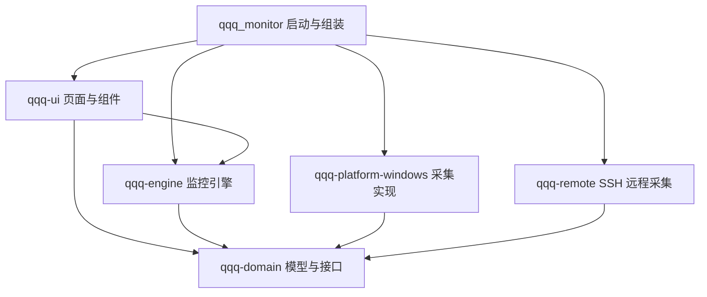
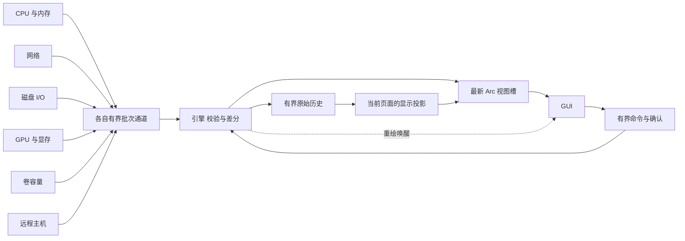

# qqq_monitor 架构设计

本项目已建立一个 Cargo Workspace、五个库 crate 和一个启动包。领域模型与引擎不依赖 Windows 或 GUI；具体采集器由启动入口注入，页面只使用不可变监控视图。本文说明当前实现、扩展契约与已知边界，范围和验收目标分别见 [技术方案](TECHNICAL_PLAN.md) 与 [实施与验收计划](IMPLEMENTATION_PLAN.md)。

## 模块和依赖方向



箭头表示编译依赖。五个库对应不同变化原因：系统接口变化只影响平台层，SSH 协议与远程 Linux 的读取方式归远程采集，指标语义变化进入领域层，调度与历史策略归引擎，布局和交互归 GUI。异步运行时只在远程采集内部承载 SSH 连接，引擎与其他采集使用标准线程；无需新增动态插件、数据库或系统服务即可扩展内置功能。

| 模块 | 当前职责 | 对外接口 |
| --- | --- | --- |
| `qqq-domain` | 设备（含所属远程主机）、指标、单位、读数状态与不可用原因、采集工厂、进程实例与进程操作、远程主机端点与会话、密码存储 | `Collector`、`CollectorFactory`、`ProcessPlatform`、`ProcessSource`、`RemotePlatform`、`RemoteSession`、`SecretStore`、`Reason` 和模型 |
| `qqq-platform-windows` | sysinfo、IP Helper、PDH、DXGI、卷 GUID、显示器工作区、用户显示语言、通知区域图标与任务栏按钮、Windows 进程枚举与操作、经 `wsl.exe` 读取和操作 WSL 进程、Windows 凭据管理器中的密码与口令、当前用户 `Run` 注册表项中的开机自动启动、原生句柄 RAII | `collectors()`、`processes()`、`secrets()`、显示器与鼠标状态查询、显示语言列表、窗口图标、托盘图标与任务栏按钮、开机自动启动的读取与开关、安全的启动错误提示 |
| `qqq-remote` | SSH 连接与登录、主机密钥核对、远程 Linux 的 shell 程序与输出解析、按远程时钟换算速率、读取 `~/.ssh/config` | `ssh()`、`secret_name()`；示例 `wsl_sshd` 与 `probe` |
| `qqq-engine` | 采样调度、差分、历史、查询投影、进程轮询与进程 CPU 使用率、进程操作、远程主机线程与重连、配置（含界面语言与远程主机）、命令确认与提示 | `MonitorRuntime`、`MonitorClient`、`MonitorView`、`ProcessView`、`RemoteView`、`ConfigStore`、`RemoteHost`、`Language`、`Notice`、`SaveStatus` |
| `qqq-ui` | 九个独立页面（含进程管理与远程主机）、边缘吸附与迷你状态栏、托盘驻留、图表、设备选择、主题、三种语言的界面文本、CJK 字体、看板娘精灵 | `DesktopApp`、`Page`、截图选项、`Desktop` 显示器查询、托盘与开机自动启动接口、`viewport()` 初始窗口、`i18n` 文本表 |
| 根包 | 日志、组装、系统语言解析、DX12 窗口、程序图标资源、CLI 冒烟和关闭 | Windows EXE |

领域、引擎、远程采集、GUI 和启动包禁止 `unsafe`。Windows 必要的 FFI 集中在 `native.rs`、`tray.rs`、`process.rs`、`secret.rs` 与 `autostart.rs`，说明每个调用的句柄、缓冲区和生命周期条件；调用方只看到安全接口。

## 当前目录

```text
qqq_monitor/
├── Cargo.toml                       # Workspace、依赖和 Rust 版本
├── Cargo.lock
├── build.rs                         # 编译并嵌入图标资源
├── assets/
│   ├── qqq_monitor.ico              # 多尺寸程序图标
│   └── qqq_monitor.rc               # Windows 资源脚本
├── src/
│   ├── main.rs                      # GUI、冒烟、截图、关闭
│   └── bootstrap.rs                 # 日志初始化
├── scripts/
│   └── release.ps1                  # 检查、构建、打包并发布 GitHub Release
├── crates/
│   ├── qqq-domain/src/
│   │   ├── lib.rs
│   │   ├── metric.rs                # 指标键、单位、采样、状态和原因
│   │   ├── device.rs                # 身份、类型、在线状态、详情
│   │   ├── collector.rs             # 工厂、周期、批次和错误
│   │   ├── process.rs               # 进程宿主、实例标识、优先级、快照与进程操作接口
│   │   └── remote.rs                # 远程主机端点、登录方式、会话、平台与密码存储接口
│   ├── qqq-platform-windows/src/
│   │   ├── lib.rs                   # 内置工厂注册
│   │   ├── cpu_memory.rs            # 持久 System 实例
│   │   ├── network.rs               # 网卡计数与身份
│   │   ├── disk_io.rs               # 物理磁盘 PDH 读写
│   │   ├── gpu.rs                   # 显卡利用率与显存聚合
│   │   ├── inventory.rs             # 本地卷发现与容量
│   │   ├── native.rs                # IP Helper、PDH、DXGI、卷、显示器与显示语言 API 和 RAII
│   │   ├── process.rs               # Windows 进程枚举、命令行与所有者、结束与优先级
│   │   ├── wsl.rs                   # 运行中的 WSL 发行版及其进程的读取与操作
│   │   ├── secret.rs                # Windows 凭据管理器中的密码与口令
│   │   ├── autostart.rs             # 当前用户启动项中的开机自动启动
│   │   └── tray.rs                  # 通知区域图标、托盘菜单与任务栏按钮
│   ├── qqq-remote/
│   │   ├── src/
│   │   │   ├── lib.rs               # SSH 远程平台与密码名称
│   │   │   ├── session.rs           # 连接、登录、主机密钥核对与常驻 shell
│   │   │   ├── linux.rs             # 远程 shell 程序、输出解析与速率换算
│   │   │   └── presets.rs           # ~/.ssh/config 中的主机
│   │   └── examples/
│   │       ├── wsl_sshd.rs          # 把命令交给 WSL 执行的开发用 SSH 服务器
│   │       └── probe.rs             # 按程序方式连接主机并输出读数
│   ├── qqq-engine/
│   │   ├── src/
│   │   │   ├── lib.rs
│   │   │   ├── runtime.rs           # 线程、命令、退出与故障隔离
│   │   │   ├── normalize.rs         # 实际时间差、预热与数据验证
│   │   │   ├── history.rs           # 有界历史和显示投影
│   │   │   ├── process.rs           # 进程轮询、CPU 使用率与进程操作线程
│   │   │   ├── remote.rs            # 远程主机线程、连接状态与重连
│   │   │   ├── view.rs              # 不可变 GUI 无关视图
│   │   │   ├── config.rs            # 界面语言、校验、恢复和后台保存
│   │   │   └── notice.rs            # 命令与配置提示、设置状态
│   │   └── tests/runtime_flow.rs    # 可控假采集器与假远程平台的运行时测试
│   └── qqq-ui/
│       ├── build.rs                 # 由看板娘插画生成像素精灵
│       ├── assets/fonts/            # Noto Sans CJK SC 和 OFL 许可
│       └── src/
│           ├── lib.rs
│           ├── app.rs               # 导航、查询、UI 状态和生命周期
│           ├── dock.rs              # 边缘吸附、窗口几何与初始窗口
│           ├── minibar.rs           # 吸附时的迷你状态栏
│           ├── tray.rs              # 托盘驻留：图标、任务栏按钮与最小化隐藏
│           ├── theme.rs             # 配色、字体、控件和卡片
│           ├── pixel.rs             # 像素图标、位图字体与精灵
│           ├── mascot.rs            # 看板娘表情、精灵纹理与角色卡
│           ├── components.rs        # 格式、图表、状态、设备名称与选择
│           ├── i18n.rs              # 当前语言、文本表结构与措辞入口
│           ├── i18n/
│           │   ├── zh.rs            # 简体中文文本表
│           │   ├── en.rs            # 英语文本表
│           │   └── ja.rs            # 日语文本表
│           └── pages/
│               ├── mod.rs
│               ├── overview.rs
│               ├── cpu.rs
│               ├── memory.rs
│               ├── gpu.rs
│               ├── disk.rs
│               ├── network.rs
│               ├── processes.rs
│               ├── remote.rs
│               └── settings.rs
└── docs/
    ├── TECHNICAL_PLAN.md
    ├── ARCHITECTURE.md
    ├── IMPLEMENTATION_PLAN.md
    └── images/                      # 各语言 README 的截图、标志与看板娘图
        └── assets/                  # 看板娘插画 mint-0 至 mint-6
```

调度、命令与客户端暂集中在 `runtime.rs`，历史与投影集中在 `history.rs`；继续增长时可在原 crate 内拆分普通模块。页面已独立分文件，页面模块是 `app` 的内部子模块，可以访问必要的 UI 状态，无需将状态字段暴露为公共 API。

## 设备和指标契约

`DeviceDescriptor` 包含会话 ID、可选的跨启动身份 persistent_id、类型、名称、在线状态和详情。名称取系统提供的名称，如 CPU 型号、网卡别名、显卡描述和卷挂载点；内存、本机、物理磁盘与逻辑核心由系统留空，GUI 按类型和 ID 中的序号以当前语言命名。详情是稳定键与值的列表，键包括 `logical_cores`、`os`、`description`、`interface_guid`、`interface_type`、`link_speed`、`vendor`、`memory_type`、`adapter_luid`、`counter_instance`、`volume_label`、`file_system`、`volume_guid`、`kernel`、`architecture`、`default_route`、`device`；枚举值同样使用稳定标记，`interface_type` 为 `physical` 或 `virtual`，`memory_type` 为 `dedicated` 或 `shared`，`default_route` 为 `yes`。GUI 负责措辞键名与标记。主键以身份而非名称构建：`cpu`、`core:索引`、`memory`、`system`、`disk:设备号`、`volume:卷GUID`、`net:LUID`、`gpu:adapter LUID`，远程主机的设备另加 `ssh:主机ID/` 前缀。物理磁盘设备号与 LUID 用于本次会话；网卡选择保存接口 GUID，启动后重新解析为本次 LUID。

`MetricKey` 由设备 ID 和指标名组成，例如 `(cpu, usage)`、`(memory, available)`、`(disk:0, read)`、`(net:LUID, receive)`、`(gpu:LUID, memory_usage)`。GPU 设备提供 `usage`、每类引擎的 `engine:类型`（如 `engine:3d`、`engine:videodecode`）、按显卡类型选取的 `memory_used`、`memory_total`、`memory_usage`，以及 `dedicated_used`、`dedicated_total`、`shared_used`、`shared_total`。引擎类型出现后持续上报，空闲时为 0。`MetricDescriptor` 声明单位；`MetricSample` 额外包含真实单调时间和 `SampleValue`：

- `Gauge(f64)` 是已经归一化的值，包括 CPU 百分比、容量和 PDH 格式化 B/s。
- `Counter(u64)` 是累计计数；当前用于网络字节，由引擎计算速率。
- `WarmingUp`、`Unsupported(Reason)`、`Failed(Reason)` 保留状态与原因，不能用零代替。`Reason` 是语言中立的枚举，例如显卡缺少性能计数器、卷容量暂不可用、设备断开、采集线程异常，以及带 API 名与状态码的系统调用失败；采集源整体失败的 `CollectorError` 与诊断中的采集源错误同样携带 `Reason`。

引擎检查单位一致、采样时刻不倒退，以及同一个指标键不被两个采集源覆盖。百分比要求 0 至 100；所有 Gauge 要求非负且有限。合法零流量仍为有效数据。

`MetricReading` 保存当前值、会话字节、状态、失败原因、最后成功时刻、最后尝试时刻和周期。无效采样保留上次成功值，但卡片和图表标注其状态和数据年龄。状态包括 `WarmingUp`、`Ready`、`Stale`、`Unsupported`、`Failed`、`Offline`；过期阈值为 `max(3 × 周期, 3 秒)`，30 秒容量指标不会在 3 秒后过期。

`Unit` 包括百分比、字节、字节每秒、秒和计数，计数用于平均负载与进程数这类纯数值。

远程主机的设备以 `ssh:主机ID/` 为前缀，后接会话报告的本地 ID，例如 `ssh:web/cpu`、`ssh:web/core:3`、`ssh:web/net:eth0`、`ssh:web/disk:sda`、`ssh:web/volume:/home`；`DeviceDescriptor.host` 记录所属主机，本机设备为 `None`，本机页面只列出本机设备。远程设备沿用本机的类型与指标名：`system` 名称为主机名，详情为 `os`、`kernel`、`architecture`，指标为 `uptime`、`load1`、`load5`、`load15`、`processes`；`cpu` 名称为处理器型号，指标为 `usage` 与 `iowait`；`memory` 另有 `swap_total`、`swap_used` 与有交换空间时的 `swap_usage`；网卡另有开机以来的累计字节 `received`、`sent`，详情 `default_route` 标记默认路由所在接口；卷的详情为 `device` 与 `file_system`。

卷容量与物理磁盘 I/O 保持独立。当前未实现卷到物理磁盘的多对多映射，不把 I/O 硬套到盘符，也不加总虚拟网卡与物理网卡的流量。

## 采集接口

当前公共接口如下，完整定义见领域 crate：

```rust
pub trait Collector {
    fn collect(&mut self, context: &CollectContext)
        -> Result<SampleBatch, CollectorError>;
}

pub trait CollectorFactory: Send + Sync {
    fn descriptor(&self) -> CollectorDescriptor;
    fn create(&self) -> Result<Box<dyn Collector>, CollectorError>;
}
```

`CollectorDescriptor` 包含稳定的采集源 ID 和 `SamplingPeriod`：跟随用户配置或固定周期。工厂跨线程，Collector 本身不要求 `Send`。实际采集对象在所属线程创建、使用和销毁，避免跨线程移动 PDH 句柄等线程相关资源；初始化由工厂完成，释放由 RAII 完成。

`SampleBatch` 提供设备、采样、开始和结束时间，以及 `complete_inventory` 标志。只有权威完整目录才能把缺席设备标记离线；预热期间返回空的部分批次不会误删设备。单指标失败进入该指标的 SampleValue，采集源整体失败返回 Result 错误并触发退避。

## 线程和数据流

| 执行位置 | 内容 | 周期 |
| --- | --- | --- |
| GUI 主线程 | eframe 布局、输入和渲染；托盘图标消息 | 输入、状态变化或快照唤醒 |
| 引擎线程 | 归一化、历史、投影和命令 | 每轮最多等待 25 ms，空闲时至少每秒发布 |
| CPU/内存线程 | 复用 sysinfo System | 0.5、1 或 2 秒 |
| 网络线程 | GetIfTable2 字节、身份和状态 | 跟随采样间隔；目录随批次更新 |
| 磁盘线程 | 持久 PDH 查询和实例数组 | 跟随采样间隔 |
| GPU 线程 | 持久 PDH 引擎与显存查询；DXGI 枚举硬件 adapter | 跟随采样间隔；计数器出现未知 adapter 时最多每 10 秒重新枚举 |
| 进程轮询线程 | 列出 GUI 正在查看的宿主的进程，并列出可用宿主 | 仅在进程页面显示时运行：Windows 为采样间隔且至少 1 秒，WSL 为采样间隔且至少 2 秒；宿主每 5 秒重新列出 |
| 进程操作线程 | 结束进程与调整优先级 | 收到操作命令时执行，完成后立即重新轮询 |
| 卷线程 | 发现本地卷并刷新容量 | 30 秒，支持手动提前刷新 |
| 远程主机线程 | 每台主机一个：连接、登录、启动远程 shell，读取 `/proc` 与 `df` | 采样间隔且至少 1 秒；可自行恢复的失败按 2、4、8、16、30、60 秒退避重连 |
| 配置写线程 | UTF-8 TOML 临时写入与替换 | 有待保存配置时写入；空闲轮询 20 ms |

CPU/内存与网络使用独立线程，使网络 API 变慢也不会拖延 CPU 更新。sysinfo 未启用内部 multithread feature。设备目录直接随网络和磁盘采样更新，首版不再额外维护一个 10 秒的身份发现线程。



历史和投影在锁外构造，共享锁只替换 Arc。GUI 用 `try_latest_view` 非阻塞克隆最新 Arc，取不到时保留当前视图；不会读取 sysinfo、Win32 或可变历史。引擎调用注入的线程安全回调请求重绘，自身不依赖 egui。

eframe 的 `logic` 消费视图、命令结果和退出事件；`ui` 只绘制页面并提交查询。窗口停止绘制不影响后台历史；窗口隐藏到托盘时 eframe 继续调用 `logic`，托盘请求由此重新显示窗口。未设置连续 60 FPS 装饰动画，最小化降频和恢复体验仍列入人工验收。

## 背压和采样时序

| 数据 | 上限 | 满载策略 |
| --- | --- | --- |
| 每个采集源批次 | 8 批 | try_send 丢弃当前批次，累计丢批；后续批次携带该计数 |
| 每台远程主机的更新 | 16 条 | 批次按采集源同样累计丢批；连接状态由后续批次或失败再次确定 |
| 最新 UI 视图 | 1 个 Arc 槽 | 替换旧视图，不排队显示快照 |
| 在途命令 | 32 个 | 立即返回繁忙；消费结果后释放名额 |
| 命令结果 | 32 个 | 在途名额包含未消费结果，保证正常运行时每个接受请求有结果 |
| 配置待保存 | 1 个 | 保留最新配置；被合并请求收到 Superseded |

引擎按限额轮询各源，避免单一采集源饿死命令和其他源。丢批之后插入历史缺口，清除该来源速率基线，不能用平滑曲线隐藏丢失。

调度使用 Instant 和截止点推进；落后多个周期时跳过旧任务，避免密集补跑。网络速率按实际经过时间求差；第一轮、回退、失败后恢复、丢批或超过三倍周期时重新预热。CPU 和 PDH 同样在首次或长间隔后先预热。异常长间隔用于识别可能的睡眠恢复，但完整的 Windows 电源事件和睡眠场景尚未验收。

## 历史与内存约束

原始历史只有引擎能写，按 MetricKey 保存 VecDeque。最长 900 秒、每序列最多 1801 点，全局历史预算 16 MiB；超出预算时按最老序列分批裁剪并收缩容量。计费包含 deque 分配容量、键字符串容量和条目结构，属于历史存储的近似预算，不包含 BTreeMap 节点分配器开销、GUI Arc 或图形资源。

当前查询最多 16 条序列，每条投影最多 400 点，GUI 各页面实际请求不超过 6 条。降采样保持峰谷时间顺序；混合有效值和缺口的桶保守保留缺口，避免画出跨越故障的连线，可能舍弃同桶部分有效细节。投影不覆盖原始数据，也不在每帧复制全部历史。

CPU 核心网格使用最新读数，点击核心后才请求其历史。离线设备及相关指标在历史过期后清理，名称变化不会生成第二套身份。

## GUI 状态和配置

主线程持有页面、所选设备、历史范围、设置草稿和当前已接受配置。`MonitorView` 提供指标、目录、投影、诊断和保存状态；`MonitorClient` 提供非阻塞取视图、提交命令、消费结果和注入唤醒。

设置采用“应用并保存”：校验后先改变引擎采样周期，再由后台保存。保存失败显示“设置已应用，但未保存”。命令错误、配置校验与读取提示是语言中立的 `Notice`，设置状态是 `SaveStatus`（已加载、按默认值恢复、保存中、已保存、已应用但未保存），GUI 显示时按当前语言措辞。选择网卡只保存当前已接受配置和接口 GUID，不顺带提交设置页面尚未应用的草稿；正常关闭保存已接受配置与窗口几何信息。

配置按字段恢复类型或范围错误，语法损坏时保留原文件并提示。未经用户主动保存，不自动替换损坏文件。保存使用同目录临时文件、UTF-8、sync_all、关闭句柄、rename 替换；失败不先删除旧配置，只清理本次临时文件。

窗口吸附由 `dock.rs` 管理。启动入口注入 `Desktop`：按点查询所在显示器的边界与工作区、判断某点是否落在任何显示器上，以及读取鼠标按键状态，均为物理像素，由平台层实现。窗口位置变化后，等到窗口静止 0.2 秒且没有按住鼠标键才判定一次移动结束；尺寸未变的纯移动若触及没有相邻显示器的顶部、左侧或右侧工作区边缘，就去掉标题栏、置顶并缩为迷你状态栏。系统贴靠和最大化会改变尺寸，因此保持系统行为。迷你状态栏被拖动后，24 逻辑像素内靠近某条开放边缘则贴齐该边缘，离开所有边缘则在落点恢复完整窗口并限制在工作区内；双击或展开按钮按吸附前的位置、尺寸和最大化状态恢复。只有用户移动后的静止参与判定，应用自身几何命令带来的变化只更新基准。`viewport()` 按配置直接创建完整窗口或迷你状态栏，关闭时保存吸附边缘、迷你状态栏位置和完整窗口几何信息。

托盘驻留由 `tray.rs` 管理。窗口创建后，启动入口把窗口句柄和重绘回调交给平台层，平台层在 GUI 线程创建一个隐藏的顶层窗口承载通知区域图标，GUI 已有的消息循环为它投递图标点击、右键菜单和资源管理器重启后的 `TaskbarCreated` 广播。`Desktop` 为此提供显示或更新图标、移除图标、读取打开请求、显示或移除任务栏按钮，以及隐去或恢复窗口绘制五个接口。吸附为迷你状态栏时，迷你状态栏留在屏幕边缘，窗口的任务栏按钮移除并显示托盘图标；`minimize_to_tray` 开启时，最小化的完整窗口隐藏并显示托盘图标。单击图标、在图标上按 Enter 或选择菜单的“显示主窗口”会显示并激活窗口，吸附状态下按吸附前的几何信息恢复完整窗口；菜单的“退出”向窗口发送关闭消息，经正常关闭流程保存配置。任务栏按钮通过 `ITaskbarList` 在窗口可见后移除；GUI 在每帧的几何命令之前同步图标与按钮，使按钮状态跟随已经生效的窗口样式。资源管理器重启后，平台层在本线程各窗口处理完广播后重新添加图标并再次移除按钮。图标文字随界面语言更新，程序退出时移除图标；截图模式保持任务栏原状。

开机自动启动由平台层 `autostart.rs` 管理，状态以当前用户的系统启动项为准。当前用户 `Software\Microsoft\Windows\CurrentVersion\Run` 下名为 `QQQ Monitor` 的字符串值保存带引号的当前 EXE 路径和 `--autostart` 参数；任务管理器与 Windows 设置的“启动应用”关闭某一项时，在 `Explorer\StartupApproved\Run` 下写入同名标记，标记首字节为奇数表示已关闭。启动项与当前 EXE 的命令行一致（路径不区分大小写）且没有关闭标记时视为开启。开启时写入 `Run` 值并清除标记，关闭时移除两者。`Desktop` 为此提供读取状态和开关两个接口；设置页每次打开时读取一次，勾选或取消立即生效并重新读取，失败以 `Notice::AutostartUnchanged` 显示在状态栏；其下的 `autostart_to_tray` 与语言选择一样立即应用并保存。

以 `--autostart` 参数启动且 `autostart_to_tray` 开启（默认）时，窗口从托盘开始。eframe 在绘制第一帧后总会显示新窗口，因此 GUI 在窗口出现前经 `Desktop` 以 DWM 隐去窗口的绘制（`DWMWA_CLOAK`），第一帧发出隐藏命令，下一帧窗口已经隐藏后再恢复绘制；此后窗口与最小化到托盘的窗口相同，只显示托盘图标，后台照常采样，单击图标显示完整窗口，吸附配置下按吸附前的几何信息恢复。托盘建立成功是从托盘开始的前提，平台层未能建立托盘时窗口照常显示。`autostart_to_tray` 关闭时，程序按配置恢复上次关闭时的完整窗口或迷你状态栏；截图模式始终显示窗口。

`minibar.rs` 只读取最新视图中的 CPU、内存和 GPU 页面所选显卡的读数，所选显卡默认取在线且显存总量最大的 GPU；过期值变暗保留，不可用时显示 `—`。顶部横条绘制数字与分段条，左右竖条按物理像素栅格逐格计算 270° 环形仪表盘，分段点亮。

GUI 复用指标卡片、历史图表、状态和设备选择组件；八个页面在独立文件维护，CPU 核心与 GPU 引擎共用热力格组件。主题、格式、界面文本和 CJK 字体集中管理，容量、速率和时间显示不改变指标口径。

## 进程管理

进程以宿主区分：`ProcessHost::Windows` 或 `ProcessHost::Wsl(发行版名)`。`ProcessId` 由宿主、PID 和启动时刻组成，Windows 取 100 ns 单位的创建时间，WSL 取开机后的时钟节拍；PID 被新进程复用后，旧标识不再匹配。平台通过 `ProcessPlatform` 提供三件事：列出当前可用的宿主、为宿主创建在轮询线程上使用的 `ProcessSource`，以及在确认实例仍然存在后执行 `ProcessAction`。

GUI 在进程页面显示时发送 `WatchProcesses(Some(宿主))`，切到其他页面、吸附为迷你状态栏或最小化时发送 `WatchProcesses(None)`。轮询线程只为正在查看的宿主取快照，切换宿主时重建数据源；引擎把最新进程表以 `Arc` 放入 `MonitorView.processes`，同时给出可用宿主和最近一次失败的原因。快照提供宿主时钟、逻辑处理器数和每个进程累计的处理器时间，`CpuTracker` 用同一实例在两次快照间多用的处理器时间除以“间隔 × 逻辑处理器数”得到 0 至 100% 的 CPU 使用率；首次出现的进程显示为空。

Windows 数据源用一次 `NtQuerySystemInformation(SystemProcessInformation)` 取得全部进程的名称、父进程、创建时间、处理器时间、专用工作集、线程数和基本优先级，System Idle Process 不列出。命令行（`ProcessCommandLineInformation`，读不到时取映像路径）和所有者账户在进程首次出现时读取一次，账户名按 SID 缓存；无权打开的进程保留空白。操作重新以最小权限打开进程，确认创建时间一致且仍在运行后调用 `TerminateProcess` 或 `SetPriorityClass`；拒绝访问和实例不符分别报告为 `Reason::AccessDenied` 与 `Reason::ProcessGone`。

WSL 宿主来自 `wsl.exe --list --running --quiet`，平台层设置 `WSL_UTF8=1` 并兼容 UTF-16 输出。每次轮询和操作前先确认发行版仍在运行，再以 `wsl.exe -d 发行版 --cd / -e sh -s` 从标准输入执行 POSIX shell 脚本，脚本只用 shell 内建命令、`getconf`、`nproc` 和 `tr` 输出 `/proc/*/stat`、`Uid`、命令行和 `/etc/passwd`，busybox 发行版同样适用。解析时去掉本次会话自身的 `sh`、`Relay` 与 `SessionLeader` 进程；内存取常驻集，名称取命令行中的程序名并补全内核截断的 15 字节名称，优先级按 nice 值映射到同一组优先级类。操作以 `-u root` 执行，脚本先核对 `/proc/PID/stat` 中的启动时刻，再执行 `kill -s TERM`、`kill -s KILL` 或 `renice`。`wsl.exe` 以无窗口方式启动，10 秒内未结束即终止。查看某个发行版的进程期间，周期性的 `wsl.exe` 使该发行版保持运行。

操作命令 `MonitorCommand::Process` 交给独立的进程操作线程，结果以普通命令结果返回，失败为 `Notice::Process(Reason)`，显示在状态栏。进程页面按宿主切换 Windows 与各个运行中的发行版，支持按名称、PID、用户和命令行搜索，点击表头按列排序，表格按可见行绘制。选中进程后可在工具栏或右键菜单结束进程、调整优先级，WSL 进程另有强制结束；结束前弹出确认对话框，Delete 键同样打开确认。

## 远程主机

远程主机是通过 SSH 监控的 Linux 主机。`AppConfig.remote_hosts` 保存主机列表，每项包含稳定 ID、显示名称、地址、端口、用户名、登录方式（`password`、`key`、`agent`）、私钥文件和用户信任的主机密钥；配置文件以 `[[remote_hosts]]` 表数组保存在末尾，读取时每项单独校验与恢复。密码与私钥口令经 `SecretStore` 保存在 Windows 凭据管理器的普通凭据 `qqq_monitor/ssh/主机ID` 中，配置文件只保存其余字段。

```rust
pub trait RemoteSession {
    fn collect(&mut self) -> Result<SampleBatch, Reason>;
}

pub trait RemotePlatform: Send + Sync {
    fn connect(&self, endpoint: &RemoteEndpoint, cancel: Arc<AtomicBool>)
        -> Result<Box<dyn RemoteSession>, Reason>;
    fn set_secret(&self, id: &str, secret: Option<&str>) -> Result<(), Reason>;
    fn presets(&self) -> Vec<RemotePreset>;
}
```

启动入口把 `qqq_remote::ssh(qqq_platform_windows::secrets())` 交给 `MonitorRuntime::start_with_remote`。引擎线程启动时读取一次 `presets()`，并按配置为每台主机启动一个线程；`SaveConfig` 应用新配置后对照主机列表启动新增主机、停止已删除的主机，连接设置变化的主机换用新线程。地址或端口变化与删除一样清除该主机已有的设备、读数与历史，只改名称时线程继续运行。旧线程通过自己的取消标志结束，正在进行的连接与读取会在 50 ms 内放弃。

主机线程先发送“连接中”，再调用 `connect`；成功后按采样间隔且至少 1 秒调用 `collect`，批次经有界通道交给引擎。引擎给每个设备 ID 加上主机前缀、设置 `host`，然后与本机采集一样校验、写入历史和投影；采集失败把该主机的指标标为失败并在历史中留出缺口，但不计入本机的采集源诊断。`MonitorView.remote` 给出每台主机的状态（连接中、已连接、失败及原因）与 SSH 配置中的主机。连接断开、超时、被拒绝或握手失败时线程按 2 至 60 秒退避重连；主机密钥未受信任或已改变、登录被拒、缺少密码、私钥不可读或口令错误、没有 SSH 代理，以及主机不是 Linux 时，线程等待 `Reconnect` 命令或新的配置，避免反复登录失败触发服务器的封禁。`RemoteSecret` 命令保存或删除密码后立即重连该主机。

`qqq-remote` 用 russh（ring 加密后端）实现 SSH。每个会话在自己的线程上持有一个单线程 tokio 运行时，只在连接与读取时驱动连接。登录方式为密码（服务器只接受键盘交互方式时用同一密码回答）、OpenSSH 或 PuTTY 格式的私钥文件（`~` 表示用户目录，加密私钥的口令来自密码存储）以及 SSH 代理（Windows OpenSSH 认证代理的命名管道，其次 Pageant）。主机密钥先与配置中信任的密钥比对；没有信任的密钥时查询用户的 `~/.ssh/known_hosts`。密钥未知时以 `Reason::HostKeyUnknown` 返回 OpenSSH 公钥行与 SHA-256 指纹，与已知密钥不同时返回 `Reason::HostKeyChanged`；用户在页面确认指纹后，GUI 把该公钥写入主机的 `host_key` 并保存配置。

登录后会话执行 `sh -s`，通过标准输入发送一段 POSIX shell 程序。程序在循环条件中打印 `@@ ready` 与每次回答结尾的 `@@ end`，保证 shell 读完整个程序后才读取命令；`i` 命令输出主机名、内核、架构、逻辑处理器数、`os-release` 与处理器型号，`s` 命令输出 `/proc` 的 `uptime`、`loadavg`、`stat`、`meminfo`、`net/dev`、`net/route`、`diskstats`，`/sys/block` 与带 `device` 的 `/sys/class/net` 条目，以及 `df -kPTl` 的结果（不支持的系统依次退回 `df -kPT`、`df -kP`）。程序只使用 shell 内建命令、`uname`、`getconf`、`cat` 与 `df`，busybox 系统同样适用。每次回答最多等待 10 秒，连接、登录与启动 shell 合计最多 15 秒。

`Sampler` 以远程主机的 `/proc/uptime` 为时钟换算速率：CPU 使用率为两次读取间非空闲时钟节拍占全部节拍的比例，I/O 等待单独计算；内存已用为 `MemTotal - MemAvailable`（旧内核按 `MemFree + Buffers + Cached`）；磁盘读写为扇区数 × 512 的增量；网卡为累计字节增量。首次读取、计数回退和时钟未前进时报告预热。磁盘只计入 `/sys/block` 中的整块磁盘，排除 `loop`、`ram`、`zram`、`dm-`、`md`、`sr`、`fd`、`nbd`；网卡排除 `lo` 与容器的 `veth` 对端。文件系统排除虚拟与只读镜像类型以及 `/proc`、`/sys`、`/dev`、`/run`（`/run/media` 除外）、`/snap`、容器目录下的挂载点，同一设备只保留最短的挂载点，使用率为 `已用 / (已用 + 可用)`，与 `df` 一致。每次读取都是完整目录，消失的网卡、磁盘和文件系统转为离线。

远程页面在主机列表中切换主机，显示连接状态与重新连接、编辑、删除按钮，主机密钥待确认时显示指纹与信任按钮；页面内容包括 CPU、内存、所选磁盘与网卡的指标卡，CPU 与内存趋势图旁的设备档案，磁盘与网卡选择器及其读写、收发曲线，文件系统卡片和逻辑核心热力格。网卡默认选择默认路由所在接口。添加或编辑对话框可从 SSH 配置导入主机；保存时先发送 `RemoteSecret`，再与网卡选择一样立即保存配置；删除主机同时删除其密码。对话框中的密码只在打开期间保存在内存中，`Secret` 的调试输出隐藏内容。

## 界面语言

界面提供简体中文、英语和日语。`AppConfig.language` 保存语言选择，`None` 表示跟随系统。启动入口通过平台层读取 Windows 首选显示语言列表，`Language::preferred` 取第一个受支持的语言，中文各地区变体归为简体中文，都不受支持时使用英语；配置以 BCP 47 标签保存，`zh-CN`、`en`、`ja`。命令行 `--lang` 与设置页面的选择效果相同。

`qqq-ui` 的 `i18n` 模块保存进程级的当前语言，`i18n::t()` 返回该语言的 `Strings` 文本表。文本表包含固定文本、按各语言语序格式化数值的函数，以及 `Reason`、`Notice`、`SaveStatus`、设备详情键和 GPU 引擎类型的措辞函数；每种语言填写完整的 `Strings`，缺项在编译期报错。页面以 `let t = i18n::t();` 取文本，组件需要的文字同样来自文本表，因此领域、平台和引擎层只提供语言中立的数据。

设置页面点击语言后，草稿与已接受配置同时更新并立即保存，与网卡选择相同。`logic` 发现已接受配置解析出的语言与当前语言不同，就切换当前语言并发送窗口标题命令；初始窗口标题由 `viewport()` 按启动语言设置。启动失败的原生提示框标题与引擎提示也按当前语言显示。

布局按文本实际宽度适配：设置页面的标签列与按钮宽度、设备档案的标签列都按当前语言最宽的文字计算，选项与复选框文字在标签右侧换行；卡片标题旁放不下读数状态文字时只显示状态色点，悬停显示状态。页面顶部的像素英文小标题、数值与单位在各语言中保持一致。三种语言共用 Noto Sans CJK SC，日文汉字以简体中文字形显示。

## 生命周期和故障隔离

启动入口先初始化日志、读取配置和组装工厂，再启动引擎和 GUI；扫描在后台完成。窗口创建后，平台层按窗口 DPI 从 EXE 内嵌的图标资源加载标题栏与任务栏图标，并按系统 DPI 加载托盘图标。DX12 启动失败会记录错误并弹原生消息框，标题使用当前界面语言；冒烟和截图模式只输出错误，便于自动检查。

每个采集源的创建与采集被 catch_unwind 隔离，失败按 1、2、4、8、16、30 秒退避并重建对象，其他源继续工作。尚未返回的同步 API 不触发并行替代线程；数据由最后成功时刻变为过期。错误恢复不等于可以恢复 FFI 未定义行为，原生缓冲区和句柄仍需独立审查。

关闭通过独立原子取消信号唤醒等待者，不依赖可能已满的命令通道。引擎处理已接受命令后设置每台远程主机的取消标志并通知配置线程完成最后保存。会话结束时向主机发送断开消息，最多等待 300 ms。统一等待最多 2 秒，已经结束的线程 join；同步 API 仍阻塞的线程记录警告并脱离等待，最终由进程退出回收。不能承诺强制中断 Win32，也不能声称超时的保存已经完成。

日志按日滚动并最多保留 7 个文件；日志目录不可写时回退 stderr。20 MiB 总量硬限制、采集耗时 p95 和详细调度延迟诊断尚未实现，不作为已交付能力。

## 扩展方式

1. **新增指标**：领域层增加必要单位或设备类型；平台实现 CollectorFactory，平台注册并交给引擎；页面通过 MetricKey 读取和查询。引擎无需识别具体采集器名称。温度和厂商 SDK 应各自独立采集，缺少能力只影响对应指标。
2. **新增页面**：在 pages 增加文件与 Page 路由，组合公共组件；在 app 的 query 中声明需要的指标。页面无需依赖 Windows API。
3. **告警与导出**：告警放在归一化之后，规则包含持续时间、恢复阈值和去抖；导出通过引擎查询有缺口的数据区间，再交后台 I/O。需要长期存储时才增加持久化接口。
4. **进程操作与进程宿主**：新操作在 `ProcessAction` 增加变体，由平台的 `act` 在确认实例后执行，GUI 在菜单与工具栏提供入口；新的宿主类型在 `ProcessHost` 增加变体，并由平台的 `hosts` 与 `source` 提供。
5. **远程指标**：在 `qqq-remote` 的 shell 程序中输出新的数据段，在 `linux.rs` 解析并以本机同样的设备 ID 与指标名报告；引擎自动加上主机前缀，远程页面通过 `remote_device` 构造的 `MetricKey` 读取。
6. **新增语言**：在 `Language` 中加入语言与 BCP 47 标签并扩展 `Language::preferred` 的匹配，在 `i18n/` 添加完整的 `Strings` 文本表，在 `i18n::t()` 与 `native_name()` 中登记。领域、平台和引擎层无需改动。
7. **新平台**：另增平台 crate 并由启动入口选择；本轮不承诺跨平台可运行。第三方动态插件若有实际需求，再设计稳定 C ABI 或进程间协议，不跨 DLL 暴露 Rust trait object。

## 验证边界

已有测试覆盖实际时间差、计数回退、Gauge 速率、合法零值、失败恢复、各周期过期、历史时间/点数/预算、投影缺口、慢采集隔离、在途命令上限、关闭保存（含吸附与托盘配置）、损坏配置保护、GPU 计数器实例解析与引擎聚合、吸附边缘判定与迷你状态栏定位、进程 CPU 使用率与实例匹配、进程轮询与操作结果、Windows 进程枚举与按实例结束和调整优先级、WSL 进程输出解析、优先级与 nice 值映射、远程主机的连接状态与重连策略（需要用户处理的失败不自动重试、删除主机后不留设备与读数）、远程主机配置的逐项恢复、主机密钥核对、Linux `/proc` 与 `df` 输出解析与按远程时钟换算速率、`~/.ssh/config` 导入、远程 shell 回答的分段、连接错误分类、Windows 凭据管理器读写、开机自动启动项的读写与关闭标记、系统语言匹配、界面语言配置保存，各语言文本表的启用与设备详情键覆盖，以及各语言看板娘台词在对话气泡内的宽度。真实 Windows 采集与 Windows、各运行中 WSL 发行版的进程列表由 CLI 的 `--smoke-test` 验证，在运行中的发行版里结束与调整优先级由忽略标记的测试 `cargo test -p qqq-platform-windows -- --ignored` 验证；九个页面与三种迷你状态栏由 `--capture` 配合 `--lang` 在三种语言下截图检查。

远程主机已用 `qqq-remote` 的 `wsl_sshd` 示例在本机 Ubuntu 24.04（WSL 2）上端到端验证：首次连接给出指纹、信任后连接，密码、Ed25519 私钥、RSA 私钥与加密私钥登录成功；错误密码、缺少或错误口令、缺失的私钥文件、拒绝连接的端口、无法解析的主机名、不可达地址与未运行的 SSH 代理分别给出对应原因。GUI 在 150% 缩放下用真实输入完成了添加主机、信任主机密钥、编辑登录方式（密码随之从凭据管理器删除）与删除主机。

吸附的拖动、贴边、换边、恢复和最大化往返已在单屏 150% 缩放下用真实鼠标输入检查。托盘已在同一环境检查：最小化后隐藏窗口并显示图标，吸附后移除任务栏按钮并显示图标，单击溢出区中的图标恢复完整窗口，右键菜单的“退出”保存配置并移除图标。开机自动启动已在同一环境检查：启动项与当前 EXE 的命令行一致时设置页显示为开启；Release 版以 `--autostart` 启动时，窗口在 eframe 显示它之前已隐去绘制并随即隐藏，高频轮询中没有出现可见且未隐去的状态；向托盘窗口投递选择图标的消息后，完整窗口与吸附两种配置都恢复完整窗口并正常绘制；关闭 `autostart_to_tray` 后窗口照常显示。进程页面已在同一环境用真实输入检查：切换 Windows 与 WSL 发行版、搜索、选中、确认后结束 Windows 进程、右键菜单调整优先级、强制结束 WSL 进程，以及结束受保护进程时状态栏显示无权限。还需验证真实网络中的各类 Linux 服务器（其他发行版、busybox、ARM、旧内核与 IPv6 地址）、SSH 代理登录、慢速与不稳定网络、多台远程主机长期运行、以管理员身份运行时的进程操作、WSL 1 发行版、资源管理器重启后的托盘恢复、管理员权限运行时的托盘、重新登录后的开机自动启动、通道真实溢出、设备消失后的清理、连续保存合并和写入失败、睡眠恢复、热插拔、键盘交互、多屏缩放与多屏吸附、集成显卡与多显卡读数及长期资源预算。构建成功和截图可读不能代替这些验收。
